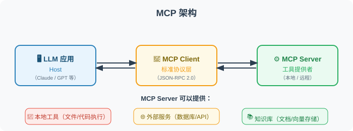

# 19.1 MCP（Model Context Protocol）详解

MCP 把 Agent 主机与工具及数据的实现解耦。主机负责选择服务器、管理权限和把结果交给模型。每个 MCP 客户端与一个服务器通信，服务器公开能力，执行请求并返回结果。

| 能力 | 客户端操作 | 示例 |
|---|---|---|
| 工具（Tools） | `tools/list`、`tools/call` | 计算结果、查询有权限访问的订单 |
| 资源（Resources） | `resources/list`、`resources/read` | 按 URI 读取帮助文档 |
| 提示（Prompts） | `prompts/list`、`prompts/get` | 获取带参数的工单摘要模板 |

工具的输入 Schema 和工具描述可以传给模型。模型提议工具调用，主机负责验证调用范围和参数，再将结果作为工具消息交回模型。应用应根据返回内容类型选择处理方式，并单独检查工具是否报告错误。

## 协议版本与传输

| | 握手版（至 `2025-11-25`） | `2026-07-28` |
|---|---|---|
| 发现与版本 | `initialize` 和 `notifications/initialized` | 客户端可以用 `server/discover` 获取版本和能力 |
| 请求上下文 | 连接初始化时协商 | 每个请求携带版本和客户端能力的 `_meta` |
| Streamable HTTP | 服务端可分配 `Mcp-Session-Id` | 协议层无会话，跨请求状态由应用用显式句柄管理 |
| 长任务 | `2025-11-25` 的实验性 Tasks | 可选 Tasks 扩展，通过 `tasks/get` 查询，必要时通过 `tasks/update` 补充输入 |

本地工具常用 **stdio**，远程服务采用 **Streamable HTTP**。新版的可选变更通知走 `subscriptions/listen`，请求内的进度可随请求响应流发送。旧的 HTTP+SSE 传输和 Roots、Sampling、Logging 在新版中已弃用。远程授权要按部署场景落实 OAuth 和最小权限，工具本身仍要检查资源访问权。

新版工具需要用户补充信息时，可以返回输入请求，由客户端收集答案后继续调用。Tasks 扩展适合确实需要跨请求查询或继续的后台工作。客户端上线前应核验所用 SDK、主机和服务器支持的版本及扩展。参见 [MCP 2026-07-28 变更](https://modelcontextprotocol.io/specification/2026-07-28/changelog)和 [Python SDK 迁移指南](https://py.sdk.modelcontextprotocol.io/migration/)。

下一步运行 [19.5 的工具发现和调用示例](./05_practice_mcp_integration.md)。
