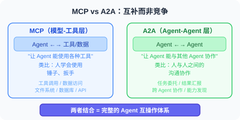
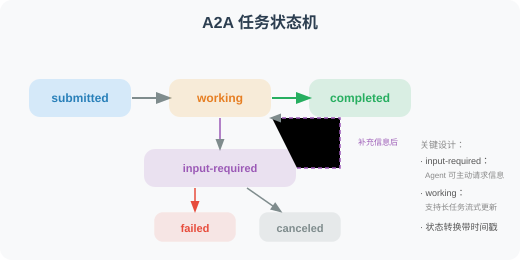

# 19.2 A2A（Agent-to-Agent）协议

A2A 让独立 Agent 发现彼此的能力、发送消息、跟踪委托任务并接收产物。A2A 的交互对象是远程 Agent。MCP 的交互对象是工具、数据源或提示服务。同一个系统可以用 A2A 委托同伴，用 MCP 接入工具。



## 发现接口

A2A v1.0 的标准发现路径是 `/.well-known/agent-card.json`，也可通过注册表或直接配置发现。Agent Card 描述技能、能力、安全方案及 `supportedInterfaces`。客户端按其中的 URL、`protocolBinding` 和 `protocolVersion` 选择接口。标准绑定包括 JSON-RPC、gRPC 和 HTTP+JSON。

下面是一张能力卡。顶层 `version` 是服务自己的版本，接口中的 `protocolVersion` 是 A2A 版本。

```json
{
  "name": "Release Notes Assistant",
  "description": "Summarizes release notes.",
  "version": "1.2.0",
  "supportedInterfaces": [
    {
      "url": "https://research.example.com/a2a",
      "protocolBinding": "HTTP+JSON",
      "protocolVersion": "1.0"
    }
  ],
  "capabilities": {
    "streaming": true
  },
  "defaultInputModes": [
    "text/plain"
  ],
  "defaultOutputModes": [
    "text/plain"
  ],
  "skills": [
    {
      "id": "summarize",
      "name": "Summarize",
      "description": "Summarizes the supplied notes.",
      "tags": [
        "release-notes"
      ]
    }
  ]
}
```

## HTTP+JSON 示例

假设 Agent Card 声明 `https://research.example.com/a2a`、`HTTP+JSON` 和 `1.0`。以下依次展示发现、提交消息、以及收到 `task.id` 后查询状态。域名和 ID 都是教学用占位值。真实连接按 Agent Card 所列的安全方案携带凭据。

```http
GET /.well-known/agent-card.json HTTP/1.1
Host: research.example.com
```

```http
POST /a2a/message:send HTTP/1.1
Host: research.example.com
Content-Type: application/json
A2A-Version: 1.0

{
  "message": {
    "messageId": "note-001",
    "role": "ROLE_USER",
    "parts": [{"text": "Summarize the provided release notes."}]
  },
  "configuration": {"returnImmediately": true}
}
```

```http
GET /a2a/tasks/task-001 HTTP/1.1
Host: research.example.com
A2A-Version: 1.0
```

## 消息、任务和产物

发送消息可能直接返回 `Message`，也可能返回带有 `id`、`contextId` 和状态的 `Task`。只有后者需要查询任务。收到 `TASK_STATE_INPUT_REQUIRED` 时，后续消息带上已有 `taskId`，并在需要时保留 `contextId`。使用 `Artifact` 接收正式产物。



发送时可选择 `POST /message:stream`，从 SSE 接收任务、状态或产物更新。对已存在且仍在运行的任务，可用 `POST /tasks/{id}:subscribe` 订阅更新。取消任务用 `POST /tasks/{id}:cancel`。推送通知需要先确认 Agent Card 声明支持。

跨系统委托时，先校验接口和授权范围，持久化任务标识与终态，并按服务端的幂等约定处理重试。完整字段、状态和各绑定的映射见 [A2A v1.0 规范](https://a2a-protocol.org/v1.0.0/specification/)。
