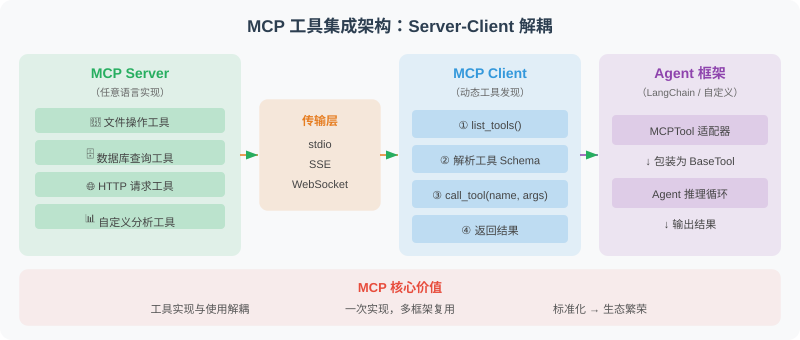

# 19.5 实战：发现并调用 MCP 工具



用官方 Python SDK v2 在进程内连接一个服务器。示例通过 `server/discover` 探测协议版本，列出工具，再调用 `add`。进程内传输便于在 CI 里验证完整调用，无需启动网络服务或配置模型密钥。

```bash
python -m pip install "mcp>=2,<3"
python examples/chapter19/mcp_demo.py
```

```python
{{#include ../../../examples/chapter19/mcp_demo.py}}
```

预期先输出 `2026-07-28: add`，再输出 `20`。SDK 自动处理发现和请求元数据。连接到独立工具进程或远程服务时，可以按 SDK 文档更换客户端的[传输配置](https://py.sdk.modelcontextprotocol.io/client/transports/)。进入客户端上下文后再加载和调用工具。如果工具包装器持有客户端引用，它的使用期必须在客户端上下文内。

在 Agent 中接入工具时，由主机决定模型可见的工具集合，由工具代码验证参数和权限。含写入的工具还需要服务端授权、必要的审批和幂等处理。远程工具的返回值可能含第三方内容，交给模型时按普通数据处理。

仓库里的 `python -m reference_agent.mcp_server` 是 **MCP 2024-11-05 的最小兼容示例**，用来查看原始 stdio 消息。新版和握手版 SDK 用法见[版本说明](https://py.sdk.modelcontextprotocol.io/protocol-versions/)。
