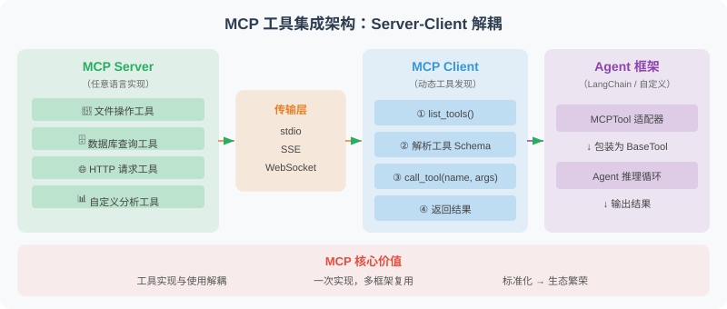

# 17.5 实战：基于 MCP 的工具集成

## 本次迭代与验收

把已有计算工具放到独立进程中，通过标准形状的请求发现和调用工具，并验证错误不会破坏后续请求。

- **成功标准**：在同一 stdio 进程中完成 `initialize`、`tools/list`、`tools/call`，核对请求 ID 与 `12*8` 的结果 `96`。
- **失败用例**：先发送坏 JSON、非法请求 ID、数组或对象形式的工具名及非对象参数，再发送合法计算；前面的错误应有明确响应，后面的计算仍能成功。
- **安全边界**：本例只暴露受限计算器。协议连通不等于业务授权；外部工具描述和工具结果都是资料，不能扩大宿主许可。

保留输入行、响应、退出状态和判定理由。评估方法见[第18章](../chapter_20_evaluation/README.md)，权限设计见[第19章](../chapter_21_security/README.md)。



图示展示 Client、Agent 与工具服务的边界。本节实际运行的是“客户端子进程调用→计算器服务”这一段，不包含现成的模型或框架适配器。

## 一、本节实际提供什么

唯一的服务实现是 `reference-agent/src/reference_agent/mcp_server.py`，测试是 `reference-agent/tests/test_mcp_server.py`。工具执行逻辑在 `reference-agent/src/reference_agent/tools/calculator.py`。阅读这些文件，避免复制一份会逐渐失真的 `handle` 节选。

这是使用 MCP 工具消息形状的 **stdio / JSON-RPC 教学子集**：每行一个 JSON 对象，支持 `initialize`、`tools/list` 和 `tools/call`；列举和调用的工具只有 `calculator`，结果为文本内容。无 `id` 的有效通知不返回响应，输入结束后进程退出。

`initialize` 固定声明 `protocolVersion="2024-11-05"`，不协商版本，也不强制完整初始化状态机。本例没有批量请求、工具分页、HTTP/SSE、远程鉴权、资源/提示功能或取消机制，未验证与官方 SDK 的互操作，不能据此声称完整 MCP 兼容或生产可用。

## 二、请求在哪里被拒绝

服务入口 `main` 负责逐行解析；`handle` 检查请求和 ID；`_tools_call` 在查询注册表前检查工具名与参数容器。具体工具继续检查表达式内容与计算资源。

| 检查位置 | 当前实现的行为 |
|---|---|
| 请求 | 必须为对象，`jsonrpc` 为 `"2.0"`，`method` 为字符串；数组不是本例支持的批量请求 |
| 请求 ID | 当前教学检查接受字符串、整数、有限浮点数与 `null`，拒绝布尔值、数组、对象和非有限数；合法 ID 原样返回，非法 ID 的错误响应使用 `null`。这是本例的检查范围，不代表完整 MCP ID 规则 |
| `params` / `arguments` | 省略时使用空对象；提供时必须为对象。不是对工具 `inputSchema` 的通用校验 |
| 工具名 | 必须为非空字符串，随后才能查询固定注册表；未知工具也被拒绝 |
| 工具执行 | 缺少 `expression`、表达式非法或计算失败，由调用签名或计算器报错，再映射为本例的执行异常响应 |

因此，`name=[]` 和 `name={}` 不会进入字典查询并触发未处理的 `TypeError`。参数错误与计算器自身报错的通道仍有区别，不能把所有失败统一理解为“没找到工具”。

## 三、JSON-RPC 错误与工具错误分开读

本例的响应只有成功的 `result` 或顶层 `error`，两者不同时出现。实际错误码如下；通用代码定义见 [JSON-RPC 2.0 规范](https://www.jsonrpc.org/specification#error_object)。

| 情况 | 本例返回 |
|---|---|
| JSON 文本无法解析 | `error.code=-32700` |
| 请求形状或请求 ID 不合法 | `error.code=-32600` |
| 未知方法 | `error.code=-32601` |
| 非对象参数、非法工具名或未知工具 | `error.code=-32602` |
| 计算器调用抛出异常，例如 `1/0` | `error.code=-32603` |

[MCP 2024-11-05 工具规范](https://modelcontextprotocol.io/specification/2024-11-05/server/tools#error-handling)还区分工具执行错误：它可以放在 `result` 中并设置 `isError=true`，与顶层 JSON-RPC `error` 不同。**当前配套服务没有实现这个字段**，而是把工具调用异常简化为 `-32603`；不要把它当作一般 MCP 服务处理业务错误的推荐映射。

客户端处理完整实现时，应先检查顶层 `error`，再检查工具结果的 `isError`，最后解析成功内容。不能仅凭有 `result` 就宣布任务成功。本节只测试现有子集，不在文字中虚构 `isError` 已实现；扩展错误语义时应一起修改源码和测试。

## 四、在同一进程中复现错误恢复

从仓库根目录保存并运行下面的 Python 片段。它仅依赖标准库，通过 stdin 将七行输入送到**同一个**服务进程：列举工具之后发送三个坏请求，再计算 `12*8`；无 ID 的通知没有响应。

```python
import json
import os
from pathlib import Path
import subprocess
import sys

source = str(Path("reference-agent/src").resolve())
env = dict(os.environ, PYTHONPATH=os.pathsep.join(
    filter(None, [source, os.environ.get("PYTHONPATH")])
))
requests = [
    json.dumps({"jsonrpc": "2.0", "id": "init", "method": "initialize"}),
    json.dumps({"jsonrpc": "2.0", "id": "list", "method": "tools/list"}),
    "{broken json",
    json.dumps({"jsonrpc": "2.0", "id": [], "method": "tools/list"}),
    json.dumps({"jsonrpc": "2.0", "id": "bad-name", "method": "tools/call",
                "params": {"name": [], "arguments": {}}}),
    json.dumps({"jsonrpc": "2.0", "method": "notifications/initialized"}),
    json.dumps({"jsonrpc": "2.0", "id": "after-errors", "method": "tools/call",
                "params": {"name": "calculator", "arguments": {"expression": "12*8"}}}),
]
process = subprocess.run(
    [sys.executable, "-m", "reference_agent.mcp_server"],
    input="\n".join(requests) + "\n", text=True, capture_output=True,
    timeout=5, check=True, env=env,
)
responses = [json.loads(line) for line in process.stdout.splitlines()]
assert len(responses) == 6
assert responses[0]["id"] == "init"
assert responses[0]["result"]["protocolVersion"] == "2024-11-05"
assert responses[1]["id"] == "list"
assert responses[1]["result"]["tools"][0]["name"] == "calculator"
assert [item["error"]["code"] for item in responses[2:5]] == [-32700, -32600, -32602]
assert responses[3]["id"] is None
assert responses[4]["id"] == "bad-name"
assert responses[-1]["id"] == "after-errors"
assert responses[-1]["result"]["content"][0]["text"] == "96"
assert process.stderr == ""
print(json.dumps(responses[-1], ensure_ascii=False))
```

预期打印含 `id="after-errors"` 和文本 `96` 的响应。输入关闭后，`subprocess.run` 等待进程退出；`timeout=5` 是本次客户端实验的等待上限，不是服务端的逐工具超时或生产恢复机制。

若每个请求都启动新进程，就不能证明“坏请求之后同一个服务仍能工作”。本例服务也没有提供持久会话恢复或业务状态保存。

## 五、接入官方 SDK 时保住会话生命周期

下面只是生命周期伪代码，不是 SDK API 示例，也未在本例上验证互操作：

```text
打开 transport
  打开并初始化 session
    发现工具元数据
    由宿主筛选工具、绑定允许的调用
    运行 Agent，并等待其工具调用结束或取消清理完成
  关闭 session
关闭 transport
```

若工具包装器持有 session，所有调用都要发生在 session 仍打开时。不要在 `load_mcp_tools` 的上下文内部返回这些包装器后关闭 session，再在外部运行 Agent；也不要把它们转交给无关的新事件循环。返回已经消费完成的普通结果可以，返回仍需使用已关闭连接的对象不可以。

具体 SDK、传输和框架接口应固定版本并独立测试。接入成功后仍需宿主工具许可、后端鉴权、参数约束和超时，不能让发现到的工具自动获得调用权限。

本节没有数据库工具。扩展数据库连接时，另读[第19章权限与隔离](../chapter_21_security/03_permission_sandbox.md)和[第22章数据连接](../chapter_24_data_agent/02_data_connection.md)，在后端实施权限，而不把字符串关键词过滤当作只读保证。

## 六、回归检查与读者练习

从仓库根目录，在已安装 pytest 的环境执行：

```bash
PYTHONPATH=reference-agent/src python -m pytest reference-agent/tests/test_mcp_server.py -q
```

需要开发依赖时先执行 `python -m pip install -e 'reference-agent[dev]'`。测试覆盖合法 ID 保留、非法 ID 不回显、未知工具、非对象参数、通知不响应，以及同一 stdio 进程坏请求后的正常计算。它们不测试生产鉴权、官方 SDK 兼容或任意生成代码的隔离。

读者练习：把上面的数组工具名换成对象，再把 `arguments` 改成数组，核对 `-32602`；将 ID 改为布尔值，核对 `-32600` 且响应 ID 为 `null`；将计算表达式改为 `1/0`，核对当前实现的 `-32603`。每次最后保留一条合法调用，确认服务仍存活。接着为计划采用的 SDK 设计单独的打开、调用、关闭与关闭后拒绝测试，未执行前标记为待验证。

---

*上一节：[17.4 Agent 间的消息传递与状态共享](./04_message_passing.md)*

*下一章：[第18章 Agent 的评估与优化](../chapter_20_evaluation/README.md)*
