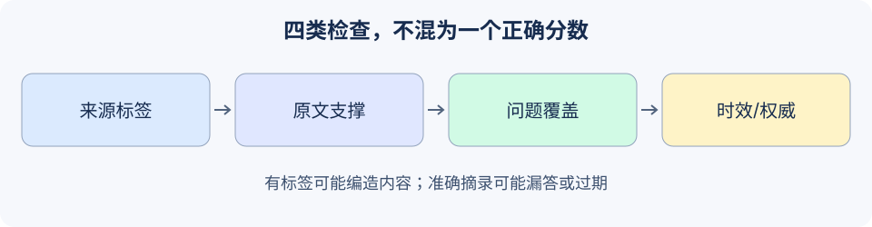

# 19.2 幻觉问题与事实性保障

本节把“有来源”“原文支持”“回答了问题”和“现实中正确”拆开验证。检索、引用与自我检查可以提供线索，不能互相替代。



## 先给失败分类，再选择检查

| 失败 | 可观察的例子 | 适用的检查 |
|---|---|---|
| 编造引用 | 回答用了不存在的来源标签 | 对照本次命中清单与来源位置 |
| 不受资料支撑 | 原文七天，回答九十天 | 独立摘录/蕴含审查 |
| 内容不完整 | 只说要收据，没有回答期限 | 调用前冻结的必答点 |
| 资料失效或错误 | 正确摘录了过期政策 | 版本、适用时间与权威来源复核 |
| 假装完成动作 | 回答说“已发布”，后端没有记录 | 实际收据与状态检查 |

要求模型谨慎、附引用或输出置信度，都是生成约束。一个0.99的自报分数不是经过校准的正确概率。相同模型再次同意自己、多个采样给出同一个答案，也可能共享错误。本章论文页将采样一致性与事实支撑区分讨论，见[19.6](./06_paper_readings.md)。

## 一个标签正确、内容错误的反例

直接复用[6.5](../chapter_rag/05_practice_qa_agent.md)的`reference_code/evidence_assistant/`，不维护第二套假FactChecker。示例是英文教学文本，便于观察字面匹配，不评估语言理解质量。仓库根目录分别运行各片段：

```python
from reference_code.evidence_assistant.rag import Document, DocumentQAAgent, answer_accepted
from reference_code.evidence_assistant.research import check_excerpts, verify_excerpts

source = Document('policy-v1', 'Refund requests are accepted within seven days.')
wrong = '[policy-v1] Refund requests are accepted within ninety days.'
producer = lambda messages: wrong
labels_only = DocumentQAAgent([source], producer).ask('refund deadline')
assert answer_accepted(labels_only) is True
assert labels_only['verification']['semantic_support'] == 'not_checked'
assert check_excerpts('refund deadline', wrong, [source])['code'] == 'unsupported_excerpt'
checked = DocumentQAAgent([source], producer, verifier=verify_excerpts).ask('refund deadline')
assert checked['status'] == 'verification_failed'
assert checked['sources'] == []
print(checked['status'])
```

默认类只检查标签，`answered`也只表示配置的类内检查通过；它不自动完成任务。`check_excerpts`要求回答按`[source] 原文摘录`逐行回查，适用于本练习的摘录输出。自由摘要或改写可能正确却无法通过此检查，不能把它宣传为通用语义事实验证器。

## 摘录准确，仍然可能漏答

先写问题的两个独立要点，再运行生成器：

```python
from reference_code.evidence_assistant.rag import Document, DocumentQAAgent
from reference_code.evidence_assistant.research import verify_excerpts
from reference_code.evidence_assistant.task_acceptance import check_question_coverage

question = 'What is the refund deadline and required proof?'
specs = [{'question': question, 'requirements': [
    {'id':'deadline', 'description':'seven-day deadline', 'all_of':['seven days']},
    {'id':'proof', 'description':'receipt required', 'all_of':['receipt']},
]}]
qa = DocumentQAAgent([Document('policy-v1', 'Refund requests require a receipt.')],
                     verifier=verify_excerpts)
result = qa.ask(question)
coverage = check_question_coverage(question, result['answer'], specs=specs)
assert result['status'] == 'answered'
assert coverage['status'] == 'failed'
assert coverage['missing_points'] == ['seven-day deadline']
unknown = check_question_coverage('Another question?', result['answer'], specs=specs)
assert unknown['status'] == 'unknown'
print(coverage['missing_points'], unknown['status'])
```

字面要点验收适用于这组冻结题目。它既不验证引用，也不理解任意同义改写；换题无匹配规格时应保留`unknown`。生成器不能按照自己的输出重写预期。完整接受条件是：生成状态满足要求、原文支撑通过、问题覆盖通过，且相关授权与来源时效另有依据。

## 接入独立核查器时保留哪些证据

语义核查器应接收原始问题、候选回答、本次可访问来源快照和独立规格，返回带理由/来源位置的结构化判定。候选是待验证资料，不能成为核查器的新系统规则。逐项声明抽取可能漏掉关键声明，因此同时检查问题覆盖与未被抽取的内容。

规定`passed/failed/unknown/error`，校验完整返回对象、来源位置与字段类型。解析失败、超时、缺证据不得转换为`passed`；只允许严格布尔`True`的回调通过，详见6.5的拒绝/异常测试。额外核查调用也要计入调用与时间预算。

若接真实模型判卷，应以独立人工样本检查误判，记录模型/提示版本，并把冲突与未知送审。核查器与生成器共享训练偏差时，双重同意仍可能错误。通过本地测试只证明相应合同，不证明所有自然语言回答正确。

练习：把资料由七天更新为十天，保留旧回答和旧规格。分别记录旧引用失效、新回答支撑通过但旧规格失败，以及审查后更新规格的依据。版本标签须由宿主维护，现有两字段`Document`没有自动版本控制。

*下一节：[19.3 权限控制与沙箱隔离](./03_permission_sandbox.md)*
