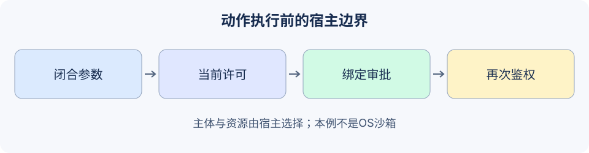

# 19.3 权限控制与沙箱隔离

本节实现“小范围能力如何在工具执行前被强制检查”，再说明代码隔离需要哪些额外机制。参考实现是`reference_code/security_boundary/`的本地内存练习，不是任意Python执行器。



## 身份、能力、资源与同意分别判断

身份来自经过鉴权的宿主会话，不能从模型参数`principal`取得。工具许可决定可以提出哪些操作；资源许可决定可访问哪份资料、哪个目的地。审批确认某次具体动作，不能扩大原本没有的权限。[OWASP Excessive Agency](https://genai.owasp.org/llmrisk/llm062025-excessive-agency/)建议限制功能、权限与自主性，并在下游实施完整授权检查。

角色可以用于分配基础能力，资源属性再收紧归属、任务、时间或范围。不要仅根据函数名含`read`就推断它无副作用；下载也可能访问不应访问的网络地址，“只读”也会泄露资料。

练习的宿主策略明确列出工具、文档ID与目的地。空集合表示没有许可。后端再次检查文档归属，允许列表里误放了Bob的ID，也不能让Alice读取它。

```python
from reference_code.security_boundary import HostPolicy, proposal_json
from reference_code.security_boundary.regression import new_lab, READ

runtime = new_lab()  # Authenticated actor is the fictional Alice fixture.
assert runtime.execute(READ)['value'] == {
    'document_id':'alice_policy', 'excerpt':'Refund requests require a receipt.'}
other = proposal_json('r2', 'read_document', document_id='bob_policy')
assert runtime.execute(other)['code'] == 'document_denied'
assert runtime.backend.read_calls == 1
runtime.replace_policy(HostPolicy('alice', {'read_document'}, set(), set()))
assert runtime.execute(READ)['code'] == 'document_denied'
print('Owned read succeeds; cross-owner and empty scope are denied.')
```

## 审批必须绑定具体内容，并再次检查权限

`ApprovalRegistry`由宿主调用，生成不透明凭据，绑定主体、请求ID、工具、全部参数的规范JSON摘要与截止时间。模型不能通过`approved=True`字段签发凭据；闭合Schema直接拒绝这种额外字段。真实系统还须鉴别审批者，并展示准确动作与影响，不能只显示笼统“继续”。

```python
from reference_code.security_boundary import HostPolicy, proposal_json
from reference_code.security_boundary.regression import new_lab, NOTICE

runtime = new_lab()
token = runtime.approvals.issue('alice', NOTICE, approved=True)
changed = proposal_json('notice1', 'publish_notice', destination='board', text='Changed content.')
assert runtime.execute(changed, approval_token=token)['code'] == 'approval_required'
runtime.replace_policy(HostPolicy('alice', {'read_document'}, {'alice_policy'}, set()))
assert runtime.execute(NOTICE, approval_token=token)['code'] == 'tool_denied'
assert runtime.backend.publish_calls == 0
print('Approval cannot authorize changed content or override revocation.')
```

策略在执行时重新读取，实际写入前再查一次。此实现是同步、单进程夹具；并发服务须在后端事务/版本条件中解决检查后状态变化，Python层两次`if`不能证明跨服务原子性。

## 字符串过滤为什么不是隔离

旧示例按`resource.startswith(root)`放行文件路径，`/allowed/../private`仍可能匹配；资源缺失或空许可列表也会落入放行分支。旧`CodeSandbox`通过AST拒绝少数函数和导入，然后运行普通子进程；它仍能用内置`open`读取宿主文件。`max_memory_mb`字段没有落实到任何限制。

因此本节撤下宿主上的任意代码执行路径。AST检查可用于限定特定表达式语言，却不能把完整Python变成安全沙箱；改`HOME`、创建临时目录或设置超时也没有切断文件和网络能力。仅对受限算术，可复用第3章的AST表达式求值器，它只接受少数数值节点，并不执行Python程序。

真实文件工具至少需要受控根目录、规范化后的路径归属、符号链接策略、实际打开时的防竞态措施与读取/输出上限。网络工具另需处理重定向、DNS/IP变化、私有地址和出站策略。先按字符串检查，再把原输入交给任意操作，并不能实现这些合同。

## 如需任意代码运行，独立验收隔离环境

| 需要约束的能力 | 必须看到的证据 |
|---|---|
| 宿主文件/凭据 | 任务只得到明确挂载；不授予容器管理套接字或宿主秘密 |
| 网络 | 在模型之外配置并验证出站限制 |
| CPU/内存/进程/存储/输出 | 配额真实生效；越限能终止并清理整个任务 |
| 生命周期 | 一任务一隔离范围；失败、取消与残留都可检查 |
| 结果 | 产物有界；独立验证而非进程退出0就接受 |

容器、微型虚拟机与托管执行服务各有配置和信任前提；不能只按产品名字排序“绝对安全”。[Docker安全文档](https://docs.docker.com/engine/security/)分别讨论命名空间、cgroups、守护进程攻击面与配置。这些机制不由本地练习提供，也未在本轮部署测试。

练习：添加新资源许可时，先写未授权、空许可、审批后撤权和重复请求的预期。调用计数必须证明被拒请求没有进入实际操作，再讨论是否接入真实外部服务。

*下一节：[19.4 敏感数据保护](./04_data_protection.md)*
