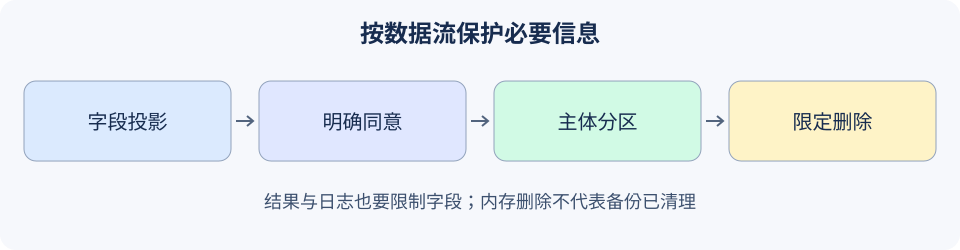

# 19.4 敏感数据保护

本节沿“获取→传入模型→调用工具→记忆→日志→删除”的链条检查资料。目标是让必要的数据进入必要的位置，而不是先把全部信息传出去，再靠正则掩码补救。



## 先减少数据，再讨论检测

按任务定义允许字段，并校验字段的实际类型与大小。未知任务拒绝，不能退回到“除了几个黑名单字段以外全部发送”。密钥也不应进入模型可读文档或系统提示；放进system角色不会使其成为秘密存储。

```python
from reference_code.security_boundary import Rejected, project_record

record = {'order_id':'ORD-DEMO', 'status':'shipped',
          'api_key':'SYNTHETIC_KEY', 'customer_name':'Alice'}
minimal = project_record('order_status', record)
assert minimal == {'order_id':'ORD-DEMO', 'status':'shipped'}
try:
    project_record('unknown_task', record)
except Rejected as exc:
    assert str(exc) == 'unknown_projection'
else:
    raise AssertionError('Unknown tasks must not receive all fields.')
print(minimal)
```

这里的字段名与内容均为夹具。允许字段中的自由文本仍可能包含隐私，所以投影不等于通用脱敏。真实接入要根据字段用途、来源和接收方继续检查，避免把整个嵌套对象放进一个“summary”字段绕过最小化。

正则可以找到部分电话、邮箱或凭据形态，却会漏掉新格式、上下文秘密、编码与分段内容，也会误识别普通数字。检测结果应保留类型、位置与理由；面向日志的结果不应再带原始命中值。多种规则重叠时，应先合并替换区间，避免按旧偏移反复修改造成残留。

## 写入同意和读取归属都由宿主提供

`ScopedNotes`只是有界的内存便签：写入必须得到严格布尔`True`，读取和删除按宿主传入的主体分区。它不接受模型指定另一个用户的身份。

```python
from reference_code.security_boundary import Rejected, ScopedNotes

notes = ScopedNotes()
try:
    notes.put('alice', 'n1', 'Fictional preference.', consent='yes')
except Rejected as exc:
    assert str(exc) == 'consent_required'
else:
    raise AssertionError('Truthy text is not consent.')
notes.put('alice', 'n1', 'Fictional preference.', consent=True)
assert notes.get('bob', 'n1') is None
assert notes.delete('alice', 'n1') is True
assert notes.get('alice', 'n1') is None
print('Explicit consent, owner scope and local deletion checked.')
```

宿主必须从真实会话得到主体与同意；上面直接传字符串仅用于可复现夹具。共享同一主体的多个会话是否允许访问，是另一项业务策略，不能用随机`session_id`替代身份。持久记忆及索引隔离另见[4.3](../chapter_memory/03_long_term_memory.md)。

## 输出和日志也要列出允许字段

`LocalBackend.read`返回文档ID与摘录，内部私有字段不进入结果。`Runtime.audit`只记录运行ID、尝试序号、工具、状态与固定原因码，不保存正文、参数、审批凭据或原始异常。测试既查正常结果，也查合成秘密标记是否流入结果/审计。

合成标记缺席只证明这个固定字段未流出，不证明任意隐私已识别。审计ID、次数、时间和资源名称也可能敏感；真实服务还需要日志访问权限、保留期限、检索授权及故障转储策略。调试时临时加的`print(arguments)`同样属于数据流。

## 加密与删除各自的合同

本练习不落盘、不实现加密。需要持久存储时，应使用经过维护的认证加密库，并将密钥、数据库和访问控制分别管理。[Fernet文档（50.0.2）](https://cryptography.io/en/50.0.2/fernet/)说明其密钥持有者可读取并创建有效消息，令牌的创建时间可见；加密不替代主体授权。

应另验密钥获取/轮换、错误密钥与篡改拒绝、主体和记录标识绑定、缓存/备份/副本及恢复权限。不要把Base64或自制异或算法命名为加密。存储删除后还要定义索引、缓存、日志和备份的处理周期；`ScopedNotes.delete`只删除当前对象的一条内存记录，不声称安全擦除或完整生命周期删除。

练习：给正常订单加上一个未知字段和一个嵌套对象，证明投影没有扩大；再用Alice/Bob同名便签验证读取与删除互不干扰。提交实际输出字段、审计字段和每类副本的保留计划，避免用“已脱敏”一个标签概括所有风险。

*下一节：[19.5 Agent行为的可控性与对齐](./05_alignment.md)*
