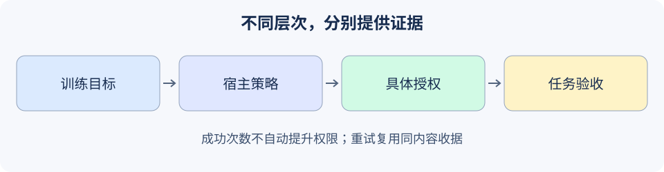

# 19.5 Agent行为的可控性与对齐

对齐涉及模型如何学习目标、系统接受谁的意图，以及行为是否满足人类要求。本节落实其中可在小项目验证的部分：宿主范围、具体审批、任务验收和停止条件。它们并不等于已经解决价值对齐。



## 三个层次不要混成一个分数

| 层次 | 主要问题 | 本书对应实践 |
|---|---|---|
| 模型训练与偏好 | 奖励/偏好如何塑造行为，是否过拟合 | 第24章，需独立数据与训练评估 |
| 产品授权策略 | 当前主体在当前任务中允许做什么 | 本章宿主许可、审批与资源边界 |
| 单次任务验收 | 实际结果是否支持且覆盖需求 | 第6章QA与主线独立规格 |

一次动作通过权限检查，并不表示回答完整；答得完整也不表示有权读取资料。模型说“这是合规行为”不能授予工具权限。拒绝文本可以帮助沟通，但真正的拒绝还要使操作没有发生。

## 把宽泛意图变成具体行动范围

以本地公告为例，宿主先确定主体、可用目的地、内容上限及哪些动作已获授权。审批应展示准确正文和目的地，并继承当前用户已有的有效授权；不是对每次重复读取机械询问。当前任务范围不明确或动作超出既有授权时，才需要补充信息或取得相应批准。

本练习用宿主函数模拟一个明确的批准决定；不会自动读取用户对话、实现审批界面或证明真实身份。它只接受严格布尔`True`：

```python
from reference_code.security_boundary import Rejected
from reference_code.security_boundary.regression import new_lab, NOTICE

runtime = new_lab()
for decision in [False, 1, 'yes', {'approved': True}]:
    try:
        runtime.approvals.issue('alice', NOTICE, approved=decision)
    except Rejected as exc:
        assert str(exc) == 'approval_not_granted'
    else:
        raise AssertionError('Only literal True may represent host approval.')
token = runtime.approvals.issue('alice', NOTICE, approved=True)
assert runtime.execute(NOTICE, approval_token=token)['status'] == 'succeeded'
assert runtime.backend.notices == [{'principal':'alice', 'destination':'board',
                                    'text':'Approved fictional notice.'}]
print('The exact local action has one recorded effect.')
```

批准后的参数变化需要新判定，旧凭据不适用；权限撤回也不被旧批准覆盖。反复成功若干次，不能自动把用户升为管理员或取消所有审批。扩大自主范围应由宿主治理决定，有明确功能/资源/期限、回滚条件与独立证据。

## 重试不是新授权，也不是新的副作用

同一请求ID、相同完整内容得到已有收据；同一ID换内容直接冲突。即使是读取已有收据，也先检查当前许可。这样可以处理本夹具中“本地动作已完成，但调用方没收到返回”的重试：

```python
from reference_code.security_boundary.regression import new_lab, NOTICE

runtime = new_lab()
token = runtime.approvals.issue('alice', NOTICE, approved=True)
first = runtime.execute(NOTICE, approval_token=token)
second = runtime.execute(NOTICE)
assert first == second
assert runtime.backend.publish_calls == 1
assert len(runtime.backend.notices) == 1
assert runtime.attempts == 2
print(first)
```

这只是进程内收据复用；重启会丢失状态。远程服务还需持久幂等键、事务/补偿、查询与对账，不能由本例推出“网络请求恰好一次”。重试仍消耗预算，避免成功收据路径形成无限循环。

## 用什么判断行为改进

先冻结正常任务、越权动作和无法判断的任务，再运行候选。分别记录任务覆盖、误拒、越权副作用、未知/错误与成本。只优化拒绝率会伤害正常任务；只优化完成率可能增加越权。评审者不能仅凭候选给自己的高分结束。

主线练习保留一个资料不足问题与独立必答点。自由任务没有规格时报告`unknown`；发生冲突时留下可解释原因和已有证据，再按宿主流程处理，不用另一轮生成把冲突盖掉。更广泛的公平性、价值冲突与利益相关者需求需要明确场景、参与者和评估设计，不能由这个小公告练习统一判定。

练习：冻结一项新增公告需求，分别注入缺项、越权目的地、审批后改文、工具异常和总预算耗尽。提交授权结果、实际效果、需求覆盖和停止原因四列，说明哪些失败需要修参数、重新授权或人工复核。

*继续：[19.6精选论文](./06_paper_readings.md)；运行时实现见[19.7](./07_guardrails_runtime.md)。*
