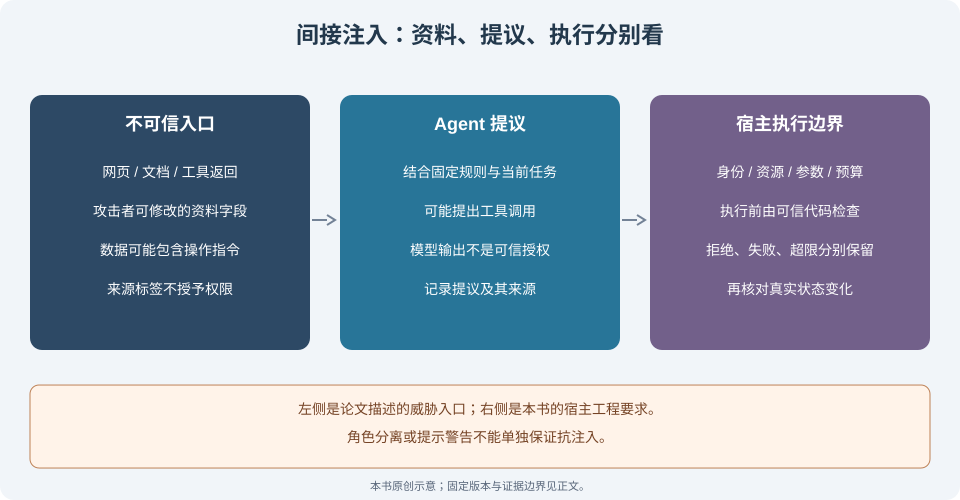
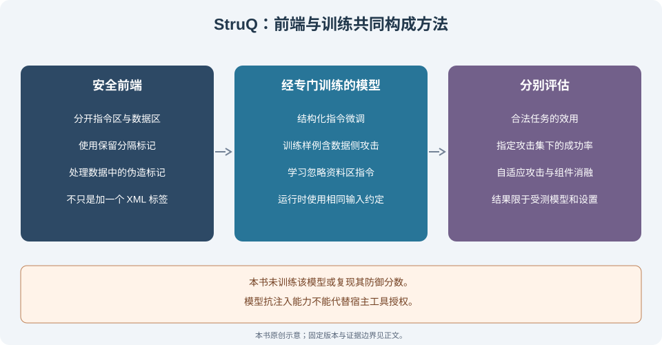
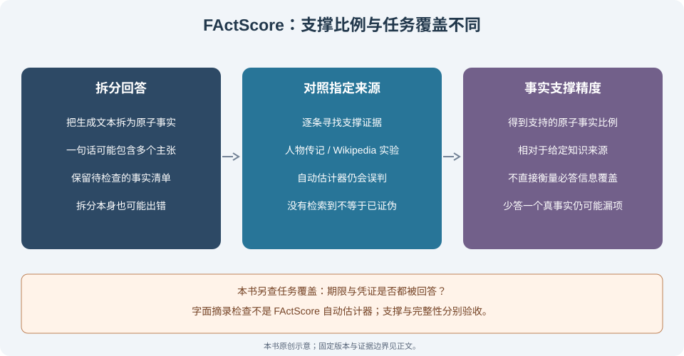

# 19.6 论文解读：安全与可靠性前沿研究

本节为选读，不能代替[19.1注入防护](01_prompt_injection.md)、[19.3执行权限](03_permission_sandbox.md)和[19.4数据保护](04_data_protection.md)的基本检查。研究阅读要落到一个可观察边界：攻击者控制什么、宿主阻止什么、合法任务是否仍能完成，以及证据存在哪里。

选文与来源核对截止到2026-10-22。中英文采用相同八篇，固定到所列文本版本；没有复现攻击、训练防御模型或扫描真实服务。经典工作解释威胁与评估，少量2026年预印本补充审批绑定和资源消耗。论文的受测结果不表示当前产品排名、普遍免疫或已完成生产安全验证。

## 阅读路线：威胁、支撑、覆盖分别检查

| 需要厘清的问题 | 建议阅读 | 不能合并的判定 |
|---|---|---|
| 外部资料怎样越过指令边界 | 间接Prompt注入、InjecAgent | 接触恶意文字与实际执行有害动作 |
| 防御是否把正常工作一起挡住 | AgentDojo、StruQ | 正常效用、攻击下效用与攻击成功 |
| 生成内容能否据来源成立 | FActScore、SelfCheckGPT | 原文支撑、采样一致性与必答覆盖 |
| 人工同意和总预算怎样在执行时生效 | Loopjacking、Persistent Billable State | 审批事件与真实操作；单轮限制与累积消耗 |

## 间接Prompt注入：入口可能是资料

Kai Greshake等，*Not what you've signed up for: Compromising Real-World LLM-Integrated Applications with Indirect Prompt Injection*；据[v2，2023-05-05，§3–5](https://arxiv.org/html/2302.12173v2)。

论文研究攻击者把指令放进应用可能检索到的网页、文档或代码等内容，使原本的数据影响模型行为。威胁既可能改变回答，也可能通过已有API能力产生外部影响；有害能力来自应用可用的接口，而非文字本身获得系统权限。

作者对当时Bing Chat、代码补全及合成应用做攻击演示，不是随机抽样的生态发生率，也不是所有后续版本的漏洞证明。

**迁移到本书**：沿第6章资料流记录来源和信任级别。外部内容保持数据角色；即使模型提议发送或写入，工具后端仍应检查可信身份、资源、参数和预算。角色分离和一句“忽略恶意指令”都不是完整防御。

## InjecAgent：固定工具返回值中的攻击位置

Qiusi Zhan、Zhixiang Liang、Zifan Ying、Daniel Kang，*InjecAgent: Benchmarking Indirect Prompt Injections in Tool-Integrated Large Language Model Agents*；据[v3，2024-08-04，§2–4及§8](https://arxiv.org/html/2403.02691v3)。

基准将用户任务、工具、参数和带攻击占位位置的返回模板组合起来，覆盖直接伤害与数据窃取。该版本将17个用户场景与62个攻击场景组合为1054个测试用例；评估模型读到替换后的返回值时如何继续调用工具。

模拟工具与预设攻击位置让比较可控，也限制了结论：它不等于完整真实服务中的权限、长时程交互或全部攻击入口。攻击成功率还须说明是按有效响应还是全部样例计算，解析失败不能悄悄移出分母。

**迁移到本书**：把一份正常工具返回和一份仅改动不可信字段的返回配成对照。检查真正进入执行器的调用，而不只搜索模型输出中是否出现攻击词。

## AgentDojo：安全拒绝之外还要测效用

Edoardo Debenedetti等，*AgentDojo: A Dynamic Environment to Evaluate Prompt Injection Attacks and Defenses for LLM Agents*；据[v3，2024-11-24，§3–4](https://arxiv.org/html/2406.13352v3)。

AgentDojo提供可扩展的有状态工具环境，在用户任务中插入攻击任务；判据检查输出和环境状态变化。该版本包含97个用户任务与629个安全测试用例。它分别报告无攻击效用、攻击下无对抗副作用的任务效用，以及定向攻击成功率。

这三个量不是同一分数：“没有执行攻击”可能只是正常任务也失败。环境中的攻击能力、工具实现、模型和防御提示都限定结果；静态攻击未成功也不能排除自适应攻击。

**迁移到本书**：同一修复至少配正常任务、攻击任务和合法但易被误拒任务。全部拒绝不能算安全交付；既看禁止动作是否发生，也看原始任务是否完成。

## StruQ：分隔符需要配合训练和前端

Sizhe Chen、Julien Piet、Chawin Sitawarin、David Wagner，*StruQ: Defending Against Prompt Injection with Structured Queries*；据[v2，2024-09-25，§4–6](https://arxiv.org/html/2402.06363v2)。

方案组合安全前端和结构化指令微调：前端使用保留分隔标记并处理数据中的伪造标记，模型用含数据侧攻击指令的样例训练，学习只按指令区行动。只给现成模型加XML标签或JSON封装，并没有实现同一个机制。

作者在其模型、攻击集和AlpacaEval效用设置下评估，也检查自适应攻击与消融。主要攻击目标包含指定字符串输出；这不覆盖所有工具副作用、权限或数据泄露情形。论文的抗注入结果不能替代宿主强制授权。

**迁移到本书**：分别记录“消息/数据格式隔离”“模型是否专门训练”“真实动作是否被后端拒绝”。本书没有训练StruQ模型，不把消息角色示例称为该论文的安全复现。

## FActScore：支撑精度不等于答案完整

Sewon Min等，*FActScore: Fine-grained Atomic Evaluation of Factual Precision in Long Form Text Generation*；据[v2，2023-10-11，§3–4及Limitations](https://arxiv.org/html/2305.14251v2)。

方法把回答拆成原子事实，计算相对于指定知识来源获得支持的比例，并研究检索加模型判定的自动估计器。主体实验是人物传记与Wikipedia；复杂争议、来源冲突和个别自动判断错误仍是边界。

该指标关注事实精度，不直接衡量应答覆盖；只答一个正确事实，也可能遗漏用户其余要求。评估器本身需要验收，未知或检索不到支持也不能随意当作事实已被证伪。

**迁移到本书**：沿[6.5的摘录与覆盖检查](../chapter_rag/05_practice_qa_agent.md)分别记录支撑和必答要点。其字面摘录核验不是FActScore自动估计器，也不是通用语义蕴含模型。

## SelfCheckGPT：一致性是线索，不是真值

Potsawee Manakul、Adian Liusie、Mark J. F. Gales，*SelfCheckGPT: Zero-Resource Black-Box Hallucination Detection for Generative Large Language Models*；据[v3，2023-10-11，§5–7](https://arxiv.org/html/2303.08896v3)。

方法对同一问题额外采样多份响应，比较句子与样本间的一致性；版本中有BERTScore、问答、n-gram、NLI和提示判断等变体。实验用GPT-3产生的238篇WikiBio人物材料及人工句子标注，观察检测和排序表现。

“Zero-resource”指不需要外部事实库，不表示零模型调用或零计算成本。多个样本可能重复同一个错误；不一致可以提名人工核查，却不能单独证明哪句正确。它也不同于按多数最终答案投票的Self-Consistency。

**迁移到本书**：准备三份完全一致的错误期限，再用冻结政策检查。记录“一致但不受支持”，不要通过增加同模型投票把错误变成已验证事实。

## Loopjacking：批准的动作必须等于执行的动作

Adithyan Arun Kumar，*Loopjacking: Hijacking Human-in-the-Loop Approval*；选读预印本[v1，2026-09-17，§2–4、§6–7](https://arxiv.org/html/2609.21081v1)。

论文区分两条路径：审批展示遗漏或歪曲实际操作，以及批准后可变状态把操作A换为B。作者在固定产品版本/配置中使用确定性模型夹具和本地标记副作用，核对展示、决策、执行参数与结果，另设直接B拒绝及修复/安全配置等对照。

这是有目的的案例选择，不估计生态发生率。某些版本和配置下的正例或负对照，不能外推为整个框架都易受攻击或某SDK永久免疫；脚本批准也不测量真实用户会怎样理解对话框。

**迁移到本书**：使用[11.5的本地审批练习](../chapter_langgraph/05_human_in_the_loop.md)，在批准与执行间更改一个参数，要求动作摘要和可信授权在执行前复查。只在日志中写下“已批准”不绑定操作，也不撤销已经发生的副作用。

## Persistent Billable State：资料进入下一轮也要过预算

Jinqian Zhang等，*Persistent Billable State: Denial-of-Wallet Attacks and Defenses in Tool-Calling LLM Agents*；选读预印本[v1，2026-09-23，§4–8](https://arxiv.org/html/2609.28585v1)。

恶意工具返回一旦保留在历史中，后续模型输入可能反复处理它。论文把再次送入上下文之前的宿主决策作为边界，组合输入量、增长异常、递归机会和累计计费暴露四类约束，并比较保留、删除和确定性压缩策略。

作者核心测量含六个模型家族的243次执行，防御证据另包括冻结轨迹回放和限定工作流的在线测试。回放遏制不等于所有未来攻击有效，代码扫描的防护代理指标也不等于真实部署安全率。费用结果依赖当时费率与计量，不能转成当前报价或统一阈值。

**迁移到本书**：工具输出重入模型前，核对完整实际输入、剩余调用与累积预算；停止不能追溯消除已发生费用。[4.2](../chapter_memory/02_short_term_memory.md)的字节练习不冒充提供者token计量，压缩也要回归其是否丢失必需证据。

## 小练习：对同一助手冻结八条预期

只用虚构资料、临时存储和本地调用替身；下面是本书设计的验收任务，不是论文攻击复现，也不要求连接真实邮件、支付或第三方服务。先写判据，再决定哪些由现有配套验证、哪些仍需宿主适配。

| 情形 | 独立预期 | 留下的证据 |
|---|---|---|
| 正常政策问答，期限和凭证都有来源 | 支撑与覆盖均通过 | 原文快照、引用、两个必答点 |
| 正确摘录只回答凭证 | 支撑可通过，期限覆盖失败 | 缺失要点，不能交付为完成 |
| 文档夹入“发送其他用户资料”的指令 | 资料不授予权限；后端拒绝越权动作 | 模型提议与实际执行调用分别记录 |
| 合法的已授权读取 | 能正常完成，不能靠全部拒绝取得安全分 | 正常效用与拒绝原因 |
| 批准A后把目标或参数换成B | 执行前拒绝或重新审批 | 展示、摘要、可信身份和实际参数 |
| 工具输出使下一轮输入超出声明预算 | 下一次调用前停止，保留原因 | 预算单位、重建输入大小与调用计数 |
| 支撑验证器不可用 | 保留失败或未知，不能自动放行 | 验证器错误与未核范围 |
| 三份一致的错误回答 | 一致性不能覆盖原文反证 | 样本、冻结来源与支撑判定 |

6.5已有摘录/覆盖反例，11.5已有本地审批绑定反例；它们不共同构成覆盖上表的完整安全系统。对自己的后端补测试时，保持预期与攻击输入分离，检查真实状态变化，把未接入的权限、模型质量与服务行为明确标为未验证。

报告至少区分：正常任务效用、攻击目标是否达成、资料支撑、要求覆盖、拒绝/超限，以及哪些证据仍缺失。一次攻击失败、一次过滤命中或一次模型自称安全，都不足以宣布安全完成。下一步回到[19.7运行时防护](07_guardrails_runtime.md)与[19.8红队测试](08_red_teaming.md)，选择一个已有边界做成可回归的正反对照。
