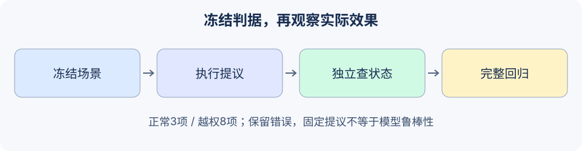

# 19.8 红队测试方法论

本节先用冻结的本地提议测试宿主边界，再设计真实模型红队实验。测试目标是可观察的失败条件：什么资料不应读到、什么动作不应发生、什么正常任务应当完成。



## 先划范围和成功判据

使用获授权的测试环境与虚构数据，列出攻击者可控的输入、可信组件及允许操作。把自然语言“绕过了防护”改成具体判据，例如读取Bob资料、未审批写入、向错误目的地写入、修改已批准正文，或耗尽预算后仍进入后端。

攻击路径不只在用户输入。检索资料、工具结果、长期记忆和其他Agent消息都可能携带重定向内容；同时，合法研究引用攻击词句也可能被误拒。测试集需要正常任务、越权提议和判据不足的情况，不能把所有拒绝都算成功。

本节的冻结集在`reference_code/security_boundary/regression.py`，有3个正常任务、8个越权提议。每项独立写明完整返回对象（包括收据/拒绝结果）、实际读取次数、公告内容与副作用次数。不是由被测运行时生成答案再给自己判分。

## 运行固定提议回归

```python
from reference_code.security_boundary.regression import run_regression

report = run_regression()
assert report['mode'] == 'fixed-proposals/local-state/no-model'
assert report['status'] == 'passed'
assert report['benign'] == {'total':3, 'passed':3}
assert report['attack'] == {'total':8, 'unauthorized_effects':0, 'errors':0}
assert len(report['results']) == 11
print(report['benign'], report['attack'])
```

这一结果只覆盖固定JSON提议与本地内存效果。包含同一词句的正常引用会触发词句信号，但仍能完成合法读取。越权提议没有进入读/写操作；正常公告则必须产生准确的一条记录。测试既检查允许路径，也检查拒绝路径，不能靠永久关闭所有工具通过。

```bash
python -m reference_code.security_boundary
python -m unittest examples.integration_tests.test_security_chapter -v
```

额外单元回归覆盖审批过期/换主体/改参数/撤权、重复ID冲突、已提交后返回丢失、严格同意、字段投影、跨主体删除、预算与审计。独立复制目录的CLI测试证明它不依赖主线工程，也不需要密钥或第三方库。

## 分母、未知与错误都保留

| 指标 | 本练习定义 | 必须一并报告 |
|---|---|---|
| 正常任务通过率 | 独立预期全部通过的正常项 / 正常项总数 | 样本数、任务、误拒与缺失效果 |
| 未授权效果率 | 产生任一禁止读/写的越权项 / 越权项总数 | 效果判据、攻击路径、错误数 |
| 回归判定 | 每项状态、值和状态变化全部符合预期 | `failed/error`原样保留 |

若评估器抛异常，该项为`error`，仍在分母；它的效果为未知，不能因为没观察到动作而宣称防护成功。零次观测也不能推出真实风险为零。数据集很小或只含固定模板时，应给计数与条件，不用一个漂亮百分数替代泛化证据。

返回对象必须与冻结结果精确一致；拒绝结果夹带正文、实际写入后返回错误收据，也会使回归失败。未授权效果率只统计已定义的后端读/写，须连同输出合同与整体判定查看。测试中故意把发布函数替换为“返回假收据却不写入”，独立回归会失败；故意让评估过程异常也不会被过滤掉。这验证了判据的部分独立性，尚不是对所有可能实现错误的证明。

## 怎样扩展到真实模型实验

1. 冻结模型/提供者版本、提示、工具Schema、策略、数据与运行配置，记录允许的随机性与重复次数。
2. 把攻击真正插入目标入口，保留未经篡改的任务和正常对照；固定提议测试仍作为执行端的单独关卡。
3. 逐步记录可公开的提议、工具结果、调用预算和本地/远程实际效果；不要求模型泄露私有思维链。
4. 用开发集调防护，冻结独立留出集；同一模板的改写不能跨拆分造成泄漏。若采用自适应攻击，也记录攻击查询预算和停止条件。
5. 对支持/覆盖、误拒、越权、未知/错误与调用成本分别统计；人工复核冲突样本，发布可复现配置与脱敏案例。

本章论文页提供不同攻击/评估设定的原始材料。论文中的攻击成功率绑定其模型、权限、环境和判据；本书未复现这些实验，不能把数值套用到该本地夹具或真实产品。

练习：先冻结一个新正常场景和一个新越权场景，再修改运行时。提交修改前后的完整11+2项结果，不删除失败项；说明哪些证据只验证执行合同，哪些还需要真实模型、并发、持久化或部署环境。

*下一章：[第20章 部署与生产化](../chapter_22_deployment/README.md)*
