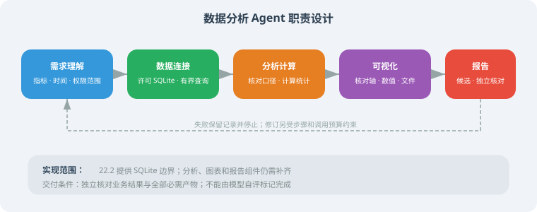
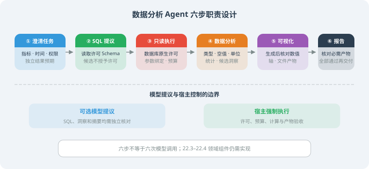

# 22.1 需求分析与架构设计

> **本节目标**：设计一个智能数据分析 Agent 的整体方案。

---

## 项目背景

数据分析是很多企业的刚需，但传统数据分析需要掌握 SQL、Python、统计学等技能。我们要构建一个 Agent，让用户用自然语言就能完成数据分析。

**用户说**："帮我分析上个月的销售数据，按区域对比增长率"

**Agent 做**：连接数据库 → 写 SQL 查询 → 分析数据 → 生成可视化图表 → 输出报告



---

## 核心功能

| 功能 | 描述 |
|------|------|
| 自然语言查询 | 用中文描述分析需求，自动转换为 SQL |
| 数据探索 | 自动了解表结构、数据分布 |
| 统计分析 | 描述性统计、趋势分析、对比分析 |
| 可视化 | 自动生成图表 |
| 报告生成 | 整合分析结果为结构化报告 |

---

## 架构设计

```python
from dataclasses import dataclass, field
from enum import Enum

class AnalysisType(Enum):
    DESCRIPTIVE = "descriptive"    # 描述性分析
    COMPARATIVE = "comparative"    # 对比分析
    TREND = "trend"               # 趋势分析
    CORRELATION = "correlation"   # 相关性分析

@dataclass
class AnalysisRequest:
    """分析请求"""
    question: str                  # 用户的自然语言问题
    analysis_type: AnalysisType = None  # 自动识别
    target_tables: list[str] = field(default_factory=list)
    time_range: dict = field(default_factory=dict)

@dataclass
class AnalysisResult:
    """分析结果"""
    summary: str                   # 文字总结
    data: dict = field(default_factory=dict)  # 原始数据
    sql_query: str = ""            # 使用的 SQL
    chart_path: str = ""           # 图表文件路径
    insights: list[str] = field(default_factory=list)  # 洞察
```

---

## 技术选型与依赖范围

先确定任务、数据访问边界和独立预期，再选组件。本章没有同条件模型排名、数据库性能或图表框架对比实验，不能给出“某模型SQL准确率最高”的结论。

| 层次 | 本章起点 | 扩展前需要验证什么 |
|---|---|---|
| SQL提议 | 22.2的固定提供者，仅检查接口 | 真实模型/SDK版本、数据发送范围、错误与业务验收率 |
| 数据访问 | 标准库SQLite与`ReadOnlySQLite` | 其他数据库的驱动、方言、账号/行列权限和资源策略需重新实现 |
| 分析与图表 | 22.3中的领域设计 | 类型、单位、统计结果、图表数值、输出文件和实际依赖 |
| 洞察与报告 | 22.4中的候选报告设计 | 结论可回查、缺失项、格式与独立交付要求 |
| 流程编排 | 22.5宿主定义的依赖顺序 | 有实测需求后再引入状态图、人工审核或并行 |

22.2及其测试只用Python标准库，在仓库根目录使用Python3.11+运行。它不需要安装模型SDK或数据处理库。组装22.3–22.4时，应在独立环境记录实际使用的组件与精确版本，并验证依赖；不能把安装若干包当成已经拥有完整应用。主线参考项目也不要求先安装这些领域扩展。

## 安全与结果边界

| 需要解决的问题 | 本章提供或要求的措施 | 不能由它推出的结论 |
|---|---|---|
| 不可信SQL候选 | 数据库只读连接与原生动作/表/函数许可，值使用参数绑定 | 正则白名单、SELECT前缀和模型Prompt不能授予权限 |
| 资源消耗 | 22.2进度回调、时间检查与有界结果行数 | LIMIT不限制所有扫描/聚合成本；行数不限制字段字节数 |
| 数据披露 | 只发送许可Schema，业务访问层另行实施身份、用途与行列限制 | 只读或字段名不敏感不代表允许公开数据 |
| 分析与报告错误 | 固定口径、独立数值与产物预期，失败保留记录 | SQL可执行、图表存在或模型自评不能证明任务完成 |

数据库只读执行器的真实实现、测试与适用范围见22.2；身份/行列级业务权限和完整敏感数据治理不是该执行器已经实现的能力。

## Pipeline职责设计



下面是**设计伪代码**，不是已实现的`DataAnalysisAgent`类。数据访问之外的组件需按22.3–22.4补齐，最终用22.5的合同组装：

```text
接收任务与交付要求
1. 澄清指标、时间、币种、权限范围与独立预期
2. 读取许可Schema，提出SQL候选；需要澄清则停止
3. 宿主在数据库许可及资源预算内执行
4. 核对类型、空值、单位，计算统计；洞察仅为候选
5. 生成图表并核对轴、数值与文件产物
6. 形成报告候选，独立核对结果与全部必需交付物
只有所有必需条件通过，才保存并标记最终交付
```

步骤数不等于模型调用数。SQL与文字可以由模型提议，查询许可、预算和验收由宿主执行；统计或报告阶段也可能调用模型，不能统称为确定性计算。模型提议成功与业务答案正确应分别记录。

## 小结

本节确定任务与组件责任。22.2提供可运行的SQLite边界和SQL提议接口，22.3–22.4保留领域实现设计，22.5说明组装与验收。读者需要补齐真实组件和固定小数据集，才能交付完整领域任务。

---

[22.2 数据连接与查询](./02_data_connection.md)
