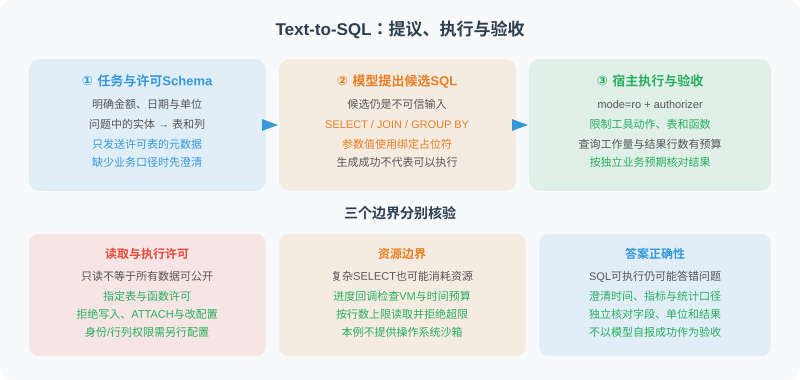

# 22.2 数据连接与查询

> **本节目标**：把自然语言问题、SQL候选、宿主执行许可和结果验收分开，运行一个受限的只读SQLite查询。



## 从问题到查询，哪些地方会出错

“上个月销售额最高的产品”至少包含四个需要确定的条件：销售额对应哪一列、是否扣除退款、业务时区是什么、以哪一天为基准计算“上个月”。SQL执行成功只能证明数据库接受了语句，不能证明这些业务口径正确。

Text-to-SQL通常需要模式链接、查询结构生成及条件填充。模式链接把自然语言中的实体对应到表、列和值；[RAT-SQL论文](https://aclanthology.org/2020.acl-main.677/)讨论了数据库结构与问题表述之间的对齐问题。本节不复现其训练方法。

| 用户表述 | 需要澄清或提供的上下文 | 错误时的处理 |
|---|---|---|
| 销售额 | `orders.amount`是下单金额还是实收金额，币种是否一致 | 澄清指标口径 |
| 上个月 | 参考日期、业务时区、自然月还是最近30天 | 明确时间范围 |
| 大客户 | 金额阈值、客户范围 | 索取阈值，不自行编造 |
| 退货率高 | 订单/退货关联键、分母及观察窗口 | 检查模式与统计定义 |

表结构很多时，可以先检索相关Schema，再交给模型生成查询；筛选出的表仍必须位于宿主许可范围内。需要多数据源时，分别实现元数据读取和受限执行接口，不能假设SQLite的权限与语法约束能直接迁移到其他数据库。

## 先运行数据库边界

实际实现位于 `reference_code/sqlite_readonly.py`，测试位于 `reference_code/tests/test_sqlite_readonly.py`。它仅依赖Python标准库；在仓库根目录使用Python 3.11+可运行下列完整示例：

```python
from pathlib import Path
import sqlite3
import tempfile
from reference_code.sqlite_readonly import ReadOnlySQLite

with tempfile.TemporaryDirectory() as directory:
    path = Path(directory) / "sales.db"
    # 仅创建虚构的练习资料；写入连接不交给Agent。
    with sqlite3.connect(path) as seed:
        seed.execute("CREATE TABLE orders(id INTEGER PRIMARY KEY, amount INTEGER)")
        seed.executemany("INSERT INTO orders(amount) VALUES (?)", [(100,), (200,)])

    database = ReadOnlySQLite(path, allowed_tables={"orders"}, max_rows=10)
    rows = database.execute_readonly(
        "SELECT sum(amount) AS total FROM orders WHERE id <= ?", (2,)
    )
    assert rows == [{"total": 300}]
    print(rows)
    try:
        database.execute_readonly("DELETE FROM orders")
    except PermissionError:
        print("写操作已拒绝")
```

预期输出总额300和写操作被拒绝的说明。数据库在临时目录中创建，示例结束后移除；这不是生产数据库初始化脚本。

执行器的约束来自数据库连接和执行回调，而不是检查SQL字符串里有没有某个词：

| 边界 | 真实实施方式 | 验收反例 |
|---|---|---|
| 文件只读 | URI `mode=ro`，再启用`query_only` | 插入、删除均不能修改文件 |
| 表与操作许可 | SQLite authorizer只允许指定表的读取、查询及少量聚合与标量函数 | 子查询读取未授权表、`ATTACH`、修改PRAGMA和加载扩展被拒绝 |
| 查询工作量 | VM进度回调与经过时间检查 | 代价过高的交叉连接被中断 |
| 结果行数 | `fetchmany(max_rows + 1)`，超限即拒绝 | 不先`fetchall()`后再检查 |
| 参数值 | DB-API参数绑定 | 值不通过字符串拼接进入SQL |

`allowed_tables=set()`表示不允许读取任何表，不会恢复默认许可。元数据接口只返回许可表的列信息，默认不把样例数据交给模型。结果出现重名列或仅大小写不同的别名（如`value`与`VALUE`）时拒绝，需改为不同别名，避免SQLite行按名称取值时静默复用第一列。

SQLite的[URI文档](https://www.sqlite.org/uri.html)说明了`mode=ro`；[authorizer文档](https://www.sqlite.org/c3ref/set_authorizer.html)说明了编译查询时的许可回调。`query_only`是补充约束，[官方说明](https://www.sqlite.org/pragma.html#pragma_query_only)并不将其等同于完全只读的数据库环境。

结果预算限制行数，不限制单个字段或单行的字节数；处理大字段时还需额外的大小与存储策略。进度回调按近似VM指令间隔触发，时间检查也在回调处进行，因此不是任意阻塞调用的严格墙钟时限。这段代码约束可信本地数据库上的查询，不是操作系统沙箱，也没有提供身份认证、行列级业务权限或完整敏感数据治理。

## 再接入模型，保持提议与执行分离

同一模块提供`TextToSQL`适配器：向注入的`llm.ainvoke(messages)`发起一次调用，接收带字符串`content`的响应。它只提出SQL，不自动执行。调用方必须提供明确的参考日期`as_of`；模型返回`NEEDS_CLARIFICATION`时，接口要求先澄清，不把不确定的业务口径默认为事实。

下面用固定提供者跑通接口与结果验收，**不调用真实模型**。它需要前一示例同样的`orders`练习数据库；将此定义放在创建数据库的代码前，并在临时目录仍有效时调用`asyncio.run(propose_and_query(database))`：

```python
import asyncio
from types import SimpleNamespace
from reference_code.sqlite_readonly import TextToSQL

class FixedSQLProvider:
    async def ainvoke(self, messages):
        return SimpleNamespace(content="SELECT sum(amount) AS total FROM orders")

async def propose_and_query(database):
    converter = TextToSQL(FixedSQLProvider(), database)
    sql = await converter.convert("全部订单金额合计是多少？", as_of="2026-03-01")
    rows = database.execute_readonly(sql)
    assert rows == [{"total": 300}]
    return {"sql": sql, "rows": rows}
```

这段代码检查提供者接口、许可和固定任务结果；提供者输出是测试替身，不能证明模型会生成正确查询。接真实模型时，替换提供者并固定模型与SDK版本，按第10–11章的方法记录实际调用；账号、密钥、费用与数据发送范围另行配置。

`TextToSQL`明确拒绝空响应、非字符串及代码围栏，保留可识别错误。即使模型违反Prompt返回`DELETE`，数据库执行器也必须拒绝。相反，错误但合法的`SELECT`仍可能被执行，因此每项业务任务还需要独立结果预期。

## 重试与结果验收

自我修正适用于可以修复的查询错误，例如拼错列名。应向下一次提议提供许可Schema、上一条SQL和必要错误信息，同时限制总提议次数。权限拒绝、缺失业务口径及敏感数据访问需求不应通过不断重试来突破。

```text
固定任务口径、许可Schema和独立预期
在总次数预算内：
  提议SQL；需要澄清时停止并询问
  宿主校验并执行；权限拒绝或预算耗尽时停止
  对可修复的语法/列名错误保留反馈，再提出候选
  查询成功后，按业务预期核对字段、单位、范围与结果
  只有业务验收通过才交付
```

上面是流程设计，不是仓库已经提供的自动重试器。只读约束、SQL能执行和业务答案正确是三项不同检查；重试不改变它们的职责。

`sqlparse`可用于分词、分组、格式化和辅助分析，不能称为验证数据库方言及执行语义的安全AST校验器；其[官方介绍](https://sqlparse.readthedocs.io/en/stable/intro.html)明确说明它是非验证型解析器。仅凭`get_type()`、`SELECT`前缀或关键词子串无法授予执行许可。例如`SELECT 'DROP TABLE' AS example`只是返回文本，不应因字面词汇误判为删除操作。

结果字段名过滤也只是辅助展示措施。`password`改名为`note`并不会消除敏感性；列、行、租户权限应在数据访问层实施，脱敏与用途限制需要独立策略。不要将“未返回敏感列名”当作未泄露数据的证明。

## 复现与练习

```bash
python -m unittest discover -s reference_code/tests -v
```

测试实际创建SQLite文件，覆盖正常聚合、参数、只读、许可表、子查询、危险操作、进度预算、结果上限与模型接口失败。不测试线上模型质量、其他数据库方言或生产权限配置。

练习：把独立预期总额设为300，让提供者改成查询订单数量。该SQL应能执行，但业务验收必须失败。再用`SELECT id, amount FROM orders`读取两行，把行数上限设为1，观察结果预算拒绝；不要用修改验收预期的方法让错误查询通过。

---

*上一节：[22.1 需求分析与系统设计](./01_requirements.md)*

*下一节：[22.3 数据分析与可视化](./03_analysis_visualization.md)*
