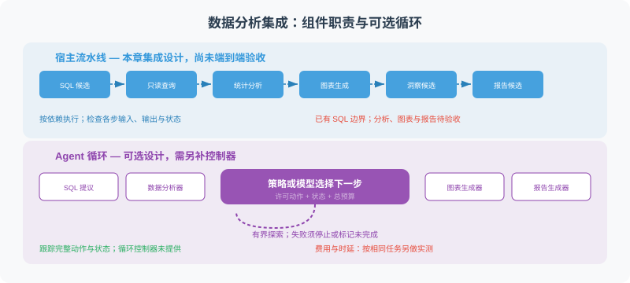
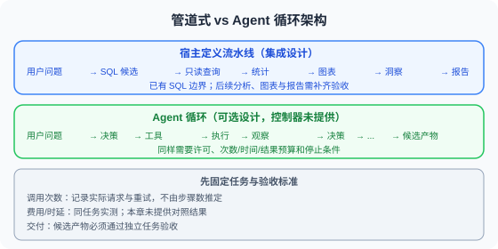

# 22.5 集成设计与可运行底座

> **本节目标**：明确22.2–22.4的组件合同、交付判定和失败路径，把已有实现与需要读者补齐的领域逻辑连接起来。



22.2的`ReadOnlySQLite`与`TextToSQL`已实现在`reference_code/sqlite_readonly.py`，并通过真实SQLite与固定提供者测试。22.3–22.4的分析、图表、洞察和报告仍需按任务整理为模块并验收。本节给出集成接口设计，不将它描述为仓库已经交付的完整数据分析应用。

若要先体验可运行的完整小任务，使用`reference_code/evidence_assistant/`的本地资料调研项目。`reference-agent/`另提供模型工具循环、评估与服务底座；两者都不自动提供这里的数据库分析业务逻辑。

## 为什么先用宿主定义的流水线

本章的典型任务是“查询金额 → 统计 → 绘图 → 报告”。宿主可以先确定步骤，在指定位置让模型提出SQL或文字。开放探索任务可能需要根据中间结果继续选择查询，此时可以考虑带权限、状态与总预算的Agent循环。



| 比较项 | 固定流水线 | Agent循环 |
|---|---|---|
| 下一步由谁确定 | 宿主声明的依赖图 | 策略或模型在许可动作内选择 |
| 故障定位 | 检查每步输入输出与状态 | 检查完整动作与状态轨迹 |
| 预算 | 各组件和整次任务都有上限 | 同样需要总次数、时间与结果预算 |
| 适用任务 | 口径与交付格式明确的固定分析 | 需要根据中间结果逐步探索的问题 |

本章没有做同题成本或时延对照。不能从“六个步骤”推导固定的模型调用次数、美元成本或优于循环的倍数；重试、模型配置、输入大小和验收率都会影响结果。

## 先写接口与交付条件

| 组件 | 输入 → 输出 | 必须保留的检查 |
|---|---|---|
| TextToSQL | 问题、参考日期、许可Schema → SQL候选或澄清要求 | 生成只负责提议，不授予执行许可 |
| ReadOnlySQLite | 候选SQL、绑定参数 → 有界行记录 | 只读连接、表/函数许可、进度与结果预算 |
| DataAnalyzer | 查询结果 → 统计摘要 | 类型、空值、单位、样本数与计算口径 |
| ChartGenerator | 结果与图表规格 → 图表产物 | 轴、单位、排序、文件路径和实际数值一致 |
| InsightGenerator | 问题、结果、统计 → 洞察候选 | 推论与观察分开，不补造数据 |
| ReportGenerator | 已有产物 → 报告候选 | 标明来源、SQL、时间范围、单位与缺失项 |
| 独立任务验收 | 固定业务要求、结果与报告 → 通过/失败原因 | 不以模型自评或文件已保存替代业务正确性 |

日期、指标、币种和业务时区在查询前确定；不清楚时先澄清。对许可表的访问也不代表所有行列都允许向用户展示，身份与用途限制仍由数据访问层负责。

下面是**依赖前述接口的集成片段**。`analyzer`、`charts`、`insights`、`reports`与`accept`需要调用方提供；没有在此隐含提供完整实现。为简化阅读，失败通过异常交给外层状态管理，候选报告未验收前不保存为最终报告：

```python
async def analyze_request(question, *, converter, database, analyzer,
                          charts, insights, reports, accept, as_of):
    sql = await converter.convert(question, as_of=as_of)
    data = database.execute_readonly(sql)
    if not data:
        return {"status": "no_data", "accepted": False}
    stats = analyzer.describe(data)
    chart = charts.auto_chart(data, question)
    observations = await insights.generate_insights(data, stats, question)
    candidate = await reports.generate_report(
        question=question, sql_query=sql, data=data, stats=stats,
        insights=observations, chart_path=chart,
    )
    decision = accept(question, data, stats, candidate)
    if decision is not True:
        return {"status": "needs_revision", "accepted": False}
    return {"status": "accepted", "accepted": True,
            "sql": sql, "report": candidate, "chart": chart}
```

这个片段解释组件顺序，不证明实际图表、模型洞察或验收器正确。`accept`必须从独立任务要求核对结果；生产实现还要把图表、数据库版本、权限和所用参考日期纳入产物清单，并在受限输出目录管理候选文件及清理。不能把`lambda *args: True`当作验收实现。

## 失败、重试与降级

| 情况 | 处理 | 可以交付什么 |
|---|---|---|
| 指标或时间范围不明确 | 停止并澄清 | 待确认条件，不生成确定结论 |
| 权限拒绝、查询预算耗尽 | 停止该查询，记录原因 | 明确失败与未完成项，不扩大许可后重试 |
| SQL拼写/列名错误 | 在总提议预算内提供许可Schema与必要错误，再提候选 | 重新执行并重新验收后的结果 |
| 没有数据 | 区分空结果、筛选错误与数据缺失 | 可说明当前查询为空，不能伪造摘要 |
| 图表生成失败 | 记录失败；任务允许时交付表格 | 明示缺图的部分结果；若图是必需产物则未完成 |
| 洞察或报告生成失败 | 保留已核对数据与错误 | 依任务合同判定部分结果，不默认完整成功 |
| 业务结果与独立预期不符 | 拒绝交付为完成，定位口径或查询错误 | 失败记录与待修候选 |

重试器是读者的扩展任务，当前`TextToSQL`只调用一次模型。修正上下文包括问题、参考日期、许可Schema、上一条SQL和必要错误；表名与错误文本也按数据处理。新候选仍经相同数据库边界，不能把所有异常都改写成“再问模型一次”。

## 优化前先测量

记录同一任务集的验收率、实际模型请求、输入输出token、耗时、重试、查询行数与失败原因，再选择优化。数据与权限版本必须进入缓存键；只按SQL文本缓存可能跨用户复用不应共享的结果。缓存失效、并发、容量和候选产物清理都需要独立设计。

有依赖的步骤不能仅为降低时延而并行。例如洞察依赖统计，最终报告依赖洞察；只有输入已经齐备、彼此独立的步骤才适合并行，并分别保留取消、异常与总预算。这里没有提供缓存器或测得固定的加速比例。

## 复现与练习

先按22.2运行金额合计300的练习数据库与固定提供者，再执行：

```bash
python -m unittest discover -s reference_code/tests -v
```

这验证数据库边界和模型提议接口。分析、图表与报告的端到端任务仍需另补真实小数据集、实际组件与验收，不能把数据库与接口测试扩写为整个领域工程已通过。

1. 固定任务“订单金额合计”，预期300。让候选改为`count(*)`：查询应能执行，业务验收应失败。说明两个判定为什么不同。
2. 将图表设为必需交付物，再模拟绘图失败。设计包含缺失产物和失败原因的状态，不以仅有报告文本宣布完成。
3. 设计至多三次SQL提议的重试器，明确哪些错误可修、哪些必须停止。保留原始许可Schema，不通过增加权限消除错误。

<details>
<summary>参考要点</summary>

第一题应核对字段、单位和独立数值预期，SQL合法不是答案正确。第二题保留已完成的数据分析，但整次任务仍不满足交付合同。第三题可对明确的语法/列名错误反馈；澄清、权限拒绝与预算耗尽应停止。预算包含失败尝试，所有新候选重新受数据库许可和结果预算约束。

</details>

模型路由的同条件评测见[18.8](../chapter_20_evaluation/08_model_routing.md)。下一章转向[多模态Agent](../chapter_25_multimodal/README.md)，继续使用“候选产物 → 宿主约束 → 独立验收”的交付方法。
