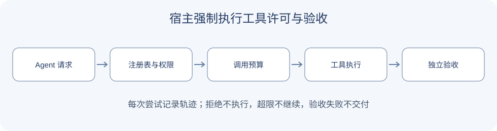

# 8.5 实战：构建你的第一个 Harness 系统

前面已经增加工具、记忆、规划、检索和上下文管理。本节将工具许可、调用预算与产物验证接入执行路径。完整模块在 `reference_code/evidence_assistant/harness.py`，演示入口在 `examples/chapter08/harness_demo.py`。

## 宿主负责强制检查

系统提示可以告诉模型规则，但执行器必须独立检查：工具是否存在、当前任务是否获准调用、调用预算是否耗尽。模型建议调用工具，不等于宿主已经授权执行。

本例把这些检查放在 `Harness.invoke` 中。拒绝的尝试也计入预算；不存在的工具与未获授权的工具都不会到达实际执行函数。这里的许可集合由宿主提供，不能从网页、文档或模型生成的文字中直接读取。



## 运行完整示例

```bash
python examples/chapter08/harness_demo.py
python -m reference_code.evidence_assistant.demo --stage harness
```

```python
from reference_code.evidence_assistant.harness import Harness

harness = Harness(
    tools={"multiply": lambda a, b: a * b},
    allowed=frozenset({"multiply"}),
    max_calls=2,
)
value = harness.invoke("multiply", {"a": 12, "b": 8})
report = harness.finish(value, verify=lambda actual: actual == 96)
assert report["status"] == "verified"
```

`invoke` 记录实际调用的结果或失败状态。`finish` 执行宿主提供的验收函数；结果错误或验收抛出异常，均返回 `verification_failed`。模型自报“完成”不会改变验收结论。

## 将它接到自己的项目

先保留原有的固定任务集。把现有工具执行入口替换为 `invoke`，并让产物经 `finish` 验收，再比较成功率、总调用量和拒绝原因。不要假设加入 Harness 必然改善固定比例的失败率。

本例仅覆盖进程内工具白名单、调用次数和独立验证。上下文预算由第7章模块承担。需要外部命令时，还应使用真正的进程或容器隔离；临时目录、危险词匹配与提示约束都不能提供这种隔离。示例没有执行任意模型生成代码。

## 必须通过的验收

- 未授权工具：执行函数未被调用，轨迹记录 `denied`。
- 调用超限：明确抛出预算耗尽错误，后续工具不能继续执行。
- 产物错误或验证器异常：返回 `verification_failed`，不能按成功交付。
- 正常计算：返回 `verified`，轨迹可追溯到参数与结果。

测试在 `reference_code/evidence_assistant/tests/test_learning_path.py` 中。这里保留一个可检查的最小实现；更完整的可观测性、权限模型和部署恢复分别在[第18章](../chapter_20_evaluation/README.md)、[第19章](../chapter_21_security/README.md)、[第20章](../chapter_22_deployment/README.md)展开。
