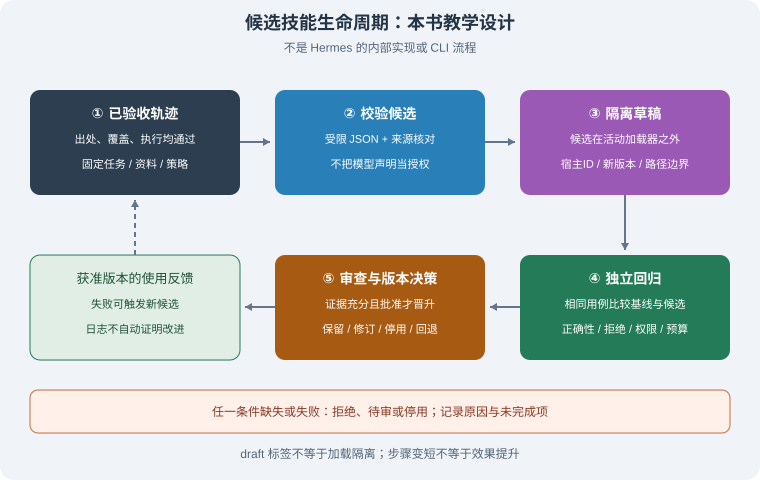

# 13.4 核心：Self-Evolving Skills 闭环

一次任务做对了，下一次仍可能漏步骤、用错资料或越过权限。把成功经验保存为技能，可以减少重复规划；但把一段回答写成 `SKILL.md`，还不能证明经验正确，更不能自动授予执行权限。本节关注的是：**怎样让任务经验成为可检查、可撤回的候选技能**。

## 一、先分清产品事实与教学设计

本节产品依据固定为 Hermes Agent v0.22.4，对应提交 `4d04303818b61bf3aa09278af48356315515965b`，核验日为 2026-10-22。新版本需要重新核对。

| 依据 | 可以支持的结论 | 本节不据此推断的能力 |
|------|----------------|--------------------|
| 固定版本 README 对学习闭环的介绍 | 项目将从经验创建技能、在使用中改进技能列为目标 | 每次任务都成功学习、固定触发阈值或效果提升 |
| `tools/skills_tool.py` 中的 `skills_list` 与 `skill_view` | 先列名称与描述，再按需查看技能内容 | 查看文档即完成执行授权 |
| 同文件的目录发现、禁用配置与路径检查 | 技能可见性、配置状态和路径边界需要具体实现 | 任意写入 `status: draft` 就必然阻止加载 |

第一项是[项目自述](https://github.com/NousResearch/hermes-agent/blob/4d04303818b61bf3aa09278af48356315515965b/README.md)，后两项可沿[固定技能工具源码](https://github.com/NousResearch/hermes-agent/blob/4d04303818b61bf3aa09278af48356315515965b/tools/skills_tool.py)核对。这些依据没有建立本节所需的整套审批与回退服务。

下面的五阶段是**本书设计的候选技能生命周期**，用于练习工程边界，不是 Hermes 内部算法、目录或 CLI 的复刻。它不指定某种自动优化算法或定期任务，也不把其他产品的技能来源限定为人工编写。

## 二、五阶段：每一步交出什么证据



| 阶段 | 输入与产物 | 进入下一步的条件 |
|------|------------|------------------|
| ① 选择已验收轨迹 | 任务、资料版本、权限策略、验收报告 | 独立任务验收通过，且有可复用需求 |
| ② 生成并校验候选 | 受限 JSON 描述；宿主附加来源标识 | 结构合法，引用可追溯，未申请额外能力 |
| ③ 隔离保存草稿 | 活动加载器之外的候选版本 | 路径、写入和加载边界均由宿主落实 |
| ④ 独立回归 | 基线与候选在同组用例上的报告 | 正确性、拒绝边界、权限及预算均通过 |
| ⑤ 决定与反馈 | 保留、修订、晋升、停用或回退记录 | 有批准记录和匹配的版本；失败可撤回 |

步数多、重复出现和“记住这个流程”可以说明复用价值，不能替代正确性证明。复杂但失败的轨迹适合保留为反例，不应进入成功流程；用户要求记住，也不等于允许扩大工具权限。

这里的技能首先是过程文档：说明适用条件、已有工具的使用顺序与检查点。若候选包含新的可执行代码，必须额外满足[9.3 节的隔离执行与独立验收接口](../chapter_skill/03_skill_learning.md#craft-的教学接口片段隔离执行与独立验收)。没有可信运行器时拒绝执行，不能在宿主 `exec` 后再补审查。

## 三、阶段①：成功必须来自宿主验收

以[贯穿项目的本地资料调研助手](../learning_project.md)为基础。一次运行有来源摘录，不代表回答覆盖了任务要求；应分别查看出处验证、任务覆盖和执行结果。默认样例使用冻结任务规格，自定义资料没有匹配规格或独立验证器时，覆盖状态可以是 `unknown`，不能作为“已验收经验”。

候选输入需要一份由宿主保存的轨迹清单。下表是本书的记录契约，**不是 Hermes 的轨迹格式，也不是调研项目已经输出的字段清单**：

| 字段 | 要求及缺失时的处理 |
|------|------------------|
| `run_id`、`finished_at` | 宿主生成标识与完成时间；缺失就退回补记录，不补造“当前时间” |
| `task_spec_digest`、`corpus_digest` | 固定验收规格与资料快照；版本不明则不能复现 |
| `policy_digest` | 工具允许列表、预算及写入范围的版本；候选不能修改 |
| `verification_report` | 引用出处检查的结果与失败位置 |
| `coverage_report` | 独立要求是否覆盖；`unknown`、`partial` 或失败均不通过 |
| `execution_report` | 完成、拒绝、预算停止、异常等实际状态 |
| `artifact_refs` | 答案与必要的工具输入/结果引用；先移除秘密和无关个人数据 |

宿主应读取报告中的判定与证据，不能只相信模型写下的 `status: success`、置信度或“用户满意”。任务规格决定验收要求，原始资料提供回答证据，两者不能互相冒充。没有明确任务规格时，可以暂存“待核经验”，但不得把它标成已验证技能来源。

复用价值另作一项判断：流程是否还会发生，输入变化是否可描述，人工检查是否值得保留。这样可以避免把偶然成功、过期资料或一次性绕过错误的做法固化下来。

## 四、阶段②：候选输入 Schema 与语义检查

把经过筛选的轨迹交给模型时，只要求生成流程描述，不允许它更改验收报告或活动版本。下面是本书练习的候选 JSON Schema；它使用 JSON Schema Draft 2020-12，**是数据约束，不是执行器**。

```json
{
  "$schema": "https://json-schema.org/draft/2020-12/schema",
  "type": "object",
  "additionalProperties": false,
  "required": ["name", "description", "trigger", "steps", "tools", "constraints", "source_refs"],
  "properties": {
    "name": {"type": "string", "pattern": "^[a-z][a-z0-9-]{0,47}$", "not": {"pattern": "\\s"}},
    "description": {"type": "string", "minLength": 1, "maxLength": 240},
    "trigger": {"type": "string", "minLength": 1, "maxLength": 240},
    "steps": {
      "type": "array", "minItems": 1, "maxItems": 10,
      "items": {"type": "string", "minLength": 1, "maxLength": 400}
    },
    "tools": {
      "type": "array", "maxItems": 8, "uniqueItems": true,
      "items": {"type": "string", "enum": ["retrieve", "answer_question"]}
    },
    "constraints": {
      "type": "array", "minItems": 1, "maxItems": 10,
      "items": {"type": "string", "minLength": 1, "maxLength": 240}
    },
    "source_refs": {
      "type": "array", "minItems": 1, "maxItems": 16, "uniqueItems": true,
      "items": {"type": "string", "minLength": 1, "maxLength": 120}
    }
  }
}
```

`retrieve` 与 `answer_question` 对应调研项目已有的调度工具名；枚举只限制候选可填写的名字，不会创建工具或授予访问权限。可以手写如下离线候选来练习审查，无需模型服务：

```json
{
  "name": "research-release-rules",
  "description": "依据本地资料回答发布规则问题，并分别检查出处和覆盖。",
  "trigger": "用户给定本地资料，并询问其中的发布规则。",
  "steps": [
    "在允许的资料集合内检索问题相关摘录。",
    "依据摘录生成带来源的回答。",
    "检查出处、任务要点与执行状态，任一未通过就保留未完成原因。"
  ],
  "tools": ["retrieve", "answer_question"],
  "constraints": ["不扩大资料范围", "无证据不补写答案", "不把覆盖未知写成任务完成"],
  "source_refs": ["run-001:answer", "run-001:acceptance"]
}
```

这里的 `run-001` 是设计用例标识，不是一次实际执行记录。真正建立候选时，宿主必须核实引用属于刚才通过验收的那次运行，并自行附加运行标识、时间、规格摘要与策略摘要。模型返回的引用只是待核字符串。

结构通过后仍需检查语义：空白文本、未知来源、把敏感内容抄进步骤、要求“忽略权限”等都应拒绝。名称 `../escape`、绝对路径、未知工具或额外的 `approved: true` 字段应在输入阶段被拒绝。不要从混杂解释文本中用贪婪正则捞取 JSON；本练习约定输入为单个完整 JSON 对象，解析失败就返回可定位的格式错误。

## 五、阶段③：草稿隔离是加载规则，不是一个标签

本书的候选工作区与活动技能加载目录必须分开。以下目录是**教学设计**，不使用产品的真实技能目录：

```text
lesson-skill-workspace/
├── candidates/<host-id>/v1/    候选描述与宿主来源清单
├── reports/<host-id>/v1/       独立回归报告
├── releases/<host-id>/v1/      获准发布的不可变快照
└── active-registry.json       宿主维护：技能ID → 获准版本与内容摘要
```

`<host-id>` 和版本由宿主分配，模型的 `name` 只作显示信息。写入方仍须落实：解析后的目标位于固定根目录内、拒绝符号链接逃逸、创建新版本而不覆盖已有版本、限制产物大小，并以原子替换更新完整清单。仅校验文件名不能覆盖目录被换成符号链接等问题。

活动加载器只接受注册表中批准的版本与匹配摘要，不扫描 `candidates/`。生成候选的组件无权写 `releases/` 或注册表；缺注册表、缺文件、摘要不符、版本冲突均拒绝加载。`status: draft` 可以方便人阅读，真正的隔离来自这些写入权限和加载检查。

这组存储、权限与注册表组件**尚未由本节提供实现**。它们是练习的接口要求，不能把目录树当成已经生效的安全系统。若只做纸面练习，应保留候选与报告，不把草稿放进实际 Hermes 技能目录试验自动加载。

## 六、阶段④：独立回归不由候选出题判分

任务维护者先冻结输入、预期与失败条件，再比较基线和候选。模型可以建议自测，但不能把自己的预期替换成验收标准。至少要包含正常任务、无答案任务、权限拒绝和预算不足；修改资料版本后还要验证旧候选是否需要重新审查。

| 独立用例 | 必须观察到的结果 | 不能判通过的捷径 |
|----------|------------------|------------------|
| 资料与任务要求匹配 | 出处、覆盖及执行均通过 | 只有“回答看起来合理” |
| 命中同主题片段但缺答案 | 保留覆盖未知/失败，不能宣称完成 | 把检索命中当成答案正确 |
| 没有相关证据 | 明确无证据，保留问题位置 | 从常识补齐并标记成功 |
| 候选要求新工具或越界资料 | 宿主拒绝，不发生调用或写入 | 仅在文档中写“不扩权” |
| 工具异常或预算耗尽 | 留下失败/停止状态与未完成项 | 把中途答案作为完整结果 |
| 新版本改变已通过结果 | 阻止晋升，保存对照报告 | 用整体平均分掩盖关键回归 |

可直接运行的底座仍是[贯穿项目](../learning_project.md)所指向的 `reference_code/evidence_assistant/`，不是本节新增的技能服务。其冻结字面要点检查适合本地摘录任务，不证明任意自然语言答案的语义正确性。候选如果增加可执行代码，独立回归还必须通过 9.3 节的可信隔离运行器；本仓库没有提供任意 Python 代码的那种运行器。

一份使用日志只能帮助定位失败，不能自行证明优化。应记录任务/资料/策略/候选版本、独立验收结果、失败原因与预算消耗。新候选必须重新运行同一组用例；没有实测前，步骤写得更短不等于调用更少、成本更低或回答更准。

## 七、阶段⑤：晋升、修订与回退的判定

下面是宿主协议的**文本伪代码**；大写操作代表需要实现和验证的组件，不是可导入函数或 Hermes API。缺组件时停在待审状态，不隐式放行。

```text
如果来源轨迹未通过独立验收，或运行/资料/策略版本缺失：拒绝提炼
如果没有复用需求：保留轨迹，不创建技能
解析并校验一个完整候选对象；未知字段、工具、来源或越界要求：拒绝
以宿主ID创建隔离候选版本；写入/隔离条件不成立：停止并记录错误

FREEZE_SUITE：固定独立输入与预期；缺用例：待审
候选含新增可执行代码但缺可信隔离运行器：待审；文档候选使用已有受控调度器
RUN_BASELINE_AND_CANDIDATE：相同资料、权限与预算下运行
如果异常、覆盖未知、关键用例失败或超预算：拒绝晋升，保留报告
如果正确性通过但没有证明改进：保留基线；可记录候选仍待评估
如果回归通过、改动目标有证据且审查批准：
    VERIFY_VERSION_AND_DIGEST：核对被审版本没有改变
    PUBLISH_SNAPSHOT_AND_REGISTRY：发布快照并原子更新活动注册表
使用中出现关键回归：先停用；核对并回归上一获准快照后决定回退
如果上一快照缺失或不能通过：保持停用，升级给维护者
```

例如，一次“覆盖未知”的调研不能进入阶段②；一个申请额外工具的候选在阶段②结束；一份合格草稿尚未跑回归时停在阶段③；候选回归失败时，阶段⑤保留基线。这些是设计用例的预期判定，**不是 Hermes 已执行的日志或效果测量**。

批准只针对被审查的确切内容与策略。批准后被改写的文件不能沿用旧报告；版本回退也不能恢复已经撤销的权限。如何调度审查可以另行设计，不能凭“离线”就宣称没有延迟、成本或并发风险。

## 八、练习与下一节边界

用纸面清单或临时工作区完成以下练习，不连接邮件、渠道账户或真实技能加载器：

1. 为调研项目准备“正常回答、同主题但无答案、无证据、禁用工具、预算不足”五个用例。冻结预期，并说明各自依据。
2. 手写一个符合 Schema 的候选；再分别改成 `../escape`、未知工具和伪造来源，标出在哪一步拒绝。额外测试符号链接或注册表冲突应由哪个宿主组件处理。
3. 为同一候选准备通过、失败和缺报告三种回归记录，写出晋升或待审判定。只写 `draft` 而活动加载器仍扫描候选目录，必须算隔离失败。
4. 设想获准版本出现回归：列出停用、上一版本摘要核对、权限重查与回退验收所需记录。没有上一快照时不得写“回退完成”。

本节产物是候选契约、拒绝用例与版本决策，不是完整自进化服务。接下来的[13.5 节记忆系统](./05_memory.md)讨论事实、用户偏好和会话材料的保存。记忆被召回不代表其中的流程已获准执行；候选技能通过回归，也不代表其引用的事实永不过期。二者可以共享来源标识与资料版本，但应保留各自的保留、更新和启用条件。
