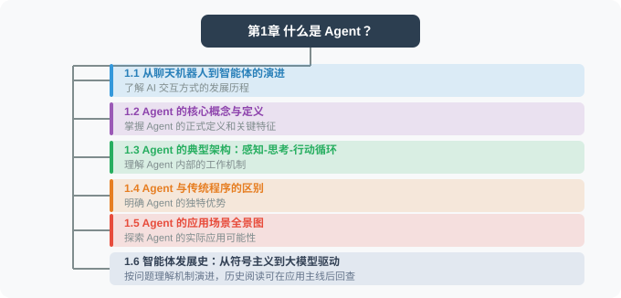
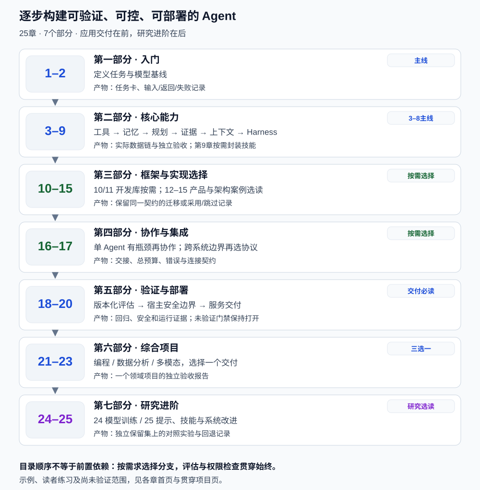

# 第1章 什么是 Agent？

**阅读层次**：核心必读。

## 本章迭代

- **上一版的不足**：聊天回答写着“已计算”或“已完成”，并不能说明系统取过资料、执行过计算，或满足了用户的要求。
- **本章增加**：给基础验证任务写一张任务卡：从教学资料 `Moon distance is 100 km.` 计算光行时间，按用户要求输出秒或毫秒，标明来源；把任务、工具动作、外部观察和最终验收画成一条链。它为后续本地资料调研助手练习机制，不等于完整应用。
- **怎样验证**：读者练习：列出正常资料、缺少距离、要求未授权动作三个输入，并为每个输入写明可接受结果和停止条件。交付任务卡与判断理由；本章不提供自动评分，也不把模型说“完成”作为证据。
- **下一步**：在[第2章](../chapter_llm/README.md)记录模型调用基线；需要动手环境时先读[附录 F](../chapter_setup/README.md)。先明确要验证什么，再增加 Agent 能力。

> 🎯 *"Agent 不仅仅是一个聊天机器人，它是能够自主感知环境、做出决策并采取行动的智能实体。"*

## 本章概览

欢迎来到 Agent 开发的世界！在这一章中，我们将从最基础的概念出发，帮助你建立对 AI Agent 的全面理解。

如果你曾经使用过 ChatGPT、Claude 等对话式 AI，你可能会想："这些不就是 Agent 吗？" 实际上，它们之间有着本质的区别。一个真正的 Agent 不仅能"说话"，更能"做事"——它可以使用工具、访问数据库、调用 API、执行代码，甚至能制定计划并自我纠错。

本章将帮助你理解这些核心差异，并为后续的开发实战打下坚实的概念基础。

上图可以先帮你建立一个完整 Agent 直觉：用户提出目标后，系统会把任务、上下文、记忆、知识库和可用技能等一起组织成 Prompt，交给大语言模型进行推理和决策。模型不会只生成一次答案，而是会在 `Reason → Action → Observe → Update` 的循环中不断推进任务：先思考下一步，再调用工具或访问文件、API，随后根据外部反馈修正计划，直到产出最终结果。

其中，`Memory` 负责保存长期偏好、历史决策和可复用经验；`RAG` 负责从文档或知识库中检索可靠资料；`Skill 库` 则沉淀常见任务流程和工具使用方式。理解这张图后，你会更容易看清 Agent 与普通聊天机器人的区别：聊天机器人主要是在回答问题，而 Agent 是在带着目标、工具和反馈闭环持续完成任务。

## 🎓 学习目标

完成本章学习后，你将能够：

- ✅ 清晰地定义什么是 AI Agent
- ✅ 理解 Agent 从简单聊天机器人到复杂智能体的演进历程
- ✅ 掌握 Agent 的核心架构：感知-思考-行动循环
- ✅ 区分 Agent 与传统程序、聊天机器人的本质差异
- ✅ 了解 Agent 在各行各业的典型应用场景
- ✅ 了解智能体发展史，从符号主义到大模型驱动的演进脉络

## 📚 本章结构

---

## 🔗 学习路径

本书共 25 章、7 个部分。应用主线是“定义任务→增加能力→选择实现→验证与部署→综合项目”，训练与自我进化在项目之后按需学习。章节次序以网页左侧目录导航为准；共同底座与每阶段产物见[贯穿项目](../learning_project.md)。

### 三条推荐路线

不同背景的读者，可以按不同路线"跳读"本书，不必从头到尾线性读完：

- 🟠 **概念与体验**：`1 → 2 → 3 → 8`。完成任务卡，观察工具调用与执行约束；目标是读懂结果和边界，不把这条短路线当成完整应用交付。

- 🔵 **工程交付**：`1–8 → 按需选9–17 → 18–20 → 21/22/23任选一个`。第9章解决复用；第10–11章按集成与状态需求学习，第12–15章选择匹配场景的案例。只有遇到协作或外部集成瓶颈，才需要第16–17章。评估、安全和部署不能被“快速上手”跳过。

- 🟣 **研究改进**：先完成至少一个应用与独立评估，再选 `24`（模型训练）或 `25`（提示、技能与系统改进）。保留相同的应用回归门禁；不需要先读完所有框架，也不要求先训练权重才能改进提示。

> 💡 **阅读建议**：每章新增能力都应留下产物与验收证据。通过前一阶段的检查后再扩大任务范围；遇到失败时，可以先回查对应模块，不必顺次堆叠全部技术。

### 后续推荐

> - 👉 [第2章 大语言模型基础](../chapter_llm/README.md) — 理解 Agent 的"大脑"
> - 👉 [附录 F：开发环境搭建](../chapter_setup/README.md) — 搭好工具，开始动手

---

*准备好了吗？让我们从 Agent 的前世今生开始说起……*
