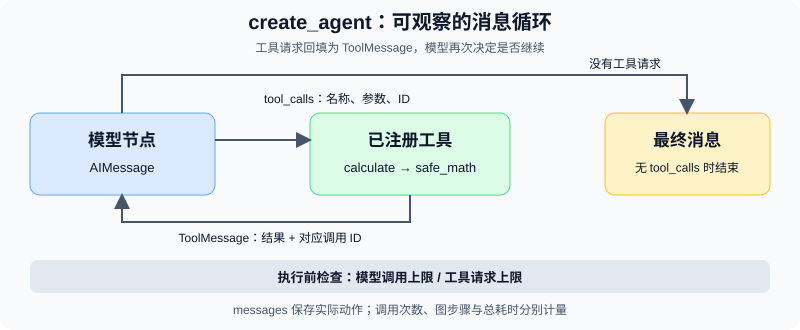

# 10.3 使用 LangChain 构建 Agent

前面的最小循环已经能调用工具。本节要减少模型、消息与工具之间的适配代码，同时保留可检查的调用记录和停止条件。使用本仓库实际验证的 **LangChain 1.4.6、langchain-core 1.6.12、LangGraph 1.2.16**；安装入口见 `examples/requirements.txt`。版本依据可查 [LangChain 1.4.6 发布记录](https://github.com/langchain-ai/langchain/releases/tag/langchain%3D%3D1.4.6)。

这一版使用 `from langchain.agents import create_agent`。它建立模型与工具之间的消息循环，底层使用 LangGraph 运行时；读者可以先用这个接口完成单 Agent 任务，出现自定义状态、分支或恢复需求时再学习第11章。官方接口说明见 [Agents](https://docs.langchain.com/oss/python/langchain/agents)。

## 先运行一个真实框架、固定模型的例子

在仓库根目录、安装配套依赖后运行：

```bash
python -m examples.chapter12.first_agent
```

目录保留历史编号 `chapter12`，对应当前第10章。默认输入是 `sqrt(144) + 2 * 3`，输出的 `tool_results[0].value` 应为 `18.0`，`model_calls` 为 `2`，`tool_calls` 为 `1`，模式为 `offline-fixture`。

这个演示实际运行 LangChain 的工具绑定、消息传递、工具执行和中间件。模型由 `examples/framework_fixture.py` 中的 `FixedToolChatModel` 替代：第一次把用户输入原样作为计算表达式请求工具，收到工具消息后原样回传结果。它不理解任意自然语言，也不发出模型、搜索或天气请求；算术结果由工具实际计算。

## 看清四个接口

| 接口 | 本例中的作用 | 仍需由应用决定 |
|---|---|---|
| `@tool` | 从参数类型和 docstring 形成工具说明与参数 Schema | 允许什么操作、如何校验输入、怎样报告失败 |
| `create_agent` | 连接模型、工具及中间件 | 使用哪种模型、开放哪些工具 |
| `messages` | 保存用户输入、模型工具请求和工具结果 | 哪些历史需要保留、是否跨调用持久化 |
| 调用限制中间件 | 限制一次调用中的模型请求数和工具请求数 | 时间、费用、权限及独立业务验收 |



本例只有一个 `calculate` 工具。其完整定义在 `examples/framework_fixture.py`，实际复用 `examples/chapter03/safe_math.py`：仅解释允许的 AST 节点、运算符和数学函数，限制表达式长度、节点数、指数与数值范围。它返回 `status=ok` 和数值，或 `status=invalid_expression` 及原因；不会执行 Python 语句。需要查询事实的任务应另接有来源的工具。

工具的 docstring 会作为模型可见的说明，参数 `expression: str` 则进入 Schema。清晰描述有助于选工具，实际许可和输入检查仍要放在执行边界。初次学习使用 `@tool` 即可；需要自定义工具类时，再完整实现 `BaseTool` 的输入模型和执行方法。

## 用 create_agent 连接并观察循环

下面与配套源码使用相同接口，可以在仓库根目录运行：

```python
import json
from langchain.agents import create_agent
from langchain.agents.middleware import ModelCallLimitMiddleware, ToolCallLimitMiddleware
from examples.framework_fixture import FixedToolChatModel, calculate

agent = create_agent(
    model=FixedToolChatModel(),
    tools=[calculate],
    system_prompt="Use calculate for arithmetic. Report rejected input as a failure.",
    middleware=[
        ModelCallLimitMiddleware(run_limit=3, exit_behavior="error"),
        ToolCallLimitMiddleware(run_limit=2, exit_behavior="error"),
    ],
)
result = agent.invoke(
    {"messages": [{"role": "user", "content": "sqrt(144) + 2 * 3"}]},
    config={"recursion_limit": 16},
)
messages = result["messages"]
print([message.type for message in messages])  # human, ai, tool, ai
print(json.loads(messages[2].content)["value"])  # 18.0
assert messages[2].tool_call_id == messages[1].tool_calls[0]["id"]
```

先查看第一个 `AIMessage.tool_calls`：其中包含工具名、参数与调用 ID。工具执行后产生的 `ToolMessage` 使用同一个 ID，将结果回填到消息列表。模型再次被调用，返回不带工具请求的消息后结束。这些是可观察的动作与结果记录，不是模型内部推理的完整展示。

`first_agent.py` 将调用包装为 `run()`，统一返回执行状态、工具结果和调用数。计算输入被拒绝时返回 `incomplete`；调用限制或图步骤限制触发时返回 `budget_exhausted`，CLI 以非零状态退出。`completed` 只说明本例执行与工具结果检查完成；输出中的 `verification_scope` 明确指出，业务验收需要另设判据。

## 分别验证错误与预算

```bash
python -m examples.chapter12.first_agent --expression '__import__("os").getcwd()'
python -m examples.chapter12.first_agent --expression '1 / 0'
python -m examples.chapter12.first_agent --max-model-calls 1
python -m pytest examples/integration_tests/test_first_langchain_agent.py -q
```

前两项应返回 `invalid_expression`，不能出现伪造数值。第三项允许第一次模型请求及其工具执行，但阻止获得最终回答所需的第二次模型调用，因此返回 `budget_exhausted`。测试另外注入持续请求工具的固定模型，确认超出工具预算的那一次调用没有进入计算器；未注册工具请求也不能成为成功结果。测试期间封锁出站 socket，不调用线上服务。

| 限制 | 本例配置 | 计量边界 |
|---|---|---|
| 模型调用 | `ModelCallLimitMiddleware(run_limit=3)` | 一次 `invoke` 内的模型调用数 |
| 工具请求 | `ToolCallLimitMiddleware(run_limit=2)` | 一次 `invoke` 内所有工具的请求数；超限以错误结束 |
| 图执行步骤 | `recursion_limit=16` | 图的调度步数，不等于工具调用数 |
| 计算输入 | `safe_math` 的长度、复杂度和数值上限 | 单次算术求值 |

两种中间件在本例均设为 `exit_behavior="error"`，避免把预算停止消息当作正常完成。配置语义可核对官方[预置中间件文档](https://docs.langchain.com/oss/python/langchain/middleware/built-in)。这些次数限制不提供总耗时保证，也不隔离任意外部代码；持久状态、业务权限和进程超时需要分别设计。

## 真实模型作为显式选做

```bash
python -m examples.chapter12.first_agent --real --model gpt-4.1-mini
```

只有传入 `--real` 才创建 `ChatOpenAI` 并访问配置的模型服务，需要可用凭证。本例设置 SDK 请求超时 `30` 秒及最多一次重试；这不等于整项任务最多运行30秒。真实模型的工具选择、参数质量、最终回答准确性和费用，需要单独的任务集评估，本节离线测试没有验证这些指标。

完成本节应保留正常消息序列、一次输入拒绝和一次预算停止记录。若这些接口已满足任务，可以继续使用 `create_agent`；需要自己定义状态与路由时，再转到[第11章](../chapter_langgraph/README.md)。下一节介绍[10.4 LCEL](./04_lcel.md)，用于表达可组合的数据处理流程。
