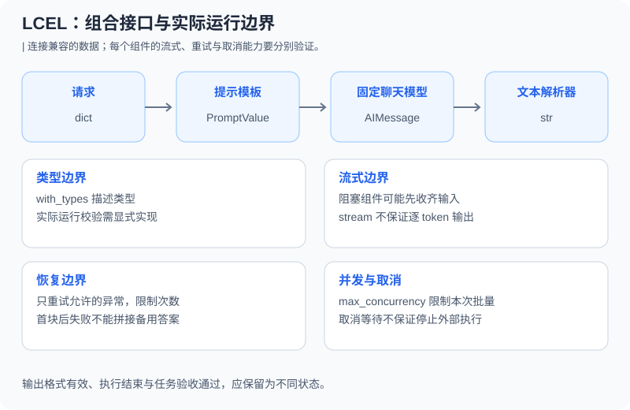

# 10.4 LCEL：LangChain 表达式语言

10.2已经使用条件与并行组合。本节进一步检查组合后的合同：什么值会流过边界、类型声明是否执行校验、输出能否逐块交付，以及哪些错误值得重试。版本与离线入口见[10.1](./01_langchain_overview.md)。



## 接口兼容与运行时校验分开

`|`创建Runnable组合，不会证明相邻函数接受对方的值。`RunnableLambda(lambda _: {"value": 3})`若接一个调用 `.upper()` 的函数，运行时会因类型不匹配失败。把字段、单位和错误状态写进合同，比依赖链名更有用。

`with_types`提供Schema信息与类型描述，不能当成所有输入都已通过Pydantic校验。下面在锁定版本实际仍返回原字符串：

```python
from langchain_core.runnables import RunnableLambda
from langsmith import tracing_context
from reference_code.langchain_patterns import PolicyAnswer

typed = RunnableLambda(lambda value: value).with_types(input_type=PolicyAnswer)
with tracing_context(enabled=False):
    result = typed.invoke("not a PolicyAnswer")
assert result == "not a PolicyAnswer"
```

若输入需要校验，显式调用验证器；若输出需要结构约束，在链中放入解析和校验步骤。字段合法也不证明事实正确。

## 完整JSON、结构约束与任务要求

配套的 `PolicyAnswer`只用于冻结练习：非空答案、整数7天和来源ID `fixture-policy-v1`，拒绝额外字段。`build_structured_chain`先用标准JSON解析确认**一个完整对象**、无重复字段及非有限数字，再交给 `PydanticOutputParser`。这避免把容错解析器对截断内容的修复当成合同通过。

```python
from langsmith import tracing_context
from reference_code.langchain_patterns import FIXTURE_ANSWER, build_structured_chain

with tracing_context(enabled=False):
    result = build_structured_chain().invoke({"fact": FIXTURE_ANSWER, "question": "refund"})
assert result.policy_days == 7
assert result.source == "fixture-policy-v1"
print(result.model_dump())
```

可以把响应的 `policy_days` 字段改为30、把 `source` 改为未知来源，或提供空白答案、额外 `approved` 字段、截断JSON。配套测试都要求拒绝；它们不是“让模型再说一遍就算修好”。这里的7天是独立冻结的练习要求，不意味着任何业务都应该使用这个值。更复杂的语义充分性仍需单独验收。

## 流式接口不等于逐token输出

```python
from langchain_core.runnables import RunnableLambda
from langsmith import tracing_context
from reference_code.langchain_patterns import build_answer_chain

with tracing_context(enabled=False):
    incremental = list(build_answer_chain("abc").stream({"fact": "fixture", "question": "x"}))
    buffered = list(RunnableLambda(lambda _: "whole value").stream("fixture"))
assert incremental == ["a", "b", "c"]
assert buffered == ["whole value"]
```

固定聊天模型按字符产出 `abc`，普通Lambda返回整块字符串。真实提供者的块大小、工具调用与结构化数据片段都可能不同。[RunnableSequence参考](https://reference.langchain.com/python/langchain-core/runnables/base/RunnableSequence)说明阻塞组件会延后后续流式产出。需要完整JSON才能校验的步骤也可能缓冲内容；不要把未验收的半个对象交作最终结果。

## 重试范围要比整条业务流程更小

下面只重试一个无外部副作用的固定动作；首个 `TimeoutError`之后第二次成功。总次数是3次，离线练习关闭等待以便快速检查：

```python
from langchain_core.runnables import RunnableLambda
from langsmith import tracing_context

attempts = {"count": 0}
def transient(value):
    attempts["count"] += 1
    if attempts["count"] == 1:
        raise TimeoutError("fixed transient failure")
    return value

retry = RunnableLambda(transient).with_retry(
    retry_if_exception_type=(TimeoutError,), stop_after_attempt=3,
    wait_exponential_jitter=False,
)
with tracing_context(enabled=False):
    assert retry.invoke("fixture-ok") == "fixture-ok"
assert attempts["count"] == 2
```

`retry_if_exception_type`只允许所选异常。参数校验、权限拒绝和业务验收失败不能统一视作临时网络错误。线上退避要考虑抖动、截止时间和提供者要求；不要把SDK重试、Runnable重试与整任务重试乘在一起而不计总预算。具有写副作用的超时还需幂等键或结果查询，不能盲目重放。

`with_fallbacks`可以在匹配异常时依次尝试备用Runnable，但不是可用性保证：备用也可能失败，已经发出的流内容不能被撤回。首块前/首块后两种失败的实测见[10.8](./08_production_patterns.md)。方法参数见[官方fallback参考](https://reference.langchain.com/python/langchain-core/runnables/base/Runnable/with_fallbacks)。

## 下一步与练习

组合、分支和并行可以继续留在LCEL；需要持久状态、暂停恢复或自己控制图节点时再评估[LangGraph](../chapter_langgraph/README.md)。不要为了一个条件分支先引入另一套状态生命周期。

练习：记录一个“接口存在但输入类型不兼容”的反例、一个截断JSON拒绝和一个不可重试的 `ValueError`。验收产物应包含失败位置与尝试次数，而不是只展示最终文本。

*上一节：[10.3 LangChain Agent](./03_langchain_agents.md)*

*下一节：[10.5 实战：客服Agent](./05_practice_customer_service.md)*
