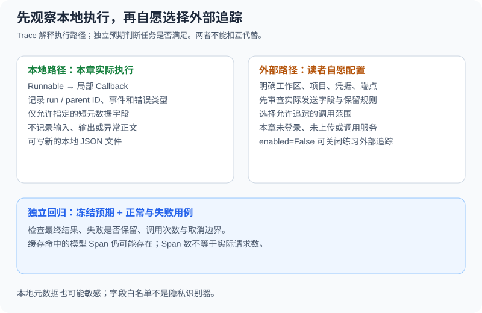

# 10.6 LangSmith 集成与可观测性

本节先回答本地问题：哪里开始、哪里失败、哪份输入被验收？再介绍如何自愿把选定数据接入LangSmith。版本沿用[10.1](./01_langchain_overview.md)，本节示例没有登录服务、创建远程数据集或上传运行记录。

## Trace、评估与业务完成分别说明什么

[LangSmith官方入门](https://docs.langchain.com/langsmith/observability-quickstart)介绍记录调用链及查看Trace。工程追踪能显示调用与错误，不能读取模型未公开的内部思考，也不能仅凭运行结束事件证明业务完成。



| 记录 | 需要回答的问题 | 不能代替什么 |
|---|---|---|
| 生命周期Trace | 哪个步骤开始、结束或报错，父子调用如何关联？ | 独立答案验收 |
| 用量与耗时 | 提供者实际返回了什么用量、请求与等待花了多久？ | 不存在的token账单或未测价格 |
| 回归结果 | 固定输入与预期是否仍满足？ | 一组自拟成功案例的印象 |
| Prompt版本 | 实际用了哪份模板、模型与资料版本？ | 只保存最新模板文本 |

缓存命中也可能有模型生命周期回调。本章实际用四次 `invoke`产生四个模型起始事件，但固定提供者只生成三次；因此Span数不是网络请求数。真实用量可能缺失，成本还依赖模型、计费规则与缓存类型，缺数据时应标未知。

## 先运行局部回调，不发数据到服务

配套 `local_trace.py` 的 `LocalTrace`使用真实 `BaseCallbackHandler`，记录链/聊天模型的开始、结束、错误、运行ID与父ID。它只保留 `case_id`、`app_version` 两个调用方选择的短字符串，不收集提示、输出或异常消息。

```python
import json
from langsmith import tracing_context
from reference_code.langchain_patterns import LocalTrace, build_answer_chain

trace = LocalTrace()
with tracing_context(enabled=False):
    answer = build_answer_chain().invoke(
        {"fact": "private-fixture-input", "question": "private-fixture-question"},
        config={"callbacks": [trace], "metadata": {"case_id": "case-1", "app_version": "v1"}},
    )
assert any(item["parent_run_id"] for item in trace.events)
assert "private-fixture-input" not in json.dumps(trace.events)
print({"events": len(trace.events), "dropped": trace.dropped})
```

当前固定链得到8个局部事件。记录器有容量上限与 `dropped`计数，避免把丢失事件当作完整轨迹。它不是通用监控器：没有工具事件、token计量、墙钟指标或持久存储；工具执行轨迹可继续看[10.3](./03_langchain_agents.md)和[10.5](./05_practice_customer_service.md)。

若需把这份局部记录保存为新文件，运行：

```bash
python -m reference_code.langchain_patterns --trace-file /tmp/lc-pattern-trace.json
```

路径应不存在；已有文件会拒绝覆盖。文件只在本地保存，没有LangSmith上传行为。元数据字段白名单不是隐私分类器：调用方仍应避免把秘密放进所谓的“标识符”。

## 本地回归保留独立预期

以下输入与期望先固定，再调用被测入口。第二题必须走澄清，不能因为生成了文字就判它已回答：

```python
from langsmith import tracing_context
from reference_code.langchain_patterns import build_intake_flow, FIXTURE_ANSWER

cases = [
    ({"question": "refund policy?"}, "policy", FIXTURE_ANSWER),
    ({"question": "unsupported fixture"}, "unsupported", "Unsupported fixture question; clarify the task."),
]
with tracing_context(enabled=False):
    actual = build_intake_flow().batch([case[0] for case in cases])
checks = [row["intent"] == intent and row["answer"] == answer
          for row, (_, intent, answer) in zip(actual, cases)]
assert checks == [True, True]
print({"passed": sum(checks), "total": len(checks)})
```

这只验收练习内的英文规则与固定回复，没有证明通用意图识别或事实性。真实客服应另列所有者越权、写入被拒、工具错误和未知问题；不能让候选答案改写预期。参考项目的测试正是可复查的本地替代，不需要服务账号。

Prompt管理也可以先留在本地：将模板文件、模型/SDK版本、资料与权限版本、用例集合及报告绑定到一次改动。比较Prompt时保留同一任务集和采样配置；更长或更短的回答不自动代表质量提升。远程Hub的拉取、推送与实验写入都是另外的服务操作，本节示例未执行。

## 自愿开启LangSmith之前明确数据范围

若项目确实需要共享追踪，再按[官方配置说明](https://docs.langchain.com/langsmith/trace-without-env-vars)配置账号、接收端与项目。下面仅说明可选配置项，不是本章运行所需的环境文件：

```text
LANGSMITH_TRACING=true
LANGSMITH_PROJECT=book-fixture-staging
LANGSMITH_API_KEY=<在本机秘密管理中配置，不写入仓库>
LANGSMITH_ENDPOINT=<所选区域或自托管服务的实际端点>
```

配置之后还需显式选择允许上传的运行，先只用虚构资料验证。项目名是分组信息，不应被当作租户授权边界；接收方、保留期限、访问权限与删除流程需要按实际服务设置检查。

| 数据 | 开启前的具体决定 |
|---|---|
| 用户消息、历史、模型输出 | 是否允许发送；哪些内容必须不记录或做明确脱敏 |
| 工具参数与结果 | 是否含路径、客户标识、数据库行或凭据 |
| 异常与元数据 | 是否会间接复制用户输入或秘密 |
| 评测样本与Prompt | 是否允许创建远程副本、由谁更新/删除 |

`config={"callbacks": []}`不等于关闭所有环境启用的外部追踪。这里使用 `with tracing_context(enabled=False)`控制本次作用域，符合[官方程序化配置](https://docs.langchain.com/langsmith/trace-without-env-vars)；同时保留自己传入的局部回调。进程中的其他SDK包装器、日志出口或显式Client操作仍需分别检查。

## 验证与练习

运行 `python -m unittest examples.integration_tests.test_langchain_chapter -v`，其中包括局部回调父子关系、错误类型、原始输入/输出未被这个记录器保存、新文件与容量边界。测试还拦截网络入口并要求零请求；它们没有验收远程服务权限或追踪保留策略。

练习：让链抛出含虚构敏感内容的 `ValueError`，确认局部记录只有错误类型，没有原始消息；再把记录容量设为1，确认 `dropped`非零。提交错误轨迹与独立任务报告两份产物，解释为什么二者不能互换。

*上一节：[10.5 实战：客服Agent](./05_practice_customer_service.md)*

*下一节：[10.7 LangChain生态2026](./07_langchain_ecosystem_2026.md)*
