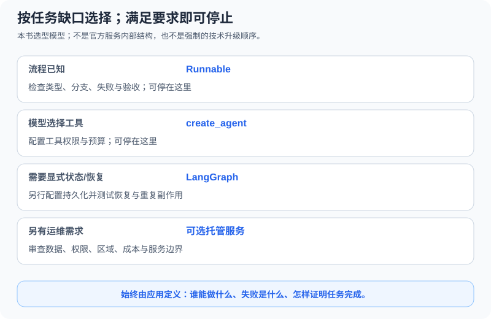

# 10.7 LangChain 生态 2026

生态名称不是学习顺序。本节以“已有应用还缺什么”为起点，区分组件编排、状态运行、Harness组合与部署服务；没有缺口就停在已验收的版本。这里不要求把一个本地问答扩成全套托管项目。

## 可复现边界与资料日期

本地实测版本见[10.1](./01_langchain_overview.md)。本页另核对2026-10-22的官方产品文档；在线页面会变化，不能把它们的所有新API都归到 `langchain==1.4.6`。Deep Agents、MCP适配包、LangServe及部署SDK没有在本章示例环境安装或进行服务互操作测试。

| 层次 | 代表入口 | 选用前要解决的问题 |
|---|---|---|
| 组件与基本工具Agent | [LangChain](https://docs.langchain.com/oss/python/langchain/overview) | Runnable组合或 `create_agent` 能否满足当前任务？ |
| 显式状态编排 | [LangGraph](../chapter_langgraph/README.md) | 是否需要控制状态、检查点、暂停与恢复？ |
| 现成Harness | [Deep Agents](https://docs.langchain.com/oss/python/deepagents/overview) | 是否确实需要文件、规划、委派等组合能力，并能约束其权限？ |
| 观察与部署服务 | [LangSmith Deployment](https://docs.langchain.com/langsmith/deployment) | 是否愿意引入服务、账号、运行数据与运营责任？ |
| 外部工具协议 | [LangChain MCP说明](https://docs.langchain.com/oss/python/langchain/mcp) | 工具来源、会话生命周期、参数与执行授权如何验证？ |
| 已有HTTP封装 | [LangServe仓库](https://github.com/langchain-ai/langserve) | 已有项目的版本、安全接口与客户端是否兼容？ |

[官方LangChain概览](https://docs.langchain.com/oss/python/langchain/overview)将基础Agent入口与更低层编排区分开。可以使用 `create_agent` 而不自己编写图；可以使用Runnable分支而不选择托管部署。需要新能力时，应先补能暴露问题的验收用例。

## 三个具体停点



| 当前任务 | 可先采用的最小路径 | 何时才继续 |
|---|---|---|
| 固定输入、固定步骤、少量独立分支 | 10.2/10.4的Runnable流程 | 需要维护跨步骤状态或恢复点 |
| 模型按问题选择工具 | 10.3/10.5的 `create_agent`，宿主保留许可与预算 | 需要自定义图节点、持久检查点或人工挂起 |
| 工作要跨请求、重启或审查持续 | 第11章的显式状态与持久化设计 | 实际运维需求支持引入服务；先测试故障恢复 |

图中是本书的责任选择模型，不是宣称平台内部有一个固定“State Server”。持久执行需要适用的存储、运行配置与恢复测试；不能从“图已经compile”推导重启后可恢复或副作用只执行一次。

## 在锁定环境检查入口，不发请求

```python
from langchain.agents import create_agent
from langchain_core.runnables import RunnableBranch
from langchain_openai import ChatOpenAI

assert callable(create_agent) and callable(RunnableBranch)
model = ChatOpenAI(model="gpt-4.1-mini", api_key="not-a-real-key", timeout=1, max_retries=0)
assert model.model_name == "gpt-4.1-mini"
# Construction only; no invoke, login, or model request.
```

这里使用无效占位密钥只构造适配器，未调用模型。真实服务调用应沿用10.3的显式 `--real` 路径另行配置，而不是把离线固定回答当作真实模型质量。安装更多集成包也不证明它们拥有同一套工具选择或结构化输出能力。

### 从旧接口迁移，先对照合同

[v1迁移说明](https://docs.langchain.com/oss/python/releases/langchain-v1)明确了精简命名空间与 `create_agent`。遗留 `LLMChain`/`AgentExecutor`材料应留在其原有依赖中复现；本章没有测试 `langchain-classic` 兼容层。

| 原有关注点 | 当前本章路径 | 迁移验收 |
|---|---|---|
| Prompt与模型串联 | `prompt | model | parser` | 输入字段、消息角色与输出值一致 |
| 工具Agent循环 | `create_agent` | 实际工具调用、许可拒绝、停止与预算反例 |
| 手写状态流程 | 按需使用LangGraph | 状态更新、重复运行、恢复与副作用处理 |
| 回调/Trace | 10.6局部回调，再自愿接服务 | 不把旧 `output` 字段或空回调列表当通用合同 |

迁移不是全局替换类名。工具描述、调用参数、消息结果、异常类型和预算语义都可能变化；先用固定提供者跑同题，再按需验证真实模型。只有编排接口需要改变时，不必同时更换模型、数据与权限策略。

## Harness与托管：仍然保留谁的责任

官方[Deep Agents概览](https://docs.langchain.com/oss/python/deepagents/overview)把多种Agent能力组合为Harness；是否采用，应逐项核对你的需求与执行边界。现成文件或委派能力会增加资源面，不会让所有任务自动更可靠。

[LangSmith Deployment说明](https://docs.langchain.com/langsmith/deployment)区分运行部署与可观测平台，列出不同部署位置；Managed Deep Agents另提供托管Deep Agents路径。本页没有验证其发布API、网络配置、费用或SLA，因此不提供假定一次命令就具备鉴权、恢复和扩缩容的完整部署代码。业务工具、数据权限与验收仍由应用负责。

MCP也不是执行权限。连接器发现了一个工具，不代表可以执行它；客户端会话要覆盖工具实际使用期间。协议边界与可运行教学子集见[17.5](../chapter_19_protocol/05_practice_mcp_integration.md)，不要复制一个退出上下文后已经关闭的session。

## 选型练习

为同一个客服任务写两份记录：一份只需10.5的订单查询，另一份确实需要跨进程恢复。分别列出固定任务、缺失能力、最小新增组件、失败用例和停止条件。若没有测出新需求，就保留简单版本；“生态里有这个产品”不是升级证据。

可交付产物是一张选择表和对应的验收命令，不要求注册服务或部署到公网。生产边界继续看[10.8](./08_production_patterns.md)；更复杂的状态任务再进入第11章。

*上一节：[10.6 LangSmith与可观测性](./06_langsmith_integration.md)*

*下一节：[10.8 LangChain生产化模式](./08_production_patterns.md)*
