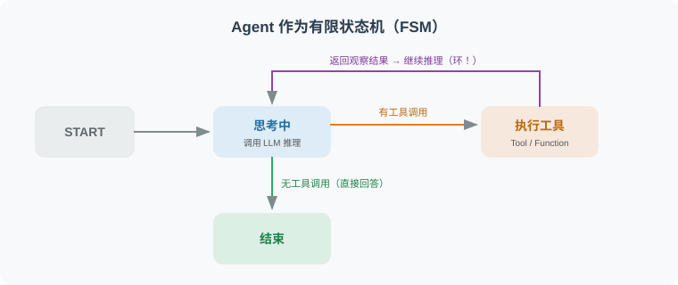
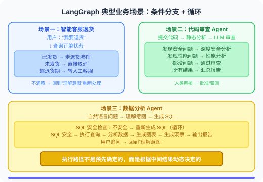

# 11.1 为什么需要图结构？

> **本节目标**：比较一个最小线性示例与显式状态模型，判断当前任务是否值得引入图编排。

下面的 `A | B | C` 只展示固定顺序的最小组合，没有定义分支、循环或恢复策略。若任务需要在失败、确认和恢复之间切换，就应显式设计执行状态；图是其中一种表达方式，自写循环、状态机或其他编排实现同样有效。是否采用 LangGraph，取决于生命周期的复杂度与维护成本。

---

## 理论背景：有限状态机与图计算

可以用有限状态机与图计算理解本节的控制流模型。这里讨论的是建模方式，不把某一种实现当成所有 Agent 的必要结构。

### 有限状态机（FSM）

为分析控制流，可以把 Agent 的执行阶段抽象为**有限状态机**：在有限个阶段之间，根据输入和条件转换 [1]。这不表示模型输出、记忆和任务数据也只有有限种取值：



在 FSM 模型中：
- **状态**（State）：Agent 当前所处的阶段（如"思考中"、"执行工具"、"等待人类审批"）
- **转换**（Transition）：从一个状态到另一个状态的条件跳转
- **动作**（Action）：在状态转换时执行的操作（如调用 LLM、执行工具）

在本节示例中，`TypedDict` 描述共享数据，Node 处理数据并返回更新，Edge 描述后续执行路径。FSM 的控制阶段与共享数据不是同一个概念；将它们明确记录，才方便测试分支、停止与恢复行为。

### 图计算在 AI Agent 中的学术渊源

图结构在 AI Agent 领域有深厚的学术基础：

| 学术领域 | 图的应用 | 与 LangGraph 的联系 |
|---------|---------|-------------------|
| **行为树**（Robotics）[2] | 用层级节点表达决策 | 条件选择可作为理解路由的类比，执行语义仍需分别检查 |
| **数据流编程**（Dataflow） | 用依赖表达数据怎样被消费 | 可以借此分析节点输入输出，而不把共享状态等同于张量传递 |
| **工作流编排**（BPM） | 显式描述依赖、重试与生命周期 | 选择实现时比较循环、恢复和副作用管理，而非只看图形 |
| **规则与认知架构**（Cognitive Arch） | 根据条件选择后续动作 | 可用于思考路由条件，但不是同一套实现机制 |

> 有向图可以包含环，DAG 则不包含环。ReAct 的重复步骤可以画成回边，也可以在普通程序的循环中实现。本节选用前一种方式展示控制流，不据此判断其他编排系统无法完成同样任务。

---

## 真实业务场景分析

先观察几个具有条件分支、重试和确认的业务场景。它们要求执行路径与停止条件清楚可查，但不要求必须使用某个图库。只有当自写控制逻辑难以维护，或恢复、并行汇总、审批等生命周期要求增多时，才需要比较图编排的收益。



这些场景的共同特点是：执行规则需要根据中间结果选择下一步。显式图便于展示路径；自写循环或状态机也能表达这些规则。比较时应检查是否容易测试、观察和恢复。

---

## 这个最小线性示例还没有表达什么

```python
# 最小 LCEL 组合示例：固定顺序 A → B → C
chain = step_a | step_b | step_c

# 本段尚未定义：
# 1. 循环：步骤B的结果不满意时怎样重试、何时停止
# 2. 条件分支：根据步骤A的结果选择B或C
# 3. 并行后汇合：同时执行B和C，再由D合并
# 4. 跨请求状态：保存哪些数据、怎样恢复
```

**一个具体的例子**：假设你在构建一个代码审查 Agent：

```python
# 本例只组合三个步骤，没有额外的路由和重试逻辑
review_chain = analyze_code | find_issues | suggest_fix

# 问题场景：
# 1. 如果 analyze_code 发现代码文件太大 → 需要先拆分，然后分段分析
#    需要另行定义拆分与重新进入分析的规则
# 2. 如果 find_issues 发现了安全漏洞 → 需要额外的安全分析步骤
#    需要另行定义安全检查的条件与路径
# 3. 如果 suggest_fix 的修复建议引入了新问题 → 需要重新审查
#    需要另行定义重审循环与总预算
```

---

## 显式状态模型怎样表达这些要求


对照对象是上面的最小固定组合与下面的显式图建模方案，不是 LCEL 全部能力与 LangGraph 全部能力的比较：

| 要求 | 最小 `A → B → C` 示例 | 显式图建模方案 |
|---|---|---|
| 执行路径 | 只有固定顺序 | 用节点与边记录路径 |
| 循环与停止 | 尚未定义 | 回边配合次数、预算和结束原因 |
| 条件分支 | 尚未定义 | 根据状态选择边 |
| 运行时数据 | 只有步骤间传值 | 明确共享状态及更新规则 |
| 人工确认 | 尚未定义 | 另行设计确认点、授权和等待状态 |
| 跨进程恢复 | 尚未定义 | 还需配置持久保存与恢复策略并测试 |
| 并行汇总 | 尚未定义 | 还需定义依赖、合并和冲突处理规则 |

---

用 Python 条件、循环、状态对象或其他组合方式补充这些规则，也可以形成有效实现。图方案的价值在于把复杂路径与生命周期集中表达；它仍需正确的工具权限、预算与独立验收。

## LangGraph 的核心设计

LangGraph 的设计围绕三个核心概念：**State（状态）**、**Node（节点）**、**Edge（边）**。

```python
# pip install langgraph

from langgraph.graph import StateGraph, END, START
from typing import TypedDict, Annotated
import operator

# 1. 定义状态（State）：图中所有节点共享的数据
class AgentState(TypedDict):
    messages: list        # 消息历史
    current_task: str     # 当前任务
    iterations: int       # 循环次数（防无限循环）
    final_answer: str     # 最终答案

# 2. 定义节点（Node）：每个节点是一个函数，接收状态，返回更新
def process_input(state: AgentState) -> AgentState:
    """节点函数：处理输入"""
    print(f"处理：{state['current_task']}")
    return {"iterations": state.get("iterations", 0) + 1}

# 3. 定义边（Edge）：节点间的连接（可以是条件边）
def should_continue(state: AgentState) -> str:
    """条件边：返回下一个节点的名称"""
    if state.get("final_answer"):
        return "end"
    elif state.get("iterations", 0) >= 5:
        return "end"  # 防止无限循环
    else:
        return "continue"

# 4. 构建图
graph = StateGraph(AgentState)
graph.add_node("process", process_input)
graph.add_edge(START, "process")
graph.add_conditional_edges(
    "process",
    should_continue,
    {"end": END, "continue": "process"}  # 可以循环回自己！
)

app = graph.compile()
```

### 什么时候值得比较 LangGraph？

```python
# 生命周期维护成本增加时，可考虑比较显式图方案：
should_use_langgraph = [
    "多步循环的失败、预算和停止状态难以追踪",
    "条件路径增多，需要集中检查状态变化",
    "审批/确认涉及等待、恢复和重复动作管理",
    "长任务需要明确的持久保存与恢复实验",
    "多个任务的状态交接与汇总已有维护成本",
]

# 可先保留简单组合、自写循环或状态机：
use_lcel_instead = [
    "简单的 Prompt → LLM → 输出",
    "固定步骤的处理管道",
    "现有控制逻辑已能清楚表达并验证生命周期",
]
```

---

## 小结

图结构的核心价值：
- **循环支持**：节点可以指向自身或之前的节点
- **显式状态**：记录运行中的共享数据；跨进程保存与恢复需要额外配置和验证
- **条件路由**：根据状态动态决定下一步
- **可视化**：图结构可以直观地展示 Agent 的执行逻辑
- **恢复设计**：需要配置状态保存、恢复位置与副作用规则；下面的最小代码尚未演示这些要求
- **确认设计**：为审批保存等待状态，并测试授权、恢复与拒绝路径；不能只增加一个节点名称

---

简单任务无需为此引入图库。是否采用 LangGraph，应由同一任务的可维护性、失败和恢复实验决定。

## 📝 本章练习

读完本节，先合上书用自己的话回答下面的问题，再展开参考答案对照。

**练习 1（概念）**：为什么说 LangGraph 是「支持环的有向图」而不是 DAG？这个区别对 Agent 意味着什么？

<details>
<summary>参考答案</summary>

DAG（有向无环图）不含环；在图结构中直接画出重复进入同一步骤的流程时，需要允许回边。ReAct 可以画成思考 → 行动 → 观察 → 再思考，也可以用普通循环实现。

- 在纯粹的无环图表示中，不能用回边表达重复；可以展开有限轮次，或由图外的控制逻辑管理循环。
- LangGraph 允许条件边指回已有节点（甚至指回自己），因此能用**固定的图结构**表达**运行时长度不定的循环**。

这说明的是两种图表示的区别，不意味着实现 Agent 必须使用 LangGraph。

</details>

**练习 2（辨析）**：下面这段需求，应该用 LCEL 链还是 LangGraph？为什么？

> "用户上传一段代码，先分析，若发现安全漏洞则插入一个额外的安全审查步骤，修复后若引入新问题需要重新审查。"

<details>
<summary>参考答案</summary>

本节给出的 `a | b | c` 示例尚未定义安全分支、重审与预算，因此不能直接满足需求。可选择 LangGraph，把分析、安全审查、修复、重审作为节点，显式记录路由和停止条件；也可以用自写循环与状态机完成同样的规则。

决定因素是路径与生命周期是否容易维护。无论选择哪一种，都要检查共享结果、重审上限、权限和失败状态；需要跨进程恢复时再设计持久保存，不能把运行时 State 直接当成持久化。

</details>

**练习 3（动手）**：本节的示例图里，`should_continue` 在 `iterations >= 5` 时返回 `"end"`。请说明这行代码的作用，并尝试修改 `AgentState` 与条件函数，让循环上限可以由外部传入而不是硬编码为 5。

<details>
<summary>参考答案</summary>

**作用**：这是次数上限的停止分支。本例的节点只增加计数，没有调用模型或生成 `final_answer`，因此通常会因达到 5 轮而结束。达到上限说明预算耗尽，不说明任务通过验收；完整实现应另记结束原因。

**让上限可配置**的一种改法：在 State 里加一个 `max_iterations` 字段，初始化时传入，条件函数读取它：

```python
class AgentState(TypedDict):
    messages: list
    current_task: str
    iterations: int
    max_iterations: int   # 新增：循环上限
    final_answer: str

def should_continue(state: AgentState) -> str:
    if state.get("final_answer"):
        return "end"
    if state.get("iterations", 0) >= state.get("max_iterations", 5):
        return "end"
    return "continue"

# 调用时通过初始 State 传入上限
app.invoke({"current_task": "...", "iterations": 0, "max_iterations": 10})
```

要点：把"策略参数"放进 State，而不是写死在代码里，是让图可复用、可测试的常见技巧。

</details>

---

*下一节：[11.2 LangGraph 核心概念：节点、边、状态](./02_core_concepts.md)*

---

## 参考文献

[1] HOPCROFT J E, MOTWANI R, ULLMAN J D. Introduction to automata theory, languages, and computation[M]. 3rd ed. Pearson, 2006.

[2] COLLEDANCHISE M, ÖGREN P. Behavior trees in robotics and AI: an introduction[M]. CRC Press, 2018.
