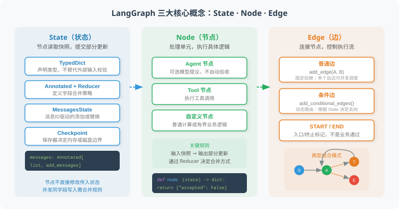

# 11.2 LangGraph 核心概念：节点、边、状态

本节用一个离线的“发布资料检查”练习理解状态流转：版本/负责人检查与回退说明检查并行执行，汇聚后才作出验收结论。节点不必调用模型，图也不会替你证明业务正确。



## 先运行，再读三个概念

本章核对环境为 Python 3.11+、`langgraph==1.2.16`，依赖锁定在仓库的 `examples/requirements.txt`。官方页面可能更新，本节以该锁定版本和离线测试界定可复现范围。从仓库根目录运行：

```bash
python -m pip install -r examples/requirements.txt
python -m reference_code.langgraph_patterns core
python -m unittest examples.integration_tests.test_langgraph_chapter -v
```

完整实现位于 `reference_code/langgraph_patterns/`，其中 `core.py` 对应本节，`review.py` 和 `approval.py` 分别对应11.4、11.5。默认无模型、Key和网络；这些是生命周期练习，不测模型理解能力。11.3的模型/工具消息循环继续使用共享的 `examples/framework_fixture.py`。

## State定义字段，Node返回部分更新

`TypedDict`表达字段契约，不自动校验所有外部输入。节点读取本步状态，返回需要更新的字段；不要直接修改传入列表或假设另一个并行节点已经写入结果。下面导入的三个检查函数均有真实实现，返回 `checks` 或 `accepted` 的部分更新：

```python
from typing import Annotated, TypedDict
import operator
from langgraph.graph import START, END, StateGraph
from reference_code.langgraph_patterns.core import (
    audit_input, check_metadata, check_rollback, summarize,
)

class AuditState(TypedDict):
    draft: dict[str, str]
    checks: Annotated[list[dict], operator.add]
    accepted: bool

builder = StateGraph(AuditState)
builder.add_node("metadata", check_metadata)
builder.add_node("rollback", check_rollback)
builder.add_node("summarize", summarize)
builder.add_edge(START, "metadata")
builder.add_edge(START, "rollback")
builder.add_edge(["metadata", "rollback"], "summarize")
builder.add_edge("summarize", END)
app = builder.compile()

result = app.invoke(audit_input({"version": "1.0", "owner": "team"}))
assert len(result["checks"]) == 2
assert result["accepted"] is False  # missing rollback
print(sorted(result["checks"], key=lambda check: check["name"]))
```

`check_metadata`只检查版本和负责人字段非空，`check_rollback`只检查回退说明非空；`summarize`核对两个检查名齐全且均通过。这是明确的小型验收契约，不是对发布方案质量的完整证明。把 `rollback` 加入资料后再运行，可以观察 `accepted=True`。

## Reducer决定合并，并发不是最后写入者获胜

| 字段规则 | 顺序更新 | 同一super-step多个节点写入 |
|---|---|---|
| 未声明reducer | 通常替换该字段 | 普通单值字段会触发 `InvalidUpdateError`，不是悄悄覆盖 |
| `Annotated[list, operator.add]` | 拼接旧列表与新列表 | 合并各分支的更新，不按业务完成先后作排序承诺 |
| `add_messages` / `MessagesState` | 按消息ID添加或替换 | 仍需正确的消息ID与应用自己的业务合并规则 |

本例为 `checks` 指定列表拼接；两个分支只提交自己的一个检查结果，避免把完整旧列表重复追加。汇总依据检查名，不依赖并行结果顺序。列表拼接不去重，也不是可交换的通用合并策略；重试、重复业务事件或同名结果冲突需另定规则。不存在适用于所有字典的“自动深合并”。无reducer的并发冲突有[官方错误说明](https://docs.langchain.com/oss/python/langgraph/errors/INVALID_CONCURRENT_GRAPH_UPDATE)。

消息列表通常使用LangGraph的 `add_messages`，而非无条件 `operator.add`。同ID表示替换原消息，不代表自动发现内容相同的业务事件：

```python
from langchain_core.messages import HumanMessage
from langgraph.graph import add_messages

messages = add_messages(
    [HumanMessage(content="draft", id="request-1")],
    [HumanMessage(content="corrected", id="request-1")],
)
assert len(messages) == 1
assert messages[0].content == "corrected"
```

## Edge安排执行，compile建立可调用图

两个 `START` 出边使检查节点在同一super-step被调度；这不保证CPU加速，也不表示每个分支能立即读到另一个分支的更新。`add_edge(["metadata", "rollback"], "summarize")` 是显式汇聚屏障：两者完成后才汇总。`START/END` 是入口/终止标记；到 `END` 只说明本次图执行结束。

`compile()`检查并建立图，之后才有 `invoke/stream/get_state` 等运行接口。它不自动安装持久化、授予工具权限或验证任务结果。若某个必需分支抛出异常，不能因为另一个分支完成就宣称整体通过。节点与边的接口见[官方Graph API说明](https://docs.langchain.com/oss/python/langgraph/graph-api)。

## Checkpoint的范围取决于保存器

下面真实检查同一保存器重建图后能读到快照，而新建内存保存器没有旧状态：

```python
from langgraph.checkpoint.memory import InMemorySaver
from reference_code.langgraph_patterns.core import audit_input, build_audit_graph

saver = InMemorySaver()
app = build_audit_graph(checkpointer=saver)
config = {"configurable": {"thread_id": "audit-1"}}
app.invoke(audit_input({"version": "1.0", "owner": "team"}), config)
snapshot = app.get_state(config)
assert snapshot.values["accepted"] is False
assert snapshot.next == ()  # ended, not waiting for approval

rebuilt = build_audit_graph(checkpointer=saver)
assert rebuilt.get_state(config).values == snapshot.values
fresh = build_audit_graph(checkpointer=InMemorySaver())
assert fresh.get_state(config).values == {}
```

本版本 `MemorySaver` 是 `InMemorySaver` 的别名。快照按执行super-step边界保存，不是在函数内每一行存盘；`thread_id`定位一条执行历史，缺少必要配置会报错。复用thread可能继续累积reducer字段；新业务任务应使用新thread，不能把 `checks=[]` 当成列表reducer的清空操作。

| 数据 | 本练习实际保存在哪里 | 重启或重新创建对象后 |
|---|---|---|
| `InMemorySaver`图检查点 | 当前保存器的进程内存 | 丢失；同一个thread名称不能重新生成旧状态 |
| 11.5的SQLite收据 | 应用自己的本地数据库 | 文件仍在时可重新读取，但它不是图检查点 |
| 磁盘/服务型checkpointer | 另装并锁定的对应保存器及存储 | 需验证连接生命周期、序列化、权限和恢复流程后才能声明可恢复 |

本锁定练习没有安装 `langgraph-checkpoint-sqlite`，不把SQLite保存器当成现成能力。若扩展使用 `SqliteSaver.from_conn_string`，需按[官方上下文管理接口](https://reference.langchain.com/python/langgraph.checkpoint.sqlite/SqliteSaver/from_conn_string)使用并让连接覆盖整个图运行；应增加两个独立进程的暂停/恢复测试。选用数据库并不自动满足多进程并发、权限或生产部署要求。[官方持久化说明](https://docs.langchain.com/oss/python/langgraph/persistence)区分了内存保存器与持久化后端。

## 错误与预算留到应用契约中

可预期的业务“不通过”可以保留在状态中；已知的适配器异常可以转为结构化失败。编程错误、授权拒绝和取消不能一律包装成“让模型再试一次”。`recursion_limit`限制图super-step数，既不是墙钟超时，也不是工具调用/token预算；11.4会增加独立业务次数限制，并测试耗尽时不放行。

运行上面的集成测试，可核对并发冲突、消息ID替换、汇聚和内存快照边界。它们证明此小型契约及接口可执行，不证明通用审查质量。

*下一节：[11.3 构建你的第一个 Graph Agent](./03_first_graph_agent.md)*
