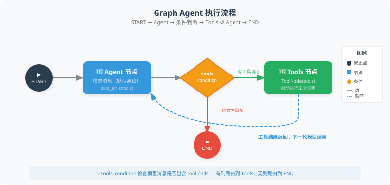

# 11.3 构建你的第一个 Graph Agent

本节把一个工具循环写成显式的状态图：`agent → tools → agent`，没有工具请求时结束。重点是观察消息怎样经过节点、条件边怎样选择下一步，以及循环怎样被上限停止。

默认使用固定响应的离线模型：它把输入原文当作算术表达式，先请求 `calculate`，收到工具结果后原样返回。这能验证真实框架的工具调用链路，不能证明模型理解了自然语言或会自主规划。完整入口为 [first_graph_agent.py](https://github.com/Haozhe-Xing/agent_learning/blob/main/examples/chapter13/first_graph_agent.py)，与10.3共用 [framework_fixture.py](https://github.com/Haozhe-Xing/agent_learning/blob/main/examples/framework_fixture.py)，避免维护两份替身。

## 先运行，再阅读图

在仓库根目录、已安装 [examples/requirements.txt](https://github.com/Haozhe-Xing/agent_learning/blob/main/examples/requirements.txt) 的环境中运行。本节验证版本为 `langgraph==1.2.16`：

```bash
python -m examples.chapter13.first_graph_agent
python -m examples.chapter13.first_graph_agent --stream
```

默认表达式是 `sqrt(144) + 2 * 3`，工具结果为 `18`。`--stream` 显示的节点顺序应为 `agent → tools → agent`。最后的 `completed` 只表示这个工具循环正常结束；离线替身与算术工具的固定用例不等于模型质量评测。



图中的 Agent 节点可接真实模型；本节默认用固定响应替代这一步，工具节点和条件路由仍由已安装的 LangGraph 执行。

## 一个可运行的最小工具循环

下面代码可在同一环境、仓库根目录直接执行。工具、模型和消息类均有明确来源：

```python
from langchain_core.messages import HumanMessage, SystemMessage
from langgraph.graph import START, MessagesState, StateGraph
from langgraph.prebuilt import ToolNode, tools_condition

from examples.framework_fixture import FixedToolChatModel, calculate

model = FixedToolChatModel().bind_tools([calculate])

def agent_node(state: MessagesState) -> dict:
    messages = state.get("messages", [])
    if not messages:
        raise ValueError("provide at least one input message")
    response = model.invoke([
        SystemMessage(content="Use calculate for arithmetic. Preserve tool failures in the reply."),
        *messages,
    ])
    return {"messages": [response]}

graph = StateGraph(MessagesState)
graph.add_node("agent", agent_node)
graph.add_node("tools", ToolNode([calculate]))
graph.add_edge(START, "agent")
graph.add_conditional_edges("agent", tools_condition)
graph.add_edge("tools", "agent")
app = graph.compile()

events = list(app.stream(
    {"messages": [HumanMessage(content="sqrt(144) + 2 * 3")]},
    config={"recursion_limit": 8},
    stream_mode="updates",
))
print([next(iter(event)) for event in events])
print(events[1]["tools"]["messages"][0].content)
```

观察四处连接：

1. `MessagesState` 为消息列表提供状态合并规则，节点返回本轮新增消息。
2. `agent_node` 调用绑定了工具定义的模型，返回 `AIMessage`。
3. `tools_condition` 检查消息中的工具请求；存在请求就进入名为 `tools` 的节点，否则结束。
4. `ToolNode` 执行已注册的工具并写入 `ToolMessage`，随后沿固定边回到 `agent`。

`calculate` 复用第3章的 [受限算术解释器](https://github.com/Haozhe-Xing/agent_learning/blob/main/examples/chapter03/safe_math.py)，只接受列明的数值、运算和函数，并限制表达式长度、树大小、幂指数和数值范围。它没有使用 `eval()`，也不是能执行任意 Python 的通用沙箱。非法表达式返回结构化工具错误；宿主 CLI 检查这些错误并以非零退出码结束。

## 看见停止，不把停止当作通过

以下两条命令分别观察工具拒绝和图步骤上限：

```bash
python -m examples.chapter13.first_graph_agent --expression "__import__('os').getcwd()"
python -m examples.chapter13.first_graph_agent --recursion-limit 1
```

第一条返回 `tool_failed`；第二条捕获 `GraphRecursionError`，返回 `budget_exhausted`。两者退出码均为 `1`。`recursion_limit` 限制图的执行步数，不是单个工具的耗时限制，也不能直接当成工具调用总数：一条模型消息可能包含多个工具请求。真实应用还需按工具的成本和副作用制定独立预算。

测试位于 [test_first_graph_agent.py](https://github.com/Haozhe-Xing/agent_learning/blob/main/examples/integration_tests/test_first_graph_agent.py)，实际覆盖工具往返、无工具请求时直接结束、重复请求被步数上限停止、空输入拒绝及 CLI 失败退出：

```bash
python -m pytest examples/integration_tests/test_first_graph_agent.py -q
```

## 与10.3的取舍，以及尚未配置的能力

| 选择 | 本节可以观察的内容 | 需要另外设计或配置 |
|---|---|---|
| 10.3的 `create_agent` | 用较少装配代码运行工具循环 | 自定义任务验收、权限及预算策略 |
| 本节的 `StateGraph` | 显式编写节点、消息状态、条件边和返回边 | 自定义状态与终止规则，以及同样的业务验收 |
| 检查点 | 本节的 `compile()` 没有传入 checkpointer | 配置检查点存储与 `thread_id`；内存存储不会跨进程保留 |
| 人工中断与恢复 | 本节没有审批节点 | 明确调用 `interrupt()`，配置 checkpointer 和线程标识，再通过 `Command(resume=...)` 恢复 |

不要把“能用图表达”理解成每个 Agent 都必须迁移。简单循环可继续用 `create_agent`；自写循环或状态机也可以。需要独立观察或修改生命周期中的状态、分支和返回路径时，再比较显式图所带来的收益与维护成本。检查点及人工中断的配置见官方 [Persistence](https://docs.langchain.com/oss/python/langgraph/persistence) 与 [Interrupts](https://docs.langchain.com/oss/python/langgraph/interrupts)，图模型与步数限制见 [Graph API](https://docs.langchain.com/oss/python/langgraph/graph-api)。

## 选做：连接真实模型

配置好模型服务凭据后，显式运行：

```bash
python -m examples.chapter13.first_graph_agent --real --model gpt-4.1-mini
```

此路径使用有超时和有限重试的 `ChatOpenAI`，会产生真实服务请求。默认离线测试没有验证该服务是否可用、模型是否选择正确工具，或它的最终回答是否完整；这些需要另做固定任务验收。`--real` 保留相同的图结构，便于比较模型消息与离线消息的差异。

---

*下一节：[11.4 条件路由与循环控制](./04_conditional_routing.md)*
