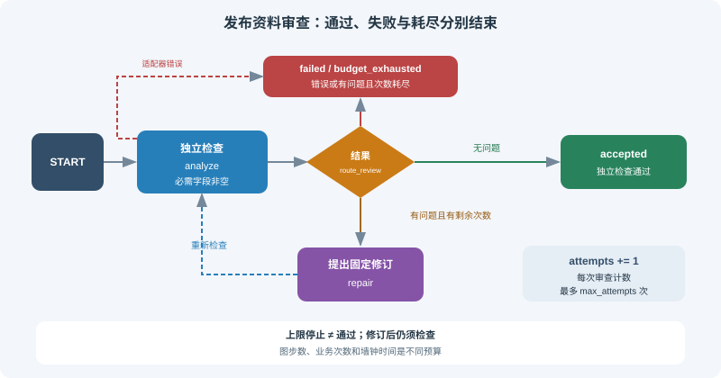

# 11.4 条件路由与循环控制

11.3的 `tools_condition` 只决定是否转向工具。本节加入业务判断：发布资料缺少必需字段时提出修订，再由独立检查函数复查；通过、检查失败和次数耗尽是不同终态。达到上限必须停止，不能把“停止”写成“通过”。



## 运行有限修订练习

使用11.2的锁定环境，从仓库根目录运行：

```bash
python -m reference_code.langgraph_patterns review
python -m reference_code.langgraph_patterns review --no-repair --max-attempts 2
```

第一条输出 `status="accepted"`、`attempts=2`：第一次检查缺回退说明，固定修订器补上，第二次检查通过。第二条保留资料不变，输出 `status="budget_exhausted"`、`accepted=false`、未解决的 `findings`，退出码为1。

真实实现见 `reference_code/langgraph_patterns/review.py`。它不执行代码、不调用模型；审查器只检查 `version/owner/rollback` 为非空字符串，修订器只会提出一个固定回退说明。把审查和修订分开，便于替换提议者而保留独立契约，但这不是通用代码审查质量实验。

```python
from reference_code.langgraph_patterns.review import run_review

draft = {"version": "1.0", "owner": "release-team"}
result = run_review(draft, max_attempts=3)
assert result["status"] == "accepted"
assert result["attempts"] == 2  # review, repair, independent recheck
assert result["findings"] == []

def keep_draft(draft, findings):
    return draft

failed = run_review(draft, max_attempts=2, repairer=keep_draft)
assert failed["status"] == "budget_exhausted"
assert failed["accepted"] is False
assert failed["findings"] == ["rollback"]
print(failed["status"], failed["attempts"], failed["findings"])
```

## 路由先区分结果，再看是否还允许修订

下面是实际路由规则。`max_attempts`计数的是**审查次数**，包括第一次审查，不是修复次数；最多有 `max_attempts-1` 次修订机会。最后一次审查若通过仍可接受，有未解决问题则耗尽：

```python
from typing import Literal
from reference_code.langgraph_patterns.review import ReviewState

def route_review(state: ReviewState) -> Literal["accept", "repair", "exhausted", "fail"]:
    if state["status"] == "failed":
        return "fail"
    if not state["findings"]:
        return "accept"
    if state["attempts"] >= state["max_attempts"]:
        return "exhausted"
    return "repair"

assert route_review({"status": "running", "findings": ["rollback"],
                     "attempts": 2, "max_attempts": 2}) == "exhausted"
```

图的连接关系为：

```text
START → analyze
  analyze → accept → END                检查通过
  analyze → exhausted → END             仍有问题且无剩余次数
  analyze → fail → END                  已知错误或无效结果
  analyze → repair → analyze            有剩余次数，修订后必须复查
  repair  → fail → END                  修订适配器失败
```

`add_conditional_edges("analyze", route_review, {...})` 映射符号到节点；路由函数不执行修订，也不把结果写成通过。不要再为同一个源节点添加无条件的成功边，期待条件边会取消它——两种边可以同时安排后继。节点返回部分状态更新，条件函数读取应用了本次更新后的状态。

## 错误不能被解析成“没有发现问题”

实现对可预期的 `AdapterError` 和无效返回值给出 `failed`，保留原因，不进入接受节点。实际编程错误继续抛出，交给调用者记录和排查；不要用裸 `except` 把任何失败转成空问题列表。即使改用结构化模型输出，字段验证也发生在运行时，且类型正确不代表业务判断正确。

```python
from langgraph.errors import GraphRecursionError
from reference_code.langgraph_patterns.review import AdapterError, run_review

def unavailable(draft):
    raise AdapterError("review unavailable")

result = run_review({}, reviewer=unavailable)
assert result["status"] == "failed"
assert result["accepted"] is False

try:
    run_review({}, recursion_limit=1)
except GraphRecursionError:
    print("graph step budget exceeded; no approval")
else:
    raise AssertionError("expected GraphRecursionError")
```

`recursion_limit` 是图super-step的额外上限，放在config顶层。它触发 `GraphRecursionError`，不是墙钟超时，也不是业务重试次数。`run_review`按有限拓扑为默认上限留出接受/失败节点的空间；刻意把该上限设成1会触发上面演示的错误。真实模型/网络调用还需自己的调用次数、token、时间和取消策略。提高图上限不能修复错误路由。接口见[官方循环与递归限制说明](https://docs.langchain.com/oss/python/langgraph/graph-api#recursion-limit)。

## 单路分流、并行分发和汇聚的区别

| 目的 | 返回或连接方式 | 还需定义的契约 |
|---|---|---|
| 选择一条业务分支 | 条件函数返回一个映射符号 | 未知/错误输入的失败分支 |
| 调度多个已知分支 | 多条出边，或条件函数返回多个目标 | 并发写入reducer、错误及汇聚屏障，见11.2 |
| 动态逐项分发 | `langgraph.types.Send`携带各项输入 | 项数/并发预算、空任务情况、结果ID及合并规则 |

返回一个字符串的互斥分流不应称为并行fan-out；`Send`也不是“LangGraph 2.0才引入”的能力。本节只运行有限单路修订；不把未实现的动态map-reduce当成已提供功能。`stream(..., stream_mode="updates")` 可观察节点更新；日志中的一次节点更新仍不是业务通过证明。

## 验收与下一步

本节测试覆盖：首次通过、最后一次通过、持续失败耗尽、无效审查、适配器失败、编程异常和图步数上限。修改 `fixture_repair`使它保持原稿，再运行测试，确认上限后仍未接受。若要把终态交给人工处理，进入11.5的显式暂停协议；到 `END` 不会自动创建可恢复审批。

*下一节：[11.5 Human-in-the-Loop：人机协作](./05_human_in_the_loop.md)*
