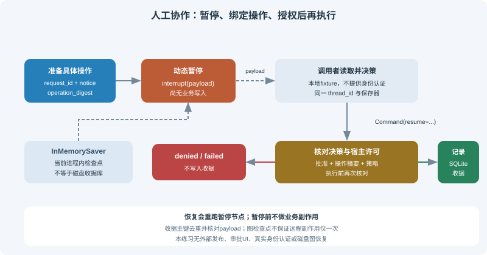

# 11.5 Human-in-the-Loop：人机协作

人工协作需要明确的暂停和恢复协议。把条件边连到 `END` 会结束本次图执行，不等于暂停；有checkpointer也不表示自动识别危险工具或授予审批权限。本节用“记录一条本地发布收据”演示完整流程，不发送邮件、不删除文件、不执行支付。



## 先运行本地审批练习

使用11.2的环境，在仓库根目录运行：

```bash
python -m reference_code.langgraph_patterns approval
python -m reference_code.langgraph_patterns approval --decision approve
```

默认拒绝返回 `status="denied"`、`receipt_count=0`和退出码1；显式选择本地批准fixture后返回 `status="recorded"`、`receipt_count=1`。CLI使用内存检查点和临时内存收据库，退出后不续跑。这些命令演示协议，不是安全身份认证或外部发布服务。

## interrupt与Command构成动态恢复协议

实现见 `reference_code/langgraph_patterns/approval.py`。`prepare`固定待审批的请求ID、正文和摘要；`approve`调用 `interrupt(payload)`；调用者从 `__interrupt__` 取回具体操作，再用同一thread和保存器提交 `Command(resume=decision)`。只有决策结构、操作摘要和宿主策略都通过，才进入独立的收据写入节点。

```python
from langgraph.checkpoint.memory import InMemorySaver
from langgraph.types import Command
from reference_code.langgraph_patterns.approval import (
    ReceiptLedger, approval_input, build_approval_graph, local_demo_policy,
)

entries = []
def observe_entry():
    entries.append("entered")

with ReceiptLedger() as ledger:
    app = build_approval_graph(
        ledger, checkpointer=InMemorySaver(), authorize=local_demo_policy,
        on_approval_entry=observe_entry,
    )
    config = {"configurable": {"thread_id": "release-1"}, "recursion_limit": 8}
    paused = app.invoke(approval_input(), config)
    pending = paused["__interrupt__"][0].value
    assert paused["status"] == "waiting"
    assert app.get_state(config).next == ("approve",)
    assert ledger.count() == 0

    # Local policy fixture, not proof of a real user's identity.
    decision = {"approved": True, "reviewer": "reviewer-1",
                "operation_digest": pending["operation_digest"]}
    result = app.invoke(Command(resume=decision), config)
    assert result["status"] == "recorded"
    assert ledger.count() == 1
    assert entries == ["entered", "entered"]  # node restarted on resume
    print(result["status"], result["receipt"])
```

暂停值必须可序列化。`Command(resume=...)` 的值成为 `interrupt()` 的返回值；恢复时会从 `approve` **函数开头重跑**，不是从暂停行之后直接继续。上例的观测列表因此有两条记录，但暂停前没有业务写入。不要用宽泛的 `try/except` 包住 `interrupt()` 并吞掉控制异常，也不要随意改变同一节点内多个interrupt的顺序。[官方interrupt接口](https://reference.langchain.com/python/langgraph/types/interrupt)明确了节点重跑及恢复值的语义。

## 暂停、同意和授权分别检查

本例中的 `local_demo_policy` 只是固定策略fixture：它允许 `reviewer-1` 这个演示值，**不能证明输入者真是该用户**。部署时宿主必须认证调用者，检查其对该thread和该操作的权限，再把可信身份交给策略。不能把调用者自填的名字、`approved=true`或已暂停状态当成授权。

审批判断和执行前复查两处，授权回调都必须明确返回布尔值 `True`。`1`、`"yes"` 或非空字典等真值不构成授权；前一次批准也不能跳过执行前的重新检查。

| 条件 | 本例结果 | 业务副作用 |
|---|---|---|
| 尚未提交决策 | `waiting`，有待恢复任务 | 无 |
| 显式拒绝或策略不允许 | `denied` | 无 |
| 决策类型错误/旧操作摘要 | `failed` | 无 |
| 暂停后修改正文，仍拿旧批准执行 | 执行前摘要复查失败 | 无 |
| 审批已通过，但执行前授权不再明确为 `True` | `failed` | 无 |
| 同意、摘要和宿主策略均通过 | `recorded` | 仅本地SQLite收据 |

改参数后应重新生成审批请求并再次确认，不能把对旧正文的批准沿用到新正文。`update_state`只是状态编辑接口，既不是审批凭据，也不会撤销已经发生的外部操作。`thread_id`是查询执行历史的标识，同样不是凭证。

## END、静态断点和动态interrupt不是同一件事

| 机制 | 会留下什么 | 如何继续 |
|---|---|---|
| 条件边到 `END` | 完成的本次执行，无该分支的待执行节点 | 新输入可以开始新一轮，但这不是恢复审批 |
| `compile(interrupt_before=[...])` 静态断点 | 在已配置节点前暂停，不能自动判定业务风险 | 在确认待执行节点和状态后，用同配置 `invoke(None, config)`继续 |
| 节点内 `interrupt(payload)` | 带操作内容的动态待输入点 | 同thread使用 `Command(resume=decision)` |
| 节点实际执行失败 | 错误和可供恢复的检查点，取决于保存器及成功写入 | 修复原因后可用 `invoke(None, config)`重试待执行任务 |

静态断点可以用于调试，但不等于完整的业务审批门。动态interrupt的示例没有 `interrupt_before`；也不把“安全工具”这个名称当作跳过权限检查的理由。[官方中断说明](https://docs.langchain.com/oss/python/langgraph/interrupts)区分了这两类暂停。

## 重放要有业务幂等键，不能只依靠检查点

写入收据后、写完图检查点前仍可能崩溃。重试该节点会再次调用业务写入，因此 `ReceiptLedger` 使用固定 `request_id` 主键与完整payload：相同请求重复提交返回同一收据；同ID不同内容报冲突。它是一个小型SQLite事务契约，不是对任意远程工具的“恰好一次”保证。

测试会故意在收据提交后抛错，再执行 `invoke(None, config)`，验证写入节点调用两次而数据库仍只有一条收据。运行：

```bash
python -m unittest examples.integration_tests.test_langgraph_chapter.ApprovalTests -v
```

对远程发送/支付，要由对方支持幂等键或建立可核对的执行日志及对账协议；不要把“图恢复成功”当成副作用只发生一次。审批之前的副作用尤其危险，应该移到审批后，并保持可重试。读取历史checkpoint重放也不会撤销之前已发送的消息。

## 保存器、预算与恢复条件

本例的 `InMemorySaver` 只能在当前对象仍在时恢复；以同一保存器重建图可续跑，换新保存器就没有旧状态。`ReceiptLedger(path)`的文件可重新打开，但文件中的业务收据不包含LangGraph恢复任务。磁盘checkpointer需要单独依赖、连接管理和跨进程测试，见11.2；本节没有实现这部分，也不推荐某个后端作为通用生产默认。

本地图拓扑有限，并显式设置 `recursion_limit=8`。这不限制审批等待时长，也不使阻塞工具自动超时。实际审批系统需要宿主定义过期、撤销、重试次数和资源策略；过期批准不得继续执行。认证、审批UI、通知链路、跨进程恢复和远程服务均不是本练习已经提供的能力。

测试覆盖暂停前零写入、拒绝/无效批准、thread隔离、操作变化、节点重入，以及提交后故障重试不重复收据。先通过这些可复现边界，再扩展11.6的工作流。

*下一节：[11.6 实战：工作流自动化 Agent](./06_practice_workflow_agent.md)*
