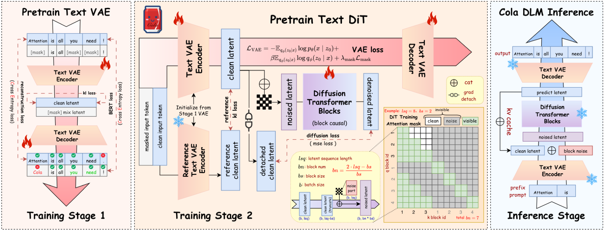

# 2.6 基座模型前沿进展与选型指南

Agent 的任务成功率由模型、工具、上下文和运行时共同决定。选模型时，先把任务和通过条件写下来，再验证候选模型能否在同一套工具和预算下完成任务。

## 四个影响 Agent 的模型趋势

**推理预算。** 一些模型允许为复杂请求分配更多推理计算。多步规划、代码修改和约束检查可能受益，短问答和意图分类通常更关心时延。对同一批任务测不同预算下的成功率、端到端延迟和花费。

**混合专家（MoE）。** MoE 的路由器为每个 token 选择部分专家执行。总参数影响权重存储，激活参数影响计算量。实际服务的吞吐量还受批大小、硬件、通信、量化和 KV cache 约束。报告自部署成本时，应同时写清吞吐量和峰值显存。

**开放权重。** 开放权重模型可用于自部署、量化和微调。上线前检查具体版本的权重许可证、商用条款、推理框架兼容性和所需硬件。许可证和权重版本应跟评估结果一起记录。

**长上下文与多模态。** 文本窗口、最大输出、所支持的输入模态和可调用的工具是不同的 API 属性。逐项核验模型 ID 与端点。对需要长期运行的任务，还要测检索、压缩、检查点与恢复。参见[长时程上下文策略](../chapter_context_engineering/03_long_horizon.md)和[多模态实战](../chapter_25_multimodal/README.md)。

## 模型与 API 规格示例

下表是 **2026-11-27** 核验的几个示例，方便区分历史型号和近期 API 变化。

| 类型 | 型号与时间 | 和 Agent 有关的规格 |
|---|---|---|
| 历史参照 | GPT-5.5，2026-04-23 发布 | OpenAI API 规格为 1,050,000 token 上下文。参见[发布公告](https://openai.com/index/introducing-gpt-5-5/)及[模型规格](https://developers.openai.com/api/docs/models/gpt-5.5)。 |
| 历史参照 | Claude Opus 4.8，2026-05-28 发布 | Claude API 文档列出 1M token 上下文。参见[发布公告](https://www.anthropic.com/news/claude-opus-4-8)及[模型规格](https://platform.claude.com/docs/en/models/opus-4-8/overview)。 |
| API 兼容性 | GPT-6.2 Astra / Sol，2026-11-17 上线 API | 两者支持 Responses 和 Chat Completions。工具调用使用 Responses。参见 [OpenAI API 更新记录](https://developers.openai.com/api/docs/changelog)。 |

## 如何选型

1. **准备一组代表性任务。** 覆盖正常任务、工具失败、权限拒绝和恢复。用可检查的结果定义成功，例如补丁通过独立测试或任务状态与业务记录一致。
2. **核对模型和端点。** 记录模型快照、工具调用和结构化输出支持、输入与输出限制、计价方式。把接入限制在试验前核实清楚。
3. **做受控比较。** 固定工具、Harness、任务和预算，每个配置重复运行。记录成功率、成功任务成本、P95 延迟以及需要人工接管的比例。
4. **确定升级门槛。** 先在基线模型上跑通，再评估更强模型是否在失败样本上带来可接受的提升。用固定回归集检查后续模型或 Harness 更新。

报表可用这样的列：`模型快照 | Harness 提交 | 数据集版本 | 成功率 | 单个成功任务成本 | P95 延迟 | 失败类型`。如果框架、工具或运行预算也发生变化，在报告里单独记下。详见[第 20 章评估](../chapter_20_evaluation/README.md)。

## 案例阅读

### 模型研究选读（2026）

### [Cola DLM：连续隐空间扩散语言模型——非自回归文本生成新范式（2026）](https://arxiv.org/abs/2605.06548)

> 🧬 **一句话**：把文本生成从"逐 token 自回归"搬到"连续隐空间分层扩散"，统一了 AR、离散去噪与连续 token 空间方法的理论框架。

**核心问题**：主流大语言模型清一色自回归（AR）逐 token 生成，但 AR 范式天然受限于串行解码、难以全局规划。离散去噪语言模型和连续 token 空间方法虽各有探索，却缺乏统一理论框架来横向对比与优势互补。

**方法介绍**：Cola DLM（Continuous Latent Diffusion Language Model）提出分层连续隐变量语言模型：先用 **Text VAE** 把文本映射到连续隐表示，再用 **block-causal 扩散 Transformer** 在隐空间建模全局语义先验，最后解码生成文本。它在严格概率定义下，把 Cola DLM 与 AR 模型、离散去噪语言模型、连续 token 空间方法纳入同一理论框架对比。整体工作流见下图：

> 图源：Cola DLM 论文（来源：2026, arXiv:2605.06548，字节跳动 Seed）

**关键结果**：在 4 个研究问题、8 个基准上与约 20 亿参数的自回归基线严格对比，验证了强扩展性；代码与检查点已以 Apache 2.0 开源。

**与本章关系**：对应 2.7 基座模型架构详解，代表语言模型从自回归范式向扩散范式探索的重要前沿，有助于理解未来基座模型的多样化架构方向。

---

### [字节跳动 Seed 2.0：面向真实世界复杂性的智能前沿（2026）](https://arxiv.org/abs/2607.00248)

**发表**：2026 年 6 月 30 日 | [arXiv:2607.00248](https://arxiv.org/abs/2607.00248)

**核心贡献**：字节跳动发布 Seed 2.0 模型系列，以用户真实需求为出发点，构建了可靠的前瞻性评估体系，重点攻克长尾知识和复杂指令遵循两大持久挑战，同时在推理智能、视觉理解和搜索能力方面达到世界领先水平。模型卡通过大量真实世界用例展示了 Seed 2.0 在复杂长时程任务上的初步解决能力，服务数亿用户。

**与本章关系**：对应本章「前沿基座模型全景」，是 2026 年下半年国内顶级大模型的重要发布节点，与 Qwen3、GLM-5.1 系列共同代表国内基座模型竞争格局的最新进展，对关注 Agent 骨干模型选型具有直接参考价值。

---

### [Soofi S 30B-A3B：混合 Mamba-Transformer MoE 主权开源基座模型（2026）](https://arxiv.org/abs/2607.09424)

**发表**：2026 年 7 月 10 日 | [arXiv:2607.09424](https://arxiv.org/abs/2607.09424)

**核心贡献**：Soofi S 30B-A3B 是面向德语和英语的主权开源 MoE 混合 Mamba Transformer 基座模型。其混合设计每 token 仅激活 30B 参数中的 3B，且推理缓存在上下文增长时保持**近恒定**，在长上下文、高并发部署场景下相比密集模型具有显著吞吐优势。在约 27 万亿 token 上预训练，刻意提升德语权重，在英语和德语综合基准上匹配密集 14–27B 模型，在两个语言的代码聚合指标上领先 17 个开源基座模型，并超越所有欧洲主权基线。在完全开源模型中取得最高英德评估分数，超越 Olmo 3 32B 和 Apertus 70B。权重、中间检查点、完整数据来源清单、超参数和训练/评估代码均以宽松条款开源。

**与本章关系**：对应 2.7 基座模型架构详解，Soofi S 代表了 Mamba-Transformer 混合架构在 MoE 配置下的最新大规模验证——近恒定推理缓存特性对长上下文 Agent 部署具有直接工程价值，与 Cola DLM（扩散范式）共同展示自回归之外基座模型架构的多样化探索方向。

---
### [GLM-5.3-Flash：Z.ai 首款原生多模态开源 MoE 模型，MIT 许可、百万上下文（2026）](https://arxiv.org/abs/2602.15763)

**发表**：2026 年 8 月 26 日正式发布 | 技术报告 [arXiv:2602.15763](https://arxiv.org/abs/2602.15763)

**核心贡献**：Z.ai 于 2026 年 8 月 26 日发布 GLM-5.3-Flash，是 GLM-5 系列首款原生多模态模型。关键参数：320B 总参数 / 18B 激活参数（MoE），首次采用**混合稀疏注意力 + 线性注意力**架构（业界首个在前沿开源模型中使用此设计），搭配 Manifold-Constrained Hyper-Connections（mHC），最大上下文 **1,048,576 tokens**，MIT 许可开放权重。Z.ai 自测显示相比 GLM-5.2 在 Agent 基准上提升显著：DeepSWE v1.1 +17.2pp（63.4 vs 46.2）、AutomationBench v1.0.6 +22.6pp（48.8 vs 26.2）、Toolathlon Verified +18.5pp。正式发布前以"Ox Alpha"名义在 OpenRouter 运行约一周，期间处理约 23.2 万亿 token。通过 SGLang/vLLM/TokenSpeed/KTransformers 支持本地部署。

**与本章关系**：直接对应本章「基座模型图谱」与「模型架构创新」知识点，GLM-5.3-Flash 的混合 Sparse+Linear Attention 架构在长上下文推理缓存开销上具有理论优势，其 MIT 许可 + 百万上下文 + 强 Agent 基准表现的组合，使其成为目前最值得关注的开源 Agent 基座模型之一。

---
