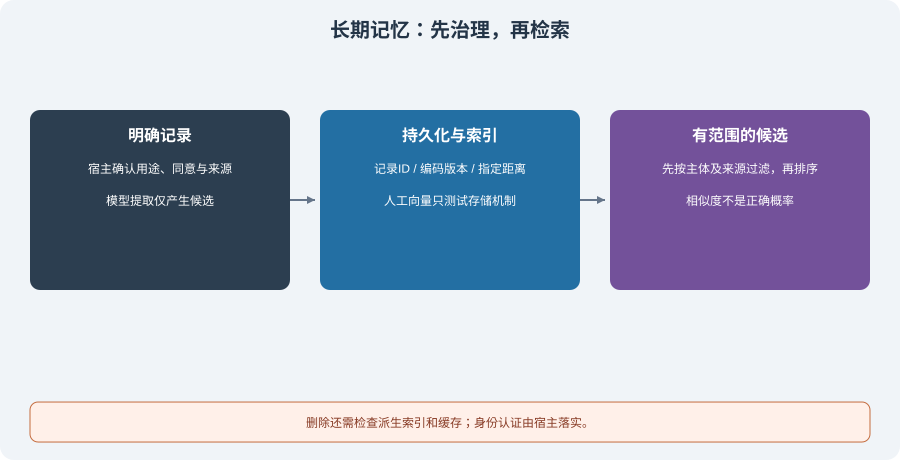

# 4.3 长期记忆：向量数据库与检索

长期记忆需要跨会话保留，但不应跨越用户、项目或同意范围。先决定什么记录可以保存、更新、检索和删除，再选择索引方式。向量数据库解决相似性候选检索，不替代这些治理要求。

## 从键查询到向量检索

用户明确问“我的回答风格偏好是什么”，按已知键查询可能比语义搜索更直接。用户问“以前讨论过哪些部署风险”，则可能需要在许多记录中检索。关键词、结构化过滤和向量表示可以组合，不能把 SQL 与自然语言场景简单对立。



向量索引用同一个编码空间表示记录与查询，再按距离选择候选。某个模型的近邻可能对应语义相似，也可能是同主题但不回答问题；维度相同不代表来自兼容编码器。模型版本、预处理和距离度量改变时，需要检查并通常重建相应索引。

余弦相似度是向量夹角的度量。不能把某个示例的 `0.4` 或 `0.9` 当成所有语言、资料和模型的通用相关性阈值，更不能把 `1 - distance` 当正确概率。只有集合使用余弦距离时，这个转换才有本节定义的意义；零向量没有可用的余弦方向。

## 可运行练习：真实 Chroma，固定人工向量

本节使用 `examples/requirements.txt` 固定的 Chroma 1.5.9。`reference_code/memory_rag/vector_memory.py` 提供 `VectorMemory`：显式传入向量，关闭默认嵌入函数，不下载模型、不调用嵌入服务。查询接口可对照[该版本集合源码](https://github.com/chroma-core/chroma/blob/1.5.9/chromadb/api/models/Collection.py)。

下面的三维向量是**人工夹具**，只用于检查存储、度量、过滤与删除；不是中文或英文的语义编码器。可从仓库根目录直接运行：

```python
from tempfile import TemporaryDirectory
from reference_code.memory_rag import VectorMemory

with TemporaryDirectory() as folder:
    memory = VectorMemory(folder)
    assert memory.search("alice", [1, 0, 0]) == []
    memory.put("alice", "style", "Use concise answers.", [1, 0, 0],
               source="explicit:1", consent=True)
    memory.put("alice", "topic", "Discuss deployment.", [0, 1, 0],
               source="explicit:2", consent=True)
    memory.put("bob", "style", "Use detailed answers.", [1, 0, 0],
               source="explicit:3", consent=True)
    hits = memory.search("alice", [1, 0, 0], source="explicit:1")
    assert [hit["id"] for hit in hits] == ["alice:style"]
    assert abs(hits[0]["cosine"] - 1.0) < 1e-6
    memory.delete("alice")
    assert memory.search("alice", [1, 0, 0]) == []
    assert len(memory.search("bob", [1, 0, 0])) == 1
```

Alice 与 Bob 的同方向向量分数都可很高，但 Bob 的记录不能出现在 Alice 的查询里。隔离先于相关性：`owner` 必须由受信宿主提供，客户端能随意选择它就没有完成身份认证。此处过滤只是数据访问组件，不是完整多租户服务。

实现的关键边界是：

- 每次读写和删除都带主体范围，记录 ID 也包含主体；同名偏好不会互相覆盖。
- 持久写入只接受 `consent is True`，保留显式 `source`；来源字符串仍需宿主核验，不能由模型自报就算可信。
- 空集合直接返回空结果；限制结果数量，组合过滤使用 `$and`，不发出零条结果请求。
- `include` 只请求 documents/metadatas/distances；ID 读取自结果字段，而不是当作可选 include 项。
- 检查向量维度、有限数值、非零范数及集合的编码版本约定，避免 NaN、零向量或不兼容索引混入。

按 source 过滤和 owner 过滤同时生效，测试还会启动第二个 Python 进程读取持久记录。它验证了持久化，不验证真实嵌入模型的召回率、用户偏好识别或生产负载。

## 从对话到记忆：提取候选不等于批准写入

自动提取可以减轻整理工作，但模型可能误解反话、混淆人物或抄入秘密。因此，本节采用下列写入流程；模型提议和宿主动作分别记录：

```text
对话/工具结果 → 提取候选（尚未写入长期库）
             → 检查类型、来源、敏感性、用途和冲突
             → 获得适用范围内的明确同意
             → 宿主写入记录与版本，保留更正/删除入口
失败或拒绝   → 保留可定位原因；不把解析失败当“没有值得记忆的信息”
```

候选应使用明确对象 Schema，而不是要求 JSON 数组却同时请求“只能返回 JSON 对象”。格式合法只说明能解析，不能证明事实、同意或权限。当前配套没有自动提取器、PII 检测或审批服务；练习中用人工记录替代提取，不以模拟置信度审批个人数据。

## 更新、冲突与删除

| 情况 | 应做的处理 | 本节已实现范围 |
|------|------------|----------------|
| 同一键的显式更正 | 认证后获得同意，更新并标明更正关系 | 基线支持同主体记录更新；完整版本审计仍需补充 |
| 事实来源相冲突 | 保存差异与来源，必要时请求确认 | 不按向量最高分自动裁决 |
| 偏好到期或用途变化 | 停止使用，按保留策略更新 | 本节没有 TTL 调度器 |
| 用户撤回 | 删除当前可检索记录，检查派生副本 | SQLite/Chroma 的主体范围逻辑删除有测试 |
| 回答引用旧摘要或缓存 | 使受影响的派生产物失效，再复核 | 尚未提供跨系统删除传播服务 |

“归档”不是“删除”的替代词。法律或业务留存、备份与安全擦除需要自己的策略；不要声称一次数据库删除清除了所有副本。更正和检索也不能把记忆升级为系统指令：召回内容应按[4.2 节](./02_short_term_memory.md)作为参考数据加入上下文。

## 验证与练习

```bash
python -m reference_code.memory_rag vectors
python examples/chapter04/long_term_memory.py
python -m unittest discover -s examples/integration_tests -p test_memory_rag_chapters.py -v
```

练习先测未同意写入、跨主体同名记录、空库、组合过滤、错误维度、零/非有限向量与删除后查询。接入真实嵌入模型前，另外冻结带独立相关性标注的任务集，记录检索召回、错误命中与删除传播结果；不能用上述人工向量夹具宣称语义质量达标。

*下一节：[4.4 工作记忆：Scratchpad 模式](./04_working_memory.md)*
