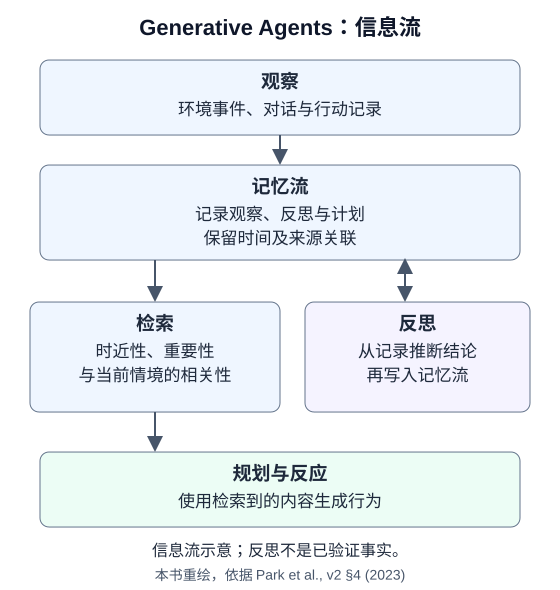
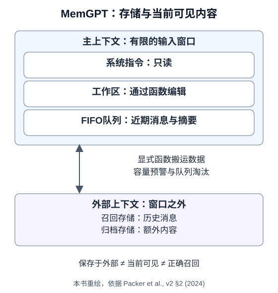
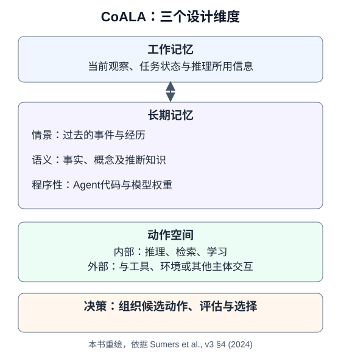

# 4.6 论文解读：记忆系统的八个设计视角

本节为选读。先完成[4.5的记忆实践](05_practice_memory_agent.md)，再用论文解释一个具体取舍。主线只要求可控的写入、隔离、召回与删除；图谱、自动巩固和多模态记忆是扩展方向。

选文与来源核对截止到2026-10-22。中英文采用相同的八篇；链接固定到下列版本或会议正式文本。这里介绍研究设计及其证据范围，没有复现论文结果，也不以论文中的系统名称替代当前产品文档。

## 阅读路线：先提出问题

| 你遇到的问题 | 建议阅读 | 读完要能说明 |
|---|---|---|
| 不知道哪些状态该放在哪里 | CoALA、MemGPT | 记忆类别与存储位置是不同维度 |
| 保存了很多经历，但难以用于当前任务 | Generative Agents、MemoryBank | 检索与压缩会引入什么取舍 |
| 答案需要关联多份材料或不同时间的事实 | HippoRAG、Zep | 图索引与时间信息解决的是哪类问题 |
| 无法判断记忆是否真的有用 | LongMemEval | 召回、读懂和答对如何分别检查 |
| 压缩后丢失图像细节或相近记录的区别 | C3M | 摘要、源指针与读取预算如何协作 |

这是一组互补视角，不是从旧方案必然进化到新方案的排名。精读两篇并完成末尾练习即可；其余可随项目需要回看。

## Generative Agents：经历如何参与决策

Park等，*Generative Agents: Interactive Simulacra of Human Behavior*；首次发表于2023年，本节据[v2，2023-08-06，§4、§6](https://arxiv.org/html/2304.03442v2)。

论文在25个虚拟居民的模拟环境中，将观察写入记忆流，用时近性、重要性和相关性组合检索，并把生成的反思重新写入，供后续规划使用。评估关注行为可信度及组件消融，不能据此推断事实正确或业务授权可靠。



**迁移到本书**：保留“观察记录”和“由记录推断的结论”之间的区别。为推断保存来源，准备一条错误反思，检查它是否会覆盖原始事实。重要性高也不能授予工具权限。

## MemGPT：上下文有限时如何管理存取

Packer等，*MemGPT: Towards LLMs as Operating Systems*；首次发表于2023年，本节据[v2，2024-02-12，§2–3](https://arxiv.org/html/2310.08560v2)。

论文把主上下文分为系统指令、可编辑工作区和FIFO消息队列，并通过函数在主上下文与外部召回/归档存储间搬运内容。队列管理器给出容量预警、执行淘汰；外部内容须显式调入才能参与本轮推理。实验涉及长对话和文档分析。



**迁移到本书**：外部可持久保存不等于当前可见或检索正确。“虚拟上下文”没有让单次窗口无限。为检索次数和返回内容设预算，记录遗漏与超限；[4.7的分层记忆练习](06b_memgpt_practice.md)是本书简化实现，不是原论文复现。

## MemoryBank：衰减与重复访问的取舍

Zhong等，*MemoryBank: Enhancing Large Language Models with Long-Term Memory*；据[v3，2023-05-21，§2、§4](https://arxiv.org/html/2305.10250v3)。

论文组织对话、事件摘要和用户画像，检索相关记忆，并探索简化的遗忘/巩固模型：$R=\exp(-t/S)$，其中$t$表示距上次学习或重置的时间，$S$随召回增加。实验包含真实对话的定性分析，以及模拟用户对话上的定量评估。

**迁移到本书**：访问频繁未必正确或重要；错误信息也可能被反复访问。比较“按时间衰减”与“保留用户明确确认的偏好”，分别记录过期误用和遗漏。降低检索权重、归档与用户要求删除是不同操作，不能用衰减代替删除。

## CoALA：把记忆、动作与决策分开

Sumers等，*Cognitive Architectures for Language Agents*；首次发表于2023年，本节据[TMLR版v3，2024-03-15，§4–5](https://arxiv.org/html/2309.02427v3)。

CoALA是组织和比较语言Agent的概念框架。它区分工作记忆与长期记忆；长期记忆包含情景、语义和程序性记忆，后者包括代码与模型权重。框架还讨论内部/外部动作及决策过程，不要求每轮依次执行“检索→推理→学习→行动”。



**迁移到本书**：先画出任务状态、用户偏好、来源片段、工具实现分别属于哪里，再为每个存储标出读写主体。分类能帮助设计，不能证明某种架构效果最好；把技能写入程序性记忆仍须经过独立验收。

## HippoRAG：用图索引连接分散证据

Jiménez Gutiérrez等，*HippoRAG: Neurobiologically Inspired Long-Term Memory for Large Language Models*；NeurIPS 2024，本节据[v3，2025-01-14，§2–3](https://arxiv.org/html/2405.14831v3)。

方法离线提取三元组并构图，加入同义关联；查询实体链接到图节点后，以个性化PageRank传播分数，再聚合为原文片段的检索排序。作者在多跳问答设置中比较检索方法。这不是“向量检索不能跨文档推理”或“图谱处处更好”的证明。

**迁移到本书**：先用[第6章的检索基线](../chapter_rag/README.md)测出跨片段漏检，再决定是否加图。固定语料、读入预算和回答器，分别测证据召回与答案支持；同时计入抽取错误和离线建图成本。

## Zep：事实何时有效，系统何时得知

Rasmussen等，*Zep: A Temporal Knowledge Graph Architecture for Agent Memory*；据[v1，2025-01-20，§2–4](https://arxiv.org/html/2501.13956v1)。

论文描述由原始事件、语义实体和社区构成的图，区分事实有效时间与系统录入时间，并对冲突边进行失效处理。作者在DMR与LongMemEval设置中评估检索和回答；这些版本和条件下的结果不能作为当前产品排名。

**迁移到本书**：若10月22日才得知“10月1日起偏好改为茶”，两个日期都应保留。分别问“现在偏好什么”和“9月偏好什么”。新到达的记录可能描述旧事实，不能仅按写入时间覆盖；时间抽取仍须核对来源。

## LongMemEval：从评估反推记忆设计

Wu等，*LongMemEval: Benchmarking Chat Assistants on Long-Term Interactive Memory*；据[ICLR 2025正式论文，§3–5](https://proceedings.iclr.cc/paper_files/paper/2025/file/d813d324dbf0598bbdc9c8e79740ed01-Paper-Conference.pdf)。

基准以500个问题覆盖信息提取、跨会话推理、时间推理、知识更新和无法回答时的弃答。论文把系统拆成索引、检索和阅读，比较存储粒度、索引键、查询与阅读策略；压成少量事实可能损失细节。

**迁移到本书**：先写独立预期，再观察失败发生在哪一层。检索到带标签的材料不等于回答正确，未知问题也应列入评估。本节末尾的小练习借鉴问题划分，不使用其数据，也不产生可与论文比较的分数。

## C3M：相似记录是否可以安全合并

Chen等，*C3M: Cross-Session Multimodal Memory Maintenance for Long-Horizon Tasks*；选读预印本[v1，2026-09-24，§2–3](https://arxiv.org/html/2609.29735v1)。

方法在未知最终查询时维护有界活跃索引，原始图文证据保存在外部存储；更新区分相同、后续状态、不同和不确定关系，查询时按页、节点、图像与文本预算展开源证据。论文实验使用MemLens的195题Agent子集。

**迁移到本书**：“相似”只够提名候选，不能直接决定合并。准备两个描述相近、日期或图像细节不同的记录，检查摘要与原始来源能否区分它们。该方法是研究扩展，不是本章必做工程；本书没有复现其多模态模型和实验结果。

## 小练习：用六个问题审查同一段历史

以下是本书自建数据。先手工写好预期，再选择4.5的本地记忆存储或另一种实现；需要时间版本时须显式扩展数据结构，当前按键覆盖的偏好表不能保存完整历史。

```text
主体：alice；这些测试记录均已明确同意保存。
r1：2026-09-10记录：报告请用中文；当前饮品偏好是咖啡。
r2：2026-10-02记录：从2026-10-01起，饮品偏好改为茶。
r3：2026-10-03记录：下一份报告只统计第三季度。
隔离对照：bob也明确同意保存b1（2026-10-03）：报告请用英文；饮品偏好是水。
```

| 问题 | 独立预期 | 要观察的失败 |
|---|---|---|
| 报告用什么语言？ | 中文，依据r1 | 原记录保留但未召回 |
| 下份报告用什么语言、统计哪个季度？ | 中文、第三季度，依据r1+r3 | 只回答一个要求 |
| 2026-09-20偏好什么饮品？ | 咖啡，依据r1及r2的生效日期 | 用当前偏好回答历史问题 |
| 2026-10-03偏好什么饮品？ | 茶，依据r2 | 旧事实覆盖新状态 |
| alice的生日是哪天？ | 信息不足，应弃答 | 因检索命中而编造答案 |
| bob能读到alice的r1–r3吗？ | 不应返回alice的记录；bob可读取自己的b1 | 相同检索词越过主体隔离 |

再撤销alice的存储记录，确认本地活动记录及可查询索引不再返回这些内容，并验证bob的b1仍可读到“英文”和“水”。演示存储的逻辑删除不等于备份、日志或磁盘残留的物理清除；它们需要各自的生命周期处理。

先报告每个问题的来源、预期、实际结果与失败阶段，再比较策略。只改变一个因素，例如检索条数或是否保存时间版本；固定其他输入和预算。这个规模足以暴露取舍，也能让项目保持适中的难度。

下一步：回到[4.5](05_practice_memory_agent.md)检查写入与删除合同，或进入[第5章](../chapter_planning/README.md)，观察记忆如何影响计划与停止条件。
