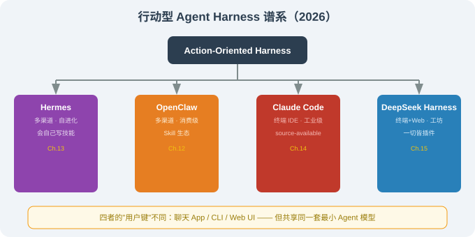
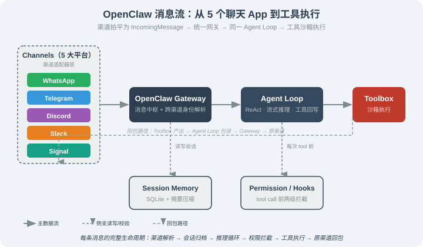

# 12.1 OpenClaw 全景：从 Clawdbot 到 OpenClaw 的演变

> 🦞 *一个周末项目如何变成现象级开源——以及它的名字为什么改了三次。*

---

## 一、为什么 OpenClaw 重要

本节从聊天入口出发：用户发送消息后，谁确认身份、选择会话并授权工具？这些问题有助于把前面的最小 Agent 与个人助理产品连接起来。

**OpenClaw** 是这类项目的一个案例。作者在[2026年1月29日的官方介绍](https://openclaw.ai/blog/introducing-openclaw)中回顾了周末原型与改名过程。本节以入口、状态和扩展边界为观察对象，不用仓库热度判断工程质量。

---

## 二、一段简短的演变史

按作者的[官方命名回顾](https://openclaw.ai/blog/introducing-openclaw)，可以确认以下顺序；没有一手依据的原型仓库名和精确中间日期不在此补写。

| 时间 | 名称或阶段 | 可确认内容 |
|---|---|---|
| 2025-11 | Clawd / WhatsApp Relay 原型阶段 | 作者回顾早期聊天消息转发实验，并将 Clawd 的起点记为2025年11月 |
| 两次命名之间 | Moltbot | 因原名称的商标顾虑调整名称，随后再次改名 |
| 2026-01-29 | OpenClaw | 官方介绍在这一天宣布 OpenClaw 名称 |

本次材料核验锚定[发行版 v2026.10.5](https://github.com/openclaw/openclaw/releases/tag/v2026.10.5)与[对应提交](https://github.com/openclaw/openclaw/commit/1b58cb9a1b4f4353e1add63c8506db4d890962e8)；该提交的[许可证为 MIT](https://github.com/openclaw/openclaw/blob/1b58cb9a1b4f4353e1add63c8506db4d890962e8/LICENSE)。这只固定产品身份与材料版本，不表示本章所有安装或架构代码已在该版本运行。

这段历史不只是八卦，它告诉我们三件事：

1. **开源的命名是工程**——和"你这个项目准备做多大"密切相关；选错名字会反复遇到商标 / SEO / 社区认知的连锁成本。
2. **第三方实现需要独立核对**——相似项目名、交互方式或多种语言实现，不能直接证明代码派生关系或核心抽象的质量。
3. **OpenClaw 选择了"社区驱动"路线**——这是它和 Claude Code（闭源）最大的分野；前者追求"被所有人拥有"，后者追求"被某一个团队完成"。

---

## 三、OpenClaw 在 Harness 谱系中的位置

本部分后面四章会各讲一个项目（OpenClaw / Hermes / Claude Code / DeepSeek Harness）。它们之间的差异可以用一张图说明：

四者在"用户键"上的差异尤其关键：

| Harness | 主要交互界面 | 用户键 |
|---------|------------|--------|
| OpenClaw | 聊天 App | 在 WhatsApp / Telegram / Discord / Slack / Signal 中 `@bot` 发消息 |
| Hermes Agent | 聊天 App + CLI + TUI | 同上 + `hermes` 命令 |
| Claude Code | 终端 CLI | 在 shell 里 `claude "修这个 bug"` |
| DeepSeek Harness | Web UI + CLI + TUI | 在浏览器 127.0.0.1:3080 / `dsh` 命令 |

> 📌 **核心观察**：OpenClaw 把"用户键"从 CLI 推到了聊天 App——这一点**对 Agent 的产品形态有结构性影响**：输入变得更短、更口语化、需要更强的"上下文摘要"与"歧义容忍"能力；本节后续段落会分析这件事。

---

## 四、与"工业级 Harness"（Claude Code）的三个根本差异

很多读者可能已经用过 Claude Code。我们把它和 OpenClaw 并排对比，差异会更清楚：

| 维度 | OpenClaw | Claude Code |
|------|----------|-------------|
| **许可** | MIT 开源 | source-available（未采用开源协议） |
| **目标场景** | 个人助理、生活类任务 | 软件工程任务（编码、Review、调试） |
| **交互入口** | 聊天 App + CLI + TUI | 终端 CLI |
| **典型能力** | 邮件 / 日历 / 航班 / 笔记 / 多平台对话 | 代码读写、命令执行、MCP 接入、长上下文工程 |
| **技能系统** | Skills（Markdown） + 插件（TypeScript） | Skills（`SKILL.md`）/ MCP / Hooks / Plugins |
| **扩展方式** | 社区贡献 + ClawHub 技能市场 | 私有 + 团队配置 |
| **默认沙箱** | 终端安全 + Docker（推荐） | 权限模式（`plan`/`default`/`bypassPermissions` 等） |
| **典型用户** | 想"有个 Agent 陪着我"的人 | 想"AI 帮我写代码"的工程师 |

要点提炼：

1. **场景而非能力是分界线**：两个 Harness 的核心能力集大致重叠（都能读文件、跑命令、调用工具）；区分它们的是**典型任务画像**。
2. **许可 ≠ 安全**：很多人误以为"开源=不安全"或者"闭源=安全"；事实上二者在设计上各有取舍——开源透明但需要用户自己运营安全边界，闭源集中但需要信任单一团队。
3. **入口决定设计**：聊天 App 的入口意味着"消息必须能在 1.6K 字以内表达清楚"，进而催生"消息压缩 / 会话摘要 / 多步任务拆解"等专门的子模块——这是 CLI 入口不一定需要的。

---

## 五、OpenClaw 的核心模块

下面按教学职责划分模块，供阅读源码时提出问题；不是对历次版本架构稳定性的证明。架构教学分析见[第12.3节](./03_architecture.md)，下一节先介绍[12.2 安装与部署](./02_install_and_deploy.md)：

| 模块 | 一句话职责 | 详细讲解 |
|--------|-----------|---------|
| **Channel Adapters** | 渠道适配器：把各平台协议拍平成统一消息 | [12.3 第二层](./03_architecture.md) |
| **Gateway** | 消息中枢：统一协议 + 跨渠道身份解析 | [12.3 第三层](./03_architecture.md) |
| **Agent Loop** | 推理循环：调 LLM → 跑工具 → 回写结果 | [12.3 第四层](./03_architecture.md) |
| **Toolbox** | 工具集：文件 / Shell / 网络 / 消息 / 日程 / 记忆 | [12.3 第五层](./03_architecture.md) |
| **Skills Registry** | 扩展接口：SKILL.md 注册新能力（可选第 5 层） | [12.5 Skills 与 ClawHub](./05_skills_and_plugins.md) |

> 💡 **核心洞察**：可以用[第8章 Harness](../chapter_harness/README.md)的六个工程维度分析这些模块——Gateway ⊂ Channels；Agent Loop ⊂ Agent 循环 + 上下文；Toolbox ⊂ 工具；Skills ⊂ 技能系统。这是一种教学映射，不是产品官方的分层定义；[12.3节](./03_architecture.md)继续分析各层交接。

---

## 六、第三方生态需要怎样核对

比较第三方项目时，先找到其独立官方仓库，再固定版本核对语言、执行隔离、接口和许可。相似名称可能指向独立实现、重写或兼容接口，不能直接称为 OpenClaw 的 fork。本次没有逐项核对原稿所列 nanobot、ZeroClaw、NanoClaw、IronClaw、NullClaw 的谱系与语言，因此不保留行数、二进制体积和派生关系表。

可迁移的学习任务是：选一个项目，用相同输入、权限与失败用例比较一个机制，记录适用条件；不以项目数量或热度证明设计正确。

---

## 七、本节小结

| 主题 | 关键要点 |
|------|---------|
| 项目定位 | 跨平台开源个人 AI 助理，住在你所有聊天 App 里 |
| 命名史 | Clawdbot → Moltbot → OpenClaw（避开商标 + 强调开源） |
| 谱系坐标 | 多渠道 · 消费级 · 社区驱动；与 Hermes（独立项目对照）、Claude Code（工业 IDE）、DeepSeek Harness（开发者工坊）并列 |
| 核心子系统 | Gateway / Agent Loop / Toolbox / Skills & Plugins |
| 与 Claude Code 差异 | 入口不同（聊天 vs CLI）、场景不同（生活 vs 编程）、许可不同（MIT vs source-available） |
| 生态 | 第三方项目的来源、语言与派生关系需要分别核验，数量不证明设计质量 |

---

*下一节：[12.2 安装与四种部署方式](./02_install_and_deploy.md)*
