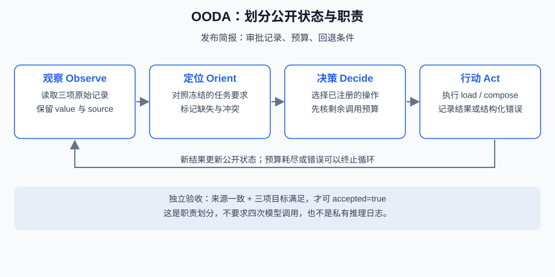
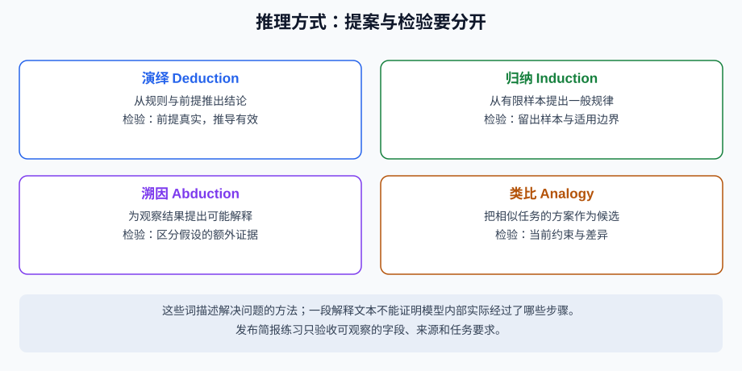

# 5.1 Agent 如何"思考"？

本节把“思考”当作应用组织信息与决定行动的简称。我们能检查的是输入、公开的计划/简短理由、工具调用、观察和产物；这些记录不是模型真实内部过程的逐字日志，也不能证明某种意识或自我认知。

## 从可检查的任务合同开始

贯穿本章的小任务是**发布简报**：收集审批记录、预算和回退说明，再输出带来源的三项简报。审批记录是资料中的事实，不是执行发布的权限。本练习没有实际发布、写文件或执行生成代码。

使用Python 3.11+，在仓库根目录运行 `python -m reference_code.planning_patterns plan`。`workflow.py`只用标准库，并复用已有 `evidence_assistant.planning.PlanAndExecuteAgent` 队列；默认无模型、密钥和网络。

```python
from reference_code.planning_patterns import run_plan

result = run_plan()
assert result["accepted"] is True
assert result["candidate"]["budget"] == {
    "value": "30 units", "source": "budget-v1#release",
}
assert [row["operation"] for row in result["trace"]] == ["load", "compose"]
assert result["trace"][0]["result"]["observations"]["budget"]["value"] == "30 units"
print(result["status"], result["verification"])
```

`FACTS`是固定观察，`REQUIREMENTS`是调用前冻结的独立要求，写作者只收到观察的副本。正常结果是审批记录、30 units预算、回退到release-1.0快照三项均有来源。这里验证的是这个小合同，不是通用自然语言规划能力。

## CoT、解释和事实证据各是什么

[Wei等的CoT论文，v6](https://arxiv.org/abs/2201.11903v6)研究中间推理文本与特定任务表现。生成的解释可以帮助组织步骤、暴露假设，也可能遗漏真实影响因素或为错误结论编出理由。不能推导“LLM只有输出token时才思考”，也不应要求接口暴露私有推理过程。

| 可保留的公开记录 | 用途 | 不能据此证明 |
|---|---|---|
| 目标、约束、所选工具及简短理由 | 审查行动是否针对任务 | 理由是完整的内部计算轨迹 |
| 工具参数、来源、返回值与错误 | 复查实际观察 | 来源内容一定真实、完整或有权限 |
| 独立预期、核验项和缺失项 | 判断是否满足当前合同 | 验证器覆盖了所有可能错误 |
| 自报置信度与反思 | 提名进一步检查方向 | 已校准概率、独立证据或通过许可 |

不要把模型自行生成的计划塞入system消息，升级成新的宿主规则。计划、反思和来源文字都是要检查的数据；权限与验收要求来自宿主。

## OODA作为责任分工



观察（Observe）收集来源；定位（Orient）核对缺失与约束；决策（Decide）选择许可动作；行动（Act）实际调用并保存结果。它是组织程序职责的视角，不要求四次模型请求，也不保证每轮都走完四段。信息不足、权限拒绝或预算耗尽都可以立即停止。

本任务中，读取来源产生观察，依赖与目标检查限制可选动作，写作者形成候选，独立检查决定是否可交付。下面把30改成300；解释再流畅也不能让它通过：

```python
from copy import deepcopy
from reference_code.planning_patterns import FACTS, check_brief

candidate = deepcopy(FACTS)
candidate["budget"]["value"] = "300 units"
verdict = check_brief(candidate, FACTS)
assert verdict["status"] == "failed"
assert verdict["unsupported_points"] == ["budget"]
assert verdict["wrong_requirements"] == ["budget"]
```

## 推理方式是提议，不是完成标准



演绎依赖前提和规则；归纳从样本作推广；溯因提出能解释观察的假设；类比借用相似结构。各自都能产生有用候选，也都有失败方式。先问缺的是来源、计算、约束还是验证，再决定是否增加一次模型调用；更长的说明不自动更准确。

练习：为发布简报记录“目标—观察来源—许可动作—独立预期—停止原因”。分别改预算数值、删回退项、让来源读取失败，比较失败位置。提交公开任务摘要与核验记录即可，不需要保存私有CoT。

*下一节：[5.2 ReAct：推理 + 行动框架](./02_react_framework.md)*
