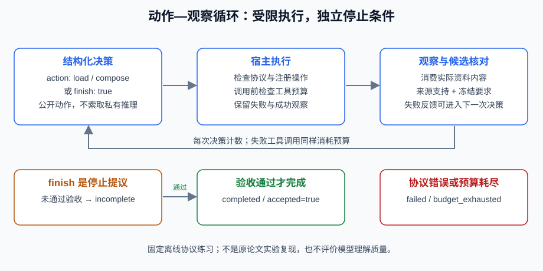

# 5.2 ReAct：推理 + 行动框架

[Yao等的ReAct论文，v3](https://arxiv.org/abs/2210.03629v3)研究交替生成推理文本与任务动作，并从环境获得反馈。它是一种组织交互的方式，不是“所有传统Agent都黑盒、ReAct就透明可靠”的分类。原论文结果取决于任务、模型和提示，本书不把那些分数移植为当前应用质量。



## 把动作协议与自由文字分开

本节用结构化动作练习这种交替控制：`chooser(snapshot)`看到公开状态和工具观察，只能返回 `{"action": "load"}`、`{"action": "compose"}` 或 `{"finish": True}`。宿主负责动作白名单、预算及结果核验。没有“找不到行动就把整段回复当最终答案”的兜底，也不从模型生成的“观察：”中提取可信工具结果。

这是本书的离线控制流练习，不复现原论文Prompt或模型。固定选择器按状态选动作，不理解任意自然语言；来源读取与写作者都是可替换的普通函数。代码见 `reference_code/planning_patterns/workflow.py`：

```python
from reference_code.planning_patterns import run_react

result = run_react()
assert result["accepted"] is True
assert result["budgets"]["decisions_used"] == 3
assert result["budgets"]["steps_used"] == 2
print([(row["operation"], row["status"]) for row in result["trace"]])
```

正常顺序是读取、形成并检查简报、提出结束：3次决策、2次工具尝试。工具观察由宿主写入trace，下一次选择器实际读到其快照。写作者消费读取到的资料，不凭空生成数据。它们不产生或保存私有推理链。

## Finish只是结束提议

自由文字、未知动作、多种动作同时出现、`finish=1`均拒绝。即使明确提出结束，独立检查尚未通过仍返回 `incomplete`，而不是交付候选：

```python
from reference_code.planning_patterns import run_react

def malformed(snapshot):
    return "All done, trust my reasoning."

def premature(snapshot):
    return {"finish": True}

assert run_react(chooser=malformed)["status"] == "failed"
result = run_react(chooser=premature)
assert result["status"] == "incomplete"
assert result["accepted"] is False
assert result["trace"] == []
```

`finish`不授予权限，不证明答案完整。来源中的审批记录也不允许调用发布工具；本练习只有 `load/compose`，没有任意Python、shell或文件写入接口。扩展计算工具时应复用第3章的受限算术接口，不重新引入 `eval`，也不要把该算术器称为通用沙箱。

## 观察如何驱动修订

若候选缺回退项，`compose`保留失败及缺项。下一轮可以在预算内重新提议，不能把工具异常伪装成普通答案。运行 `python -m reference_code.planning_patterns react`观察正常路径；将 `writer`换为 `OmitRollbackOnce()`，会经历一次缺项再修订。5.4展开这个反馈过程。

真实模型可能忽略观察、编造理由或反复选择同一动作。结构正确只证明能解析；来源支撑和目标覆盖仍需另验。相同模型批评自己的答案不能充当第二份独立证据。

## 两种预算，两个失败出口

`max_decisions`计每次选择器调用，包括结束提议；`max_calls`计工具尝试，包括失败。两者均为1..30的整数，达到上限仍未核验就为 `budget_exhausted`。它们不限制阻塞回调的墙钟时间；接入外部适配器还需超时、取消、权限和幂等合同。

练习让选择器一直返回 `load`，分别只给1次工具调用与1次决策，记录实际使用量及原因。再返回一句“任务已完成”，确认它是协议失败而非成功。比较计划预先已知和需要观察后再选择的任务，而不是把ReAct固定归为简单任务、另一模式固定归为生产任务。

*下一节：[5.3 任务分解：将复杂问题拆解为子任务](./03_task_decomposition.md)*
