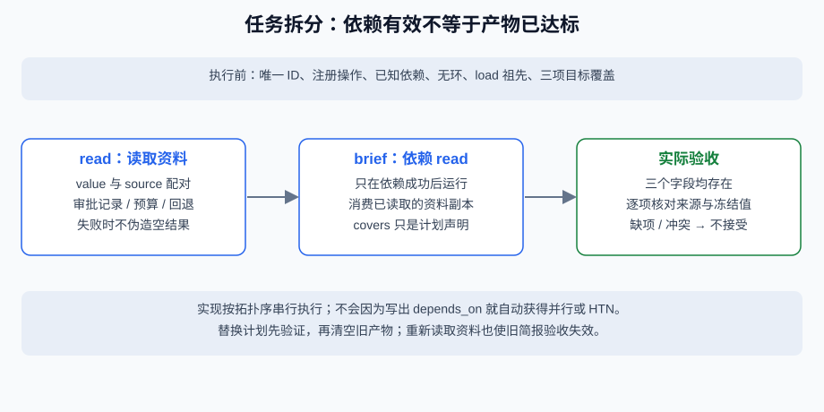

# 5.3 任务分解：将复杂问题拆解为子任务

分解不是多写几条待办。每个子任务都应说明输入、依赖、许可动作、产物及所覆盖的目标；执行时要真的检查这些关系。发布简报的三个目标是审批记录、预算和回退说明，不是“生成任意一段总结”。



## 从列表升级为有界依赖图

配套 `Node(id, operation, depends_on, covers)` 描述计划节点。`validate_plan`只接受最多12个节点的列表，拒绝重复ID、未知依赖、环、未注册动作与漏目标；不能遍历一个无限生成器来“验证计划”。`compose`还必须有 `load`祖先，避免靠偶然列表顺序碰巧有资料。

```python
from reference_code.planning_patterns import default_plan, validate_plan, run_plan

proposal = list(reversed(default_plan()))
ordered = validate_plan(proposal)
assert [node.id for node in ordered] == ["read", "brief"]
result = run_plan(nodes=proposal, max_steps=2)
assert result["accepted"] is True
assert result["budgets"]["steps_used"] == 2
```

即使输入列表反向，校验器也按依赖给出 `read → brief`。本例执行仍是顺序的，没有实现并行调度。独立节点可以在设计上并行，但若共享写入或生成报告依赖统计结果，还要定义合并与汇聚，不能从“没依赖”推导线程安全。

本练习一次只保留一份最新资料快照。`compose` 实际消费的最近一次 `load` 必须属于其声明的依赖祖先，否则拒绝，避免把另一支路的资料串入。多个 `load` 不会自动合并；需要分支工件时应另建显式的产物选择与汇合协议。

## 计划覆盖与结果覆盖要分别检查

`covers`用于静态检查计划是否遗漏目标，并限制某种动作能声明哪些目标；它不能证明产物已经满足目标。即便声明三项都覆盖，写作者仍可能漏回退说明、写错预算或伪造来源。独立 `check_brief`检查完整字段、原观察及冻结值，不读取写作者自报的分数。

```python
from reference_code.planning_patterns import Node, run_plan

missing_goal = [Node("read", "load"),
                Node("brief", "compose", ("read",), ("budget",))]
result = run_plan(nodes=missing_goal)
assert result["status"] == "failed"
assert result["trace"] == []  # rejected before calling any tool

cycle = [Node("a", "load", ("b",)),
         Node("b", "compose", ("a",), ("approval", "budget", "rollback"))]
assert run_plan(nodes=cycle)["status"] == "failed"
```

这两种错误都在工具调用前结束，trace为空。循环依赖不应通过“按原列表继续”消解，漏目标也不应该等最后生成器补一句话。

## 依赖完成、尝试过和验证通过不是一个状态

成功读取后才有资料；写作/检查失败时该节点没有进入completed集合。失败后如果允许重规划，本练习用新队列替换旧队列，并保守地使全部旧产物失效、重新读取。这样较容易验证，但会多花调用；更细粒度复用需要版本化产物、依赖失效传播及幂等约束，当前没有实现。

`Session`分别保留公开trace、候选和verification。给回调的数据是副本，写作者改动预算字段不会改写原观察或独立要求。当前任务只有三条固定结构资料，不声称能自动拆解任意研究项目。

## 层次分解还要增加什么

将“准备发布”分成资料检查、审批流程和实际部署，属于另一层任务建模；不能因JSON包含 `leaf/composite` 就宣称有HTN规划器。递归方案还需限制深度、节点总数、展开调用、分支数与总工具尝试，并检测未覆盖目标、重复动作和不可执行叶子。本节不提供HTN或自动递归模型。

练习先把回退项从 `covers` 删除，再把它只从生成结果删除，分别记录静态失败与动态核验失败。然后准备一个依赖中间产物的任务，解释哪些节点可以并行、哪些必须等待，以及取消后哪些迟到结果应拒绝。先交付依赖图、目标映射与失败轨迹，不执行模型生成的文件写入或代码。

*下一节：[5.4 反思与自我纠错机制](./04_reflection.md)*
