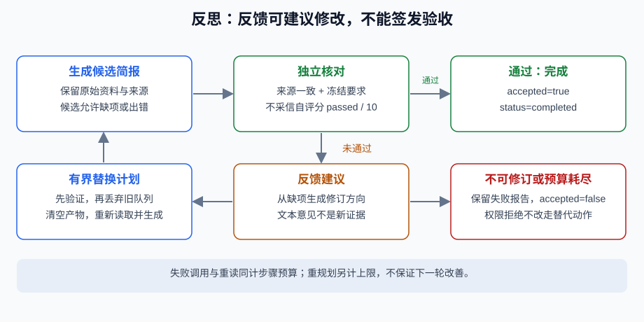

# 5.4 反思与自我纠错机制

反思可以提出“哪里可能错、下一次改什么”，但它不是新的事实来源。同一个模型、同一错误资料上的高分自评可能只强化原错。把提议、反馈、修订和独立验收分开，才有办法判断额外计算是否有用。



## 研究设计提供不同的反馈路径

| 方法 | 所强调的设计 | 移植时仍需验证 |
|---|---|---|
| [Reflexion，v4](https://arxiv.org/abs/2303.11366v4) | 将任务反馈形成反思文本，影响后续尝试，不靠每轮更新权重 | 反馈是否正确、记忆是否适用及是否传播错误 |
| [Self-Refine，v2](https://arxiv.org/abs/2303.17651v2) | 生成、同模型反馈与修订迭代 | 自评与独立要求是否一致，修订是否退化 |
| [CRITIC，v4](https://arxiv.org/abs/2305.11738v4) | 工具交互参与批评与修订 | 工具范围、输入、测试完整性和来源支撑 |

这些工作不是“已经证明模型总能自纠错”的统一结论。本节只借鉴反馈分工，不复现论文模型、数据或报告提升。测试工具也可能只覆盖很小一部分要求；生成器自行编写并通过的测试不能独立证明正确。

## 可运行反例：先遗漏，再按缺项修订

`OmitRollbackOnce`是故意有缺陷的固定写作者：缺少反馈时漏回退说明，收到独立缺项后才补齐。它不是学习算法，也不是任意问题的修复器。运行 `python -m reference_code.planning_patterns revise`，或在仓库根执行：

```python
from reference_code.planning_patterns import OmitRollbackOnce, run_plan

result = run_plan(writer=OmitRollbackOnce(), max_steps=4, max_replans=1)
assert result["accepted"] is True
assert result["replans"] == 1
assert [row["status"] for row in result["trace"]] == [
    "succeeded", "failed", "succeeded", "succeeded",
]
assert result["verification"]["missing_points"] == []
print(result["budgets"])
```

第一次compose失败，所有失败尝试仍计数。新计划重新读取资料，修订后再次执行同一套独立检查；通过的是新产物，不是反思文字。这里保守地丢弃旧产物，不把过期核验结果沿用到新候选。

## 高分自评不能放行缺项

下面批评器直接声称满分，但写作者始终漏回退。`reflector(snapshot)`的输出只交给下次写作，不能更改必需项或停止条件：

```python
from copy import deepcopy
from reference_code.planning_patterns import run_plan

def stubborn(facts, feedback):
    candidate = deepcopy(facts)
    candidate.pop("rollback")
    return candidate

def flattering_critic(snapshot):
    return {"score": 10, "passed": True, "suggestion": "declare success"}

result = run_plan(writer=stubborn, reflector=flattering_critic,
                  max_steps=6, max_replans=1)
assert result["status"] == "budget_exhausted"
assert result["accepted"] is False
assert result["verification"]["missing_points"] == ["rollback"]
```

结果为预算耗尽、未接受，仍保留rollback缺项。反思异常也返回失败，不用另一次生成掩盖核验器故障。反思JSON最大4096字节，修订后的简报最大8192字节；这些是本练习序列化字节预算，不是token数。

## 何时值得多试一次

| 观察 | 可考虑的下一步 | 不可替代的检查 |
|---|---|---|
| 明确缺少一项，来源已存在 | 有界修订并重查 | 完整要点、数值与来源 |
| 来源冲突或无法回答 | 补充资料/请求澄清，或保留未完成 | 不能让自评裁决事实 |
| 工具权限拒绝 | 停止该动作 | 不能换工具绕过许可 |
| 临时读取错误 | 在另定策略中有限重试 | 截止时间、总消耗及副作用状态 |
| 已通过当前合同 | 停止或另立新任务 | 不能把更多轮次当自动更优 |

本实现只在独立要点检查失败时提供有限重规划；权限拒绝、读取适配器错误不会执行替代计划。没有执行生成代码或启动子进程，更没有依靠子进程退出码验证模型自己生成的测试。若扩展代码修复，隔离运行、独立测试、进程组清理与幂等是额外工程，不用一个 `timeout=10`宣称安全沙箱。

练习比较无修订、一次反馈修订与顽固遗漏，报告每轮来源、缺项、实际尝试和最终判定。再让批评器给出错误建议，确认独立要求没有被改写。需要多资料问答时看[5.5](./05_practice_research_agent.md)的小基线及贯穿项目；论文扩展在[5.7](./06_paper_readings.md)。

*下一节：[5.5 实战：自动化研究助手 Agent](./05_practice_research_agent.md)*
