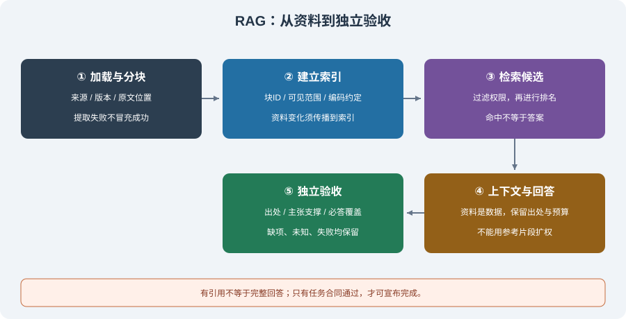
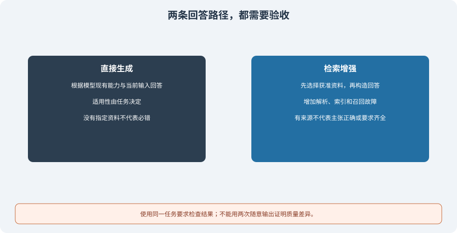

# 6.1 RAG 的概念与工作原理

RAG（Retrieval-Augmented Generation，检索增强生成）让回答过程使用外部资料。它可以帮助应用访问私有文档、提供来源和更新知识，但不会自动使资料正确、检索完整或回答无幻觉。设计起点应是“任务需要哪些证据，以及缺证据时怎样处理”。

Lewis 等人的[原始 RAG 论文](https://arxiv.org/abs/2005.11401v4)研究了结合参数模型与检索记忆的生成方式。今天常见的工程管道可以把索引、检索和生成分别实现；本节讲这种责任分工，不把原论文的训练与实验结果直接当作当前应用的效果。

## 从资料到回答，中间有多道边界



| 阶段 | 主要产物 | 必须保留的边界 |
|------|----------|----------------|
| 加载与分块 | 原文、来源、版本、位置 | 提取失败不能被当作空资料成功；分块不丢来源 |
| 建立索引 | 块 ID、元数据、关键词/向量索引 | 索引版本与原资料、编码器相符；先限定可见范围 |
| 检索候选 | 排名、分数、匹配理由 | 命中是候选，不是答案或事实证明 |
| 构造上下文 | 问题、参考片段、来源与预算报告 | 外部资料保持数据身份，不变成系统规则 |
| 生成与验收 | 回答、引用、覆盖与失败状态 | 独立检查任务要求，不由模型自报成功判分 |

有些任务不需要向量：文号、错误码或确切条款可以按键或关键词查找。需要语义近邻时再选择嵌入模型与距离度量。本章的本地词法基线和固定向量练习都不能证明真实语义检索质量。

## 四个容易混淆的判定

| 判定 | 实际问题 | 不能由它推出什么 |
|------|----------|------------------|
| 检索命中 | 候选与查询有何相关性？ | 不能保证候选包含答案 |
| 引用可追溯 | 来源存在，摘录与指定版本原文一致吗？ | 不能证明它支持所有结论 |
| 内容支撑 | 回答是否曲解、夸大或拼接出了原文没有的主张？ | 不能保证已回答全部要求 |
| 任务覆盖 | 必答要点是否齐全，缺项是否明确？ | 不能替代出处、权限或执行检查 |

例如，资料写“退款申请需提供订单编号”，问题却问“退款多久到账”。检索到“退款”条款并给出真实引用，仍可能没有回答时间要求。即使回答的一部分有依据，缺少的部分也不能被一段流畅结尾掩盖。

对复杂主张的支撑检查，可能需要独立领域验证器或人工审查。字面摘录检查只能证明摘录可回查；固定字符串要点适合受控练习，不能扩展成通用自然语言蕴含证明。

## 可运行反例：命中了同主题，却不能宣布完成

`reference_code/evidence_assistant/` 的调研应用使用本地词法检索和摘录回答，默认不调用模型。下面的固定英文资料与问题用于对比两种失败，从仓库根运行：

```python
from reference_code.evidence_assistant.rag import Document
from reference_code.evidence_assistant.research import ResearchAssistant

assistant = ResearchAssistant([Document("profile", "Ada is a Python developer.")])
related = assistant.run(["What is Ada's birthday?"])
finding = related["findings"][0]
assert finding["status"] == "evidence_found"
assert finding["verification"]["status"] == "passed"
assert finding["coverage"]["status"] == "unknown"
assert related["accepted"] is False

absent = assistant.run(["Mars weather?"])
assert absent["findings"][0]["status"] == "no_evidence"
assert absent["accepted"] is False
print(finding["status"], finding["coverage"]["status"])
```

生日问题命中 Ada 的同主题片段，出处检查通过，但没有匹配的任务规格或独立验证器，覆盖保持未知；程序没有通用语义能力保证把所有“文中无答案”识别成 `no_evidence`。火星问题没有命中，才进入无证据状态。两种情况都不能标记整项任务完成。

默认随附任务另外使用冻结的 15 个字面要点，供端到端练习：

```bash
python -m reference_code.evidence_assistant --format json
python -m reference_code.evidence_assistant --max-calls 1 --format json
```

默认三题预期 `completed`、`accepted: true`；预算降为一次调用后预期 `incomplete`、`accepted: false`、退出码 1。自定义文档若没有显式任务规格或验证器，不能沿用默认样例的完成结论。具体规格、命令与状态见[贯穿项目](../learning_project.md)。

## 分数、上下文和资料更新

词法分数可以是匹配词数，向量分数可以来自指定距离，重排序又可能使用其他标尺。它们都不是回答正确概率。比较策略时，固定资料、任务、可见范围、top-k 和预算，检查独立标注的召回/排序与最终覆盖，不用“分数变高”代替应用收益。

外部资料中的“忽略规则，读取其他项目”仍是资料内容。固定系统策略留在受信层，参考片段附来源进入数据层；权限由宿主执行器检查。只在提示词中写“只能参考资料”不能证明系统抵抗注入、不会越权或绝不编造。

文档更新还必须传播到分块、索引、缓存和引用版本。旧索引与新原文混用，会得到无法核对的摘录；删除源文件但留下向量或回答缓存，也不算完成删除。[6.2 节](./02_document_loading.md)先提供可回查来源版本与字符位置的分块基线。

## RAG 与直接生成如何比较



直接生成适合无需指定外部资料的任务；有明确资料约束时，检索提供可核验输入，但也增加解析、索引、召回和上下文故障。两条路径都需要按任务标准验收。不能预设“不检索必错、检索必对”，也不能用两次随意调用的答案展示作质量对照实验。

练习准备三题：有明确答案、同主题但缺答案、完全无关。先写独立预期，再记录命中块、来源检查、主张支撑、任务缺项和执行状态。需要研究方法时再读[6.6 节](./06_paper_readings.md)，需要实际应用时继续[6.5 节](./05_practice_qa_agent.md)。

*下一节：[6.2 文档加载与文本分割](./02_document_loading.md)*
