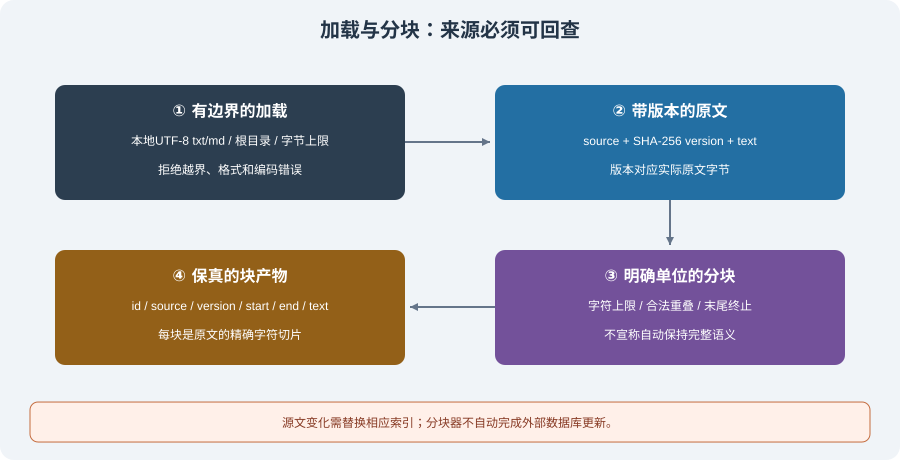

# 6.2 文档加载与文本分割

检索器找不到从未成功提取的答案。分块前先检查资料是否完整、可读、可授权使用；分块后检查每段还能否回到指定版本原文。一个返回字符串的解析函数不等于完整的数据管道。



## 加载输出不能只有正文

最小文档记录应有来源标识、内容版本、正文与提取状态。页码、标题路径、表格行列和字符位置按格式补充，不能用一个模糊的 `source="unknown"` 覆盖所有文档。

| 格式 | 提取时要核对 | 不应直接假定 |
|------|--------------|--------------|
| UTF-8 文本/Markdown | 编码、字节上限、来源、换行与原文版本 | Markdown 标题就是完整语义单元 |
| PDF | 页级提取结果、空页原因、阅读顺序、扫描页 | 文本提取器自带 OCR 或总能返回非空字符串 |
| Word | 段落/表格顺序、表头、批注和修订是否需要 | 把全部表格移到结尾不影响含义 |
| 网页 | 获准 URL、状态、大小、重定向、获取时间和正文区域 | 去掉导航就得到完整可信正文 |
| 表格/CSV | 行列结构、单位、编码、缺失值 | 任意按字符切割仍能解释每个数字 |

PDF/Word/网页适配器要分别用固定样本测试；本节可运行核心只支持本地 `.txt`/`.md`，不联网或安装额外解析器。批量导入应同时报告成功与失败，不能打印异常后只返回成功列表，使调用方误以为全量入库。

## 可运行加载：固定根目录、大小与版本

`reference_code/memory_rag/core.py` 的 `load_text` 读取指定目录内的一份 UTF-8 文档。它拒绝越界路径、指向根目录之外的符号链接、未知格式、过大文件和非法编码，不把失败转成空正文。来源使用根目录相对路径，版本是原始字节的 SHA-256。

```python
from pathlib import Path
from tempfile import TemporaryDirectory
from reference_code.memory_rag import load_text

with TemporaryDirectory() as folder:
    path = Path(folder) / "policy.md"
    path.write_text("退款期限为七天。\n保留订单编号。", encoding="utf-8")
    document = load_text(folder, "policy.md", max_bytes=1000)
    assert document.source == "policy.md"
    assert document.text == path.read_text(encoding="utf-8")
    assert len(document.version) == 64
    old_version = document.version
    path.write_text("退款期限为十天。", encoding="utf-8")
    assert load_text(folder, "policy.md").version != old_version
```

这是受信本地目录的边界练习，不是抵抗另一个进程同时替换目录的操作系统沙箱。真实服务还需访问授权、并发读写策略、敏感资料规则与审计。摘要或清洗后的文本应另记转换版本，不能继续假装位置对应原始 PDF 字节。

## 分块器先满足可验证的不变量

分块策略可以按字符、分词器 token、段落、标题或表格结构设计，但度量必须明确。以下实现选择**Unicode 码点窗口**，先保证终止、大小和原文对应关系，不宣称“智能语义分割”。

```python
from pathlib import Path
from tempfile import TemporaryDirectory
from reference_code.memory_rag import load_text, split_document

with TemporaryDirectory() as folder:
    path = Path(folder) / "policy.md"
    path.write_text("退款期限为七天。\n保留订单编号。\n" * 4, encoding="utf-8")
    document = load_text(folder, "policy.md")
    chunks = split_document(document, max_chars=20, overlap=4)
    assert chunks[0]["start_char"] == 0
    assert chunks[-1]["end_char"] == len(document.text)
    for chunk in chunks:
        assert 0 < len(chunk["text"]) <= 20
        assert chunk["text"] == document.text[chunk["start_char"]:chunk["end_char"]]
        assert chunk["source"] == document.source
        assert chunk["version"] == document.version
    for left, right in zip(chunks, chunks[1:]):
        assert right["start_char"] == left["end_char"] - 4
    print(len(chunks), "exact source slices")
```

每块包含 `id/source/version/start_char/end_char/text`。位置使用左闭右开的 Python 字符索引；不是 UTF-8 字节、token、PDF 页坐标，也不保证不拆开组合字符或一个完整概念。块 ID 由来源、版本、参数和位置确定；相同输入可复现，资料或分块参数变化会产生不同标识。

循环的不变量是 `0 <= overlap < max_chars`，下一窗口的起点必须前进，达到正文末尾立即结束。空文档返回空块列表；参数错误在迭代前拒绝。块重叠不增加独立证据数量，答案合并时应按来源与位置去重。

## 从固定窗口走向结构分割

| 策略 | 能解决什么 | 仍须检查什么 |
|------|------------|--------------|
| 字符窗口 | 简单、上限明确、位置可回查 | 句子、单位或表格可能被切开 |
| 段落/递归分隔符 | 优先自然断点 | 无分隔符的长段落仍要满足硬上限；不得补造分隔符 |
| Markdown 结构 | 可保留标题上下文 | 代码围栏内的 `#` 不是标题，末节也要处理；标题前缀不能冒充原文 |
| Token 分割 | 对指定编码器控制长度 | 不同模型编码不同；末尾必须终止；解码边界和来源位置需验证 |
| 表格/代码结构 | 保留行列、函数或类的关系 | 超大单元的拒绝/拆分策略及必要上下文 |

重叠只是减轻切割边界损失的办法，不能保证完整句子一定出现在某一块中：如果句子本身比窗口还长，这个保证就不成立。对于结构性资料，可把标题路径和单位作为元数据或明确标记的附加上下文，而不是改写 `text` 后仍使用原始偏移。

Chunk 大小也没有统一的“问答 500 字、摘要 1500 字”最优值。先固定任务集，再比较答案所在片段的召回、引用可核验性、上下文预算与最终覆盖。块越小不必然越精准，块越大也不必然上下文更有用。

## 更新与失败如何传播

源文档变化后，应产生新版本块，重建或替换相应索引，并使旧版本缓存失效。不要只追加一份随机 ID 的新块，同时让旧块继续参与检索。当前分块函数生成新版本标识，**不负责自动替换外部向量库**；索引调用方还要实现删除旧版本和更新失败时的回退。

删除资料时同样检查块、向量、摘要和回答缓存。授权范围应随块保留，不能在分块时丢掉，再希望生成器自行判断访问权限。解析失败、空文本、来源缺失和无法回查都应有单独状态，业务层决定是否继续部分导入。

## 验证与练习

```bash
python -m reference_code.memory_rag chunks
python -m unittest discover -s examples/integration_tests -p test_memory_rag_chapters.py -v
```

测试覆盖短文、空文、无分隔长文、末尾重叠终止、非法参数、中文/emoji、大小上限、越界链接、原文变动和确定性 ID。练习再准备一个跨块的单位说明，记录它是否仍足以回答问题；若不行，调整策略并重新测任务覆盖，不能只看块数。

*下一节：[6.3 向量嵌入与向量数据库](./03_embeddings_vectordb.md)*
