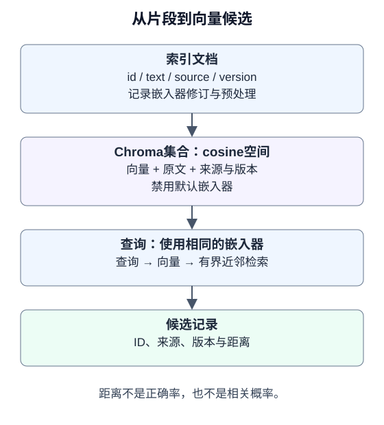

# 6.3 向量嵌入与向量数据库

本节接着[6.2的保真分块](02_document_loading.md)，把带来源的片段存入真实Chroma，再观察距离、过滤、重开与删除。参考实现放在独立目录`reference_code/vector_retrieval/`，只增加小型存取层，不引入额外应用框架。

## 嵌入表示相似性，不验证事实

嵌入器把文本映射为向量。相同模型、修订版和预处理用于文档与查询，才有共同的比较空间；相同维度并不能说明两个嵌入器兼容。更换模型、分块方式或预处理时，应建立新索引并回归评估，再切换读取。

选择云端或本地嵌入器，都要在自己的问题集上比较证据召回、回答支持、延迟、存储和数据处理要求。云端调用有服务费用；本地方案也有下载、硬件、运维和许可约束。维度更大、更新日期更近都不能单独证明更适合任务。



配套显式使用余弦距离。非零向量$x,y$的余弦相似度为：

$$
\begin{aligned}
\operatorname{cos}(x,y)&=\frac{x\cdot y}{\|x\|\|y\|}\\
d_{cos}&=1-\operatorname{cos}(x,y)
\end{aligned}
$$

相似度理论上在$[-1,1]$，相应距离在$[0,2]$；浮点运算有误差。这些值不是正确率或相关概率。只有确认距离度量后才能解释`1-distance`；默认L2距离不能套用这个说明。Chroma的[配置文档](https://docs.trychroma.com/docs/collections/configure)列出了各度量和索引参数。

Chroma以float32保存向量。配套先按最大绝对值缩放，再做L2归一化，避免合法的极小/极大Python数在入库时变成全零或无穷；这个归一化规则也记入集合元数据。它保留余弦方向，不消除浮点误差，也不改善嵌入语义。

## 保存来源与嵌入版本

配套的`Record`保留四个字段：`id`、`text`、`source`、`version`。6.2的分块字典可按同名字段映射；原文偏移仍保留在加载/分块记录中，当前向量封装不另外持久化偏移。`version`用于区分内容版本，集合元数据另记`embedding_id`及维度。

| 入口 | 合同 | 失败行为 |
|---|---|---|
| `VectorStore(path, embed, embedding_id=..., dimension=...)` | 明确cosine空间；禁用默认嵌入函数；同名集合的版本与配置须匹配 | 不兼容则拒绝，要求新集合 |
| `add(records)` | 每批最多100块、集合最多2000块；非空来源/版本/文本、唯一ID、有限非零向量 | 写入前校验本批；重复ID拒绝 |
| `search(query, limit=..., source=..., min_cosine=...)` | 查询与文档使用同一注入嵌入器；返回ID、来源、版本及距离 | 空集合直接返回空；其他错误向上报告 |
| `records()` / `delete_source(source)` | 读取当前集合或删除指定来源 | 删除不是归档，也不证明磁盘物理擦除 |

`embed(texts)`必须按输入顺序返回向量。若服务端批量响应携带索引，适配器要检查完整性并据索引复位，不能默认网络响应顺序正确。声明的`embedding_id`是调用方的版本记录，不会识别一个伪报版本的适配器。

这是单写入者的本地练习，不处理并发更新、跨调用事务或线上迁移。存储失败可能需要检查并重建集合；不要捕获所有异常后返回空列表，把故障伪装成“没有证据”。

## 离线运行：先让错误排名可观察

在仓库根目录，使用Python 3.11+和`examples/requirements.txt`中的锁定环境。本轮验证使用ChromaDB 1.5.9。

```bash
python -m reference_code.vector_retrieval
python -m pytest examples/integration_tests/test_vector_retrieval.py -q
```

下面是完整可执行的数据库机制练习。`fixed_embeddings`仅接受配套中的固定文本，输出人工指定的三维向量；它故意让500文档比404文档更接近查询，用来观察排序错误，不是语义嵌入模型。

```python
from tempfile import TemporaryDirectory
from reference_code.vector_retrieval import VectorStore
from reference_code.vector_retrieval.fixture import build_fixture, fixed_embeddings

with TemporaryDirectory() as directory:
    store = build_fixture(directory)
    hits = store.search('404', limit=3)
    assert [hit.record.id for hit in hits][:2] == ['http500-v1:0', 'http404-v1:0']
    assert abs(hits[1].distance - 0.2) < 1e-6
    only_404 = store.search('404', source='http404.md')
    assert [hit.record.id for hit in only_404] == ['http404-v1:0']
    assert store.search('birthday', min_cosine=0.8) == []
    reopened = VectorStore(directory, fixed_embeddings,
                           embedding_id='book-fixture-v1:exact-text', dimension=3)
    assert len(reopened.records()) == 3
    reopened.delete_source('http404.md')
    assert reopened.records(source='http404.md') == []
    assert len(reopened.records()) == 2
```

即使404文档排名第一，也只能说明检索顺序，不能说明最终答案正确。`source`过滤只是资料筛选；使用者可以选择来源时，它不能代替身份认证或租户权限。面向用户记忆的写入同意与主体隔离见[4.3](../chapter_memory/03_long_term_memory.md)。

## 接上真实嵌入器前的检查

先用小批量检查返回条数、顺序、维度、有限性和模型修订，再将适配器注入`VectorStore`；保留原始文本和稳定ID。建立独立问题集，既包含可回答问题，也包含没有证据的问题。阈值只能在开发集上选择，不能反复看测试预期调整。

Chroma的[`query`与`get`说明](https://docs.trychroma.com/docs/querying-collections/query-and-get)区分相似检索与按条件读取；当前版本的`ids`自动返回，不写进`include`列表。多条件元数据查询应采用[逻辑过滤表达式](https://docs.trychroma.com/docs/querying-collections/metadata-filtering)。配套只接受单一来源过滤，避免把任意模型生成字典直接交给数据库。

**验证边界**：测试执行真实Chroma的写入、cosine距离、过滤、独立进程重开及来源删除，并拒绝版本混用、重复ID与畸形向量。没有下载或调用嵌入模型，没有测语义召回质量、线上负载或备份删除。

下一节：[6.4 检索策略与重排序](04_retrieval_strategies.md)，用同一批ID修正这个固定反例的排序。
