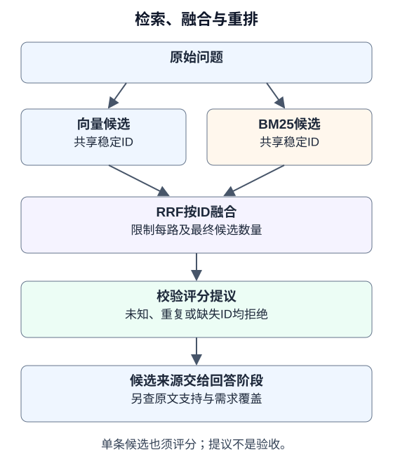

# 6.4 检索策略与重排序

[6.3的固定反例](03_embeddings_vectordb.md)中，查询`404`却把500文档排在前面。本节在同一批来源ID上加入词法检索、排名融合和有校验的重排提议，观察它们分别改变什么。它们都不直接验收答案。



## 两条检索通路必须使用同一身份

词法检索适合观察标识符与字词匹配，向量检索根据嵌入空间找邻近项。两者可能互补，也可能一起漏掉证据。若词法结果叫`doc_0`、向量结果叫另一组UUID，同一片段就无法融合；按文本去重又会混淆不同来源或版本。

配套对两条通路使用同一`Record.id`，保留`source`和`version`。同ID指向不同内容时拒绝；相同文本但不同ID仍作为不同来源保留。需要合并重复内容时，要另外维护来源映射。

`bm25_search`采用BM25的词频、逆文档频率与长度归一化思路。教学分词器只处理ASCII标识符和相邻汉字二元组，不声称支持通用中文语义或所有语言。参数固定为`k1=1.2,b=0.75`供练习，并非最佳值。方法背景见[Robertson与Zaragoza的综述](https://www.staff.city.ac.uk/~sbrp622/papers/foundations_bm25_review.pdf)。

## 用排名融合，避免误把分数当同一尺度

余弦相似度与BM25分数有不同含义，不能仅因都写成小数就相加。配套使用倒数排名融合（RRF）：

$$
\operatorname{RRF}(d)=\sum_{L:d\in L}\frac{1}{k+\operatorname{rank}_L(d)}
$$

排名从1开始，未出现在某条列表中的文档不给该路分数。练习取`k=60`，并限制每路候选数；同一路重复ID拒绝，不能多次投票。RRF分数不是置信度，其原始方法见[Cormack等，SIGIR 2009](https://cormack.uwaterloo.ca/cormacksigir09-rrf.pdf)。

实际顺序是“有界向量候选 + 有界BM25候选 → 按ID融合 → 截取候选预算”。初筛漏掉的证据不能靠重排序恢复。候选数增大会增加后续读取成本，不能把“更多”当“更好”。

## 重排序仍是待验证的提议

配套的`rerank(query,candidates,scorer,...)`要求评分器为每个候选返回且只返回一个`{id,score}`，分数为有限的$[0,1]$数值。缺失、重复、未知ID和畸形输出均拒绝；评分器异常继续向上报告。

即使候选只有一条，也要经过评分及阈值检查，不能因数量少就标为相关。通过校验只证明评分提议符合格式和身份合同；候选内容是否支持问题，以及最终答案是否覆盖要求，仍由后续独立验收判断。

若接入真实重排模型，把来源文字作为待评估数据，保留固定评估规则，限制候选字数与总输入，防止候选中的指令改变流程。提示层说明不能代替宿主权限与预算。本配套未实现线上模型调用、截断策略或语义验证器。

## 完整离线练习

从仓库根目录使用锁定依赖执行以下代码。`fixture_scorer`只为查询`404`和固定文档给出预设分数；这是可观察机制的替身，不是通用重排模型。

```python
from tempfile import TemporaryDirectory
from reference_code.vector_retrieval import hybrid_search, rerank, Ranked, query_variants
from reference_code.vector_retrieval.fixture import build_fixture, fixture_scorer, RECORDS

with TemporaryDirectory() as directory:
    store = build_fixture(directory)
    hybrid = hybrid_search(store, '404', limit=3)
    assert hybrid[0].record.id == 'http404-v1:0'
    assert len({hit.record.id for hit in hybrid}) == 3
    proposed = rerank('404', hybrid, fixture_scorer, min_score=0.5)
    assert [hit.record.id for hit in proposed] == ['http404-v1:0']
    assert rerank('404', [Ranked(RECORDS[1], 1.0)], fixture_scorer) == []
    assert query_variants('404', [' 404 ', 'missing resource path']) == ['404', 'missing resource path']
```

正常结果是融合将404来源排到前面，固定评分器只留下这一条；单独给出的500候选也会被拒绝。配套没有生成答案，CLI的`answer_accepted`保持`false`，避免把排序练习算成问答完成。

## 查询扩展：先控制意图与预算

查询扩展可尝试同义表述、缩写或时间约束，但生成模型可能改变原意。`query_variants`只保留原查询、去除重复并限制两个提议和每条200字符；它不判断语义等价。示例仅验证提议的形式，未对`missing resource path`执行新嵌入查询，固定向量器也不支持任意文本。

若将其接入检索，每个保留查询都消耗调用与候选预算。合并时继续使用稳定ID，最后以**原始问题**评估支持与覆盖。扩展失败应显式记录；是否退回原查询是调用方预先定义的策略，不能静默生成“成功”。

## 用独立问题比较收益

先冻结来源、版本和预期，再比较向量、BM25、融合与重排。至少加入精确标识符、跨片段要求、没有证据三类问题，记录证据Recall@k、输入规模、耗时和答案验收；候选相关、引用存在、原文支持、需求覆盖分别记账。一次只改一个策略，避免同时换模型、切块和预算而无法解释变化。

当前自动测试覆盖真实数据库、同ID融合、重复与冲突拒绝、单候选不相关、畸形重排结果及异常；两语代码块均实际执行。固定数据上的预期顺序不证明策略在真实语料上提升质量，亦未测试线上模型费用或延迟。

下一节：[6.5 实战：智能文档问答Agent](05_practice_qa_agent.md)，把候选来源交给独立的回答与验收阶段。
