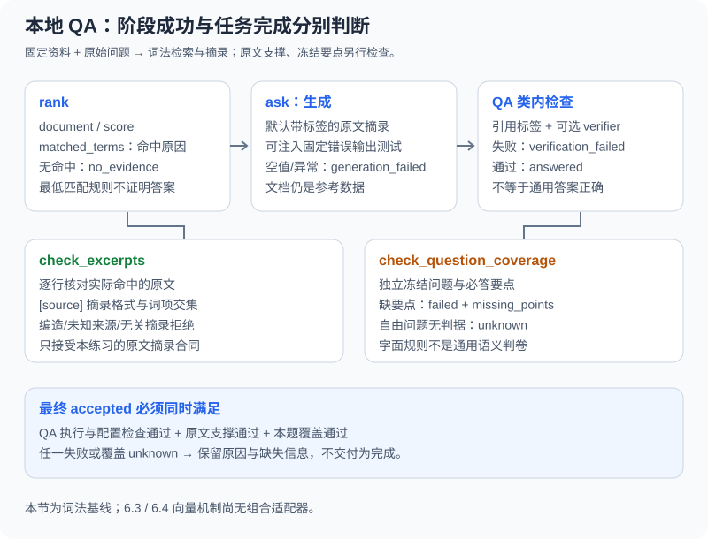

# 6.5 实战：智能文档问答 Agent

本节用一份虚构退款政策完成一个可检查的本地问答练习：先找资料，再生成带来源的摘录，最后分别核对原文支撑和问题覆盖。默认不调用模型或嵌入服务，不需要密钥。配套直接复用 `reference_code/evidence_assistant/`，不再维护另一套同名问答类。

## 本次迭代与验收

- **上一版的不足**：检索命中与引用标签存在，仍可能没有回答具体问题；“有答案文字”不足以交付。
- **本章增加**：观察词法匹配、保留检索/生成/验证状态，接上独立的摘录核验和冻结任务要求。
- **怎样验证**：正常问题、同主题缺答案、完全无关、编造内容、坏引用、验证器拒绝/异常以及资料更新都要留下预期与实际结果。下面全部 Python 片段可在仓库根目录独立运行。
- **下一步**：有多个问题与总调用预算时使用[本地资料调研助手](../learning_project.md)；需要进一步控制实际输入时进入[第7章](../chapter_context_engineering/README.md)。



## 先读清三个接口的合同

| 已有模块/入口 | 本节实际使用 | 不能从中推导什么 |
|---|---|---|
| `rag.py` 的 `Document(source, text)`、`rank`/`ask` | 内存资料、可解释词法排名、带状态的回答 | 没有内置持久索引、内容版本或多格式加载 |
| `research.py` 的 `check_excerpts`/`verify_excerpts` | 每行 `[source] 原文摘录` 可回查本次命中的原文，并有词项交集 | 不支持通用改写/摘要的语义蕴含判断，不验证现实来源真实性 |
| `task_acceptance.py` 的 `check_question_coverage` | 对匹配问题核对独立冻结的字面要点；无规格/验证器时为 `unknown` | 不是自然语言通用判卷器，也不验证引用与权限 |

`rank` 返回 `document/score/matched_terms`，分数是不同命中词项数。英文按词、中文按基础二元组匹配并过滤通用短语；短语过滤和最低匹配规则只能减少部分弱命中，不是语义检索或正确概率。

`ask` 返回字典，包含 `status/answer/retrieved_sources/sources/retrieval/generation/verification/retryable`。默认生成器逐条引用检索原文；`answerer(messages)` 可以替换生成，但必须另外验收它的输出。系统规则固定，文档放在独立参考消息，当前问题单独保留。

`answered` 表示这个类配置的检查通过。**未配置验证器时，它只检查引用标签；`answer_accepted(result)`也不能凭空补出原文支撑或任务覆盖。** 此时 `semantic_support=not_checked`。本节最终完成条件还必须包括独立的原文检查和 `coverage.status == "passed"`。`sources` 是通过类内检查后回答实际引用的来源，`retrieved_sources` 才是命中列表；失败回答不能把命中列表当成已核验引用。

## 正常路径：先冻结题目与要点，再运行

练习问题是“退款期限和需要的凭证是什么”。资料、问题和要点均为教学夹具；英文文本使词项匹配结果容易观察，不是语言理解质量测试。7天和收据要求由调用前的规格固定，生成器无权修改它们：

```python
from reference_code.evidence_assistant.rag import Document, DocumentQAAgent, answer_accepted
from reference_code.evidence_assistant.research import check_excerpts, verify_excerpts
from reference_code.evidence_assistant.task_acceptance import check_question_coverage

question = "What is the refund deadline and required proof?"
# Freeze requirements independently of the answer producer.
tasks = [{"question": question, "requirements": [
    {"id": "deadline", "description": "seven-day refund deadline", "all_of": ["seven days"]},
    {"id": "proof", "description": "receipt required", "all_of": ["receipt"]},
]}]
documents = [Document("policy-v1",
    "Refund requests are accepted within seven days and require a receipt.")]
qa = DocumentQAAgent(documents, verifier=verify_excerpts)
hits = qa.rank(question)
assert hits[0]["document"].source == "policy-v1"
assert hits[0]["score"] == len(hits[0]["matched_terms"])
retrieved = [hit["document"] for hit in hits]
result = qa.ask(question)
support = check_excerpts(question, result["answer"], retrieved)
coverage = check_question_coverage(question, result["answer"], specs=tasks)
accepted = (answer_accepted(result) and support["status"] == "passed"
            and coverage["status"] == "passed")
assert accepted is True
assert result["sources"] == ["policy-v1"]
print({"qa": result["status"], "support": support["status"],
       "coverage": coverage["status"], "accepted": accepted})
```

预期输出中的 `qa/support/coverage` 分别为 `answered/passed/passed`，`accepted` 为 `True`。`verify_excerpts` 是给 QA 类的独立布尔回调，另行保留的 `support` 字典用于查看详细原因；它们都只核对摘录。`check_question_coverage` 不调用生成器，独立检查两个要点。大写、空白的规范化允许排版变化，不允许把“十天”当作“七天”。

本例在一次调用中冻结资料，`rank` 与 `ask` 使用同一份列表。实际服务不能在两次操作间静默切换资料或权限。每个来源标签在本例中唯一；接收外部资料的适配器还应检查重复/非法标识，保留稳定版本与命中快照。

## 资料相关，但还不能完成问题

只有收据要求的资料可以提供有效摘录，却没有期限。自由问题也不能套用另一道题的预期：

```python
from reference_code.evidence_assistant.rag import Document, DocumentQAAgent
from reference_code.evidence_assistant.research import verify_excerpts
from reference_code.evidence_assistant.task_acceptance import check_question_coverage

question = "What is the refund deadline and required proof?"
tasks = [{"question": question, "requirements": [
    {"id": "deadline", "description": "seven-day refund deadline", "all_of": ["seven days"]},
    {"id": "proof", "description": "receipt required", "all_of": ["receipt"]},
]}]
qa = DocumentQAAgent([Document("policy-v1", "Refund requests require a receipt.")],
                     verifier=verify_excerpts)
result = qa.ask(question)
coverage = check_question_coverage(question, result["answer"], specs=tasks)
assert result["status"] == "answered"  # A supported excerpt, not a complete answer.
assert coverage["status"] == "failed"
assert coverage["missing_points"] == ["seven-day refund deadline"]

free_question = "What is the refund owner's birthday?"
free = qa.ask(free_question)
unknown = check_question_coverage(free_question, free["answer"], specs=tasks)
assert unknown["status"] == "unknown"
absent = qa.ask("Mars weather?")
assert absent["status"] == "no_evidence"
assert absent["generation"]["status"] == "not_started"
print({"missing": coverage["missing_points"], "free_question": unknown["status"],
       "unrelated": absent["status"]})
```

三种结果分别是：命中但缺“七天期限”要点、命中但没有本题验收规格、检索无命中。它们都不能交付为已完成。`unknown` 表示判据尚未配置，不代表已证明问题无解；`no_evidence` 也只说明当前检索没有找到候选，不代表全世界没有资料。

`ask` 本身不执行重试。`retryable` 只是给宿主的提示，不能据此无限改写问题直到出现来源。若尝试新查询，须限制查询/调用次数并始终按原始问题验收；无证据时重复同一请求不会自动补出答案。

## 有正确标签，内容仍然可能不受支持

下面注入一个固定错误输出。它只模拟生成器失误，没有发真实模型请求：

```python
from reference_code.evidence_assistant.rag import Document, DocumentQAAgent, answer_accepted
from reference_code.evidence_assistant.research import check_excerpts, verify_excerpts

policy = Document("policy-v1", "Refund requests are accepted within seven days.")
wrong = "[policy-v1] Refund requests are accepted within ninety days."
# A scripted faulty producer, not a real language-model call.
producer = lambda messages: wrong
labels_only = DocumentQAAgent([policy], producer).ask("refund deadline")
assert answer_accepted(labels_only) is True
assert labels_only["verification"]["semantic_support"] == "not_checked"
support = check_excerpts("refund deadline", labels_only["answer"], [policy])
assert support["code"] == "unsupported_excerpt"
assert support["status"] == "failed"

checked = DocumentQAAgent([policy], producer, verifier=verify_excerpts).ask("refund deadline")
assert checked["status"] == "verification_failed"
assert answer_accepted(checked) is False
assert checked["sources"] == []
assert checked["retrieved_sources"] == ["policy-v1"]
print(checked["status"], support["code"])
```

这解释了为什么不能把默认 `answered` 当作问答完成。加上摘录验证器后，九十天无法回查七天原文，结果是 `verification_failed`；被检索到的 `policy-v1` 仍出现在 `retrieved_sources` 中，`sources` 为空。若以后允许自由改写，应替换为适用的独立支撑验证或人工审查，而不是放松成“有标签就行”。

## 失败不是空字符串，也不是成功的替代答案

```python
from reference_code.evidence_assistant.rag import Document, DocumentQAAgent, answer_accepted

policy = Document("policy-v1", "Refund requests are accepted within seven days.")
for output, status, error in [
    ("  ", "generation_failed", "empty_or_non_string_answer"),
    (None, "generation_failed", "empty_or_non_string_answer"),
    ("Seven days.", "verification_failed", "missing_citations"),
    ("[invented] Refunds take seven days.", "verification_failed", "unknown_citations"),
]:
    result = DocumentQAAgent([policy], lambda messages: output).ask("refund")
    assert result["status"] == status
    stage = "generation" if status == "generation_failed" else "verification"
    assert result[stage]["error"] == error
    assert answer_accepted(result) is False

def broken_verifier(question, answer, documents):
    raise RuntimeError("fixed verifier failure")

for verifier, error in [
    (lambda question, answer, documents: False, "task_requirements_not_met"),
    (lambda question, answer, documents: 1, "task_requirements_not_met"),
    (broken_verifier, "verifier_error"),
]:
    result = DocumentQAAgent([policy], verifier=verifier).ask("refund")
    assert result["status"] == "verification_failed"
    assert result["verification"]["error"] == error
    assert result["generation"]["status"] == "succeeded"
print("output, citation, and verifier failures retained")
```

| 外层状态 | 实际含义 |
|---|---|
| `retrieval_failed` | 检索或来源标识检查异常，尚不能当作无命中 |
| `no_evidence` | 当前检索为空；生成未开始、验证未运行 |
| `generation_failed` | 生成异常，或输出为空白/非字符串 |
| `verification_failed` | 缺引用、未知/未命中引用，或配置的独立回调拒绝/异常 |
| `answered` | 类内检查通过；最终交付还要看本题要求的支撑和覆盖 |

提供者的 `TimeoutError`/`ConnectionError` 会保留错误类型并标记可重试；普通 `RuntimeError` 不被当作临时故障。`KeyboardInterrupt` 不转换为成功或普通失败。回调必须严格返回布尔 `True` 才通过；抛异常保留 `verifier_error`，不要用另一次生成掩盖判据故障。

## 来源变了，旧回答与旧预期都要复核

```python
from reference_code.evidence_assistant.rag import Document, DocumentQAAgent
from reference_code.evidence_assistant.research import check_excerpts, verify_excerpts
from reference_code.evidence_assistant.task_acceptance import check_question_coverage

question = "What is the refund deadline?"
tasks = [{"question": question, "requirements": [
    {"id": "deadline", "description": "seven-day deadline", "all_of": ["seven days"]},
]}]
old = Document("policy-v1", "Refund requests are accepted within seven days.")
old_result = DocumentQAAgent([old], verifier=verify_excerpts).ask(question)
updated = Document("policy-v2", "Refund requests are accepted within ten days.")
new_result = DocumentQAAgent([updated], verifier=verify_excerpts).ask(question)
assert check_excerpts(question, old_result["answer"], [updated])["status"] == "failed"
coverage = check_question_coverage(question, new_result["answer"], specs=tasks)
assert new_result["status"] == "answered"
assert coverage["status"] == "failed"  # A policy change requires a specification review.
print(new_result["sources"], coverage["missing_points"])
```

`Document` 只有来源标签和文本，本节的 `v1/v2` 由调用方提供，**不是自动版本管理**。摘录核验可以拒绝引用旧正文的回答，但不会自动决定政策改变是否正确。变成十天后，旧的七天要求不再满足，应审查资料与业务规格后另立预期，不能让生成器按新答案改测试。

[6.2](./02_document_loading.md)已提供原文 SHA-256 与字符偏移的分块机制；接入时应把块 ID、来源版本和偏移映射到 QA 的引用清单，再对本次命中快照核验。重复来源、旧索引清理、权限变更与缓存失效也属于适配合同，当前两字段 `Document` 不会自动完成这些工作。

## 到哪里停，怎样继续

| 已有练习 | 与本节的关系 | 仍须单独完成的接入 |
|---|---|---|
| [6.2 加载与分块](./02_document_loading.md) | 保真文本、稳定来源版本与位置 | 加载/分块结果到问答引用清单的映射 |
| [6.3 向量存储](./03_embeddings_vectordb.md)、[6.4 融合/重排](./04_retrieval_strategies.md) | 独立 `reference_code/vector_retrieval/` 练习，返回候选而不生成答案 | 当前没有与本 QA 类组合的适配器；须保留候选身份、版本、预算和失败 |
| 本节词法 QA | 正常与反例、摘录支撑、冻结要点 | 不含 PDF/Word/Web、语义编码器、对话历史或上线服务 |
| [综合调研项目](../learning_project.md) | 已组合本地资料、多问题、上下文和 Harness 预算 | 其默认规格只适用于随附任务，自有资料须提供独立规格或验证器 |

在仓库根目录运行：

```bash
python examples/chapter06/doc_qa_agent.py
python -m unittest examples.integration_tests.test_rag_qa_chapter -v
python -m reference_code.evidence_assistant --format json
```

第一个命令只展示原始 QA 接口的阶段状态，不带本节完整覆盖规格；第三个命令是另一个已配规格的多问题应用。两者都不是“本章所有检索技术已接成一个产品”的证据。本节代码和测试无额外依赖、无线上调用；真实模型、语义检索效果、跨片段充分性与生产权限需要另行测试。

练习增加一题必须合并两个来源的要求，事先冻结两个必答点。分别移除一个来源、改动关键数值、返回不受支持的改写，提交排名原因、阶段状态、支撑结果、缺失要点和最终判定。先让这一组证据闭环，再决定是否需要向量检索、更多格式或更复杂的 Agent 循环。

*下一章：[第7章：上下文工程](../chapter_context_engineering/README.md)*
