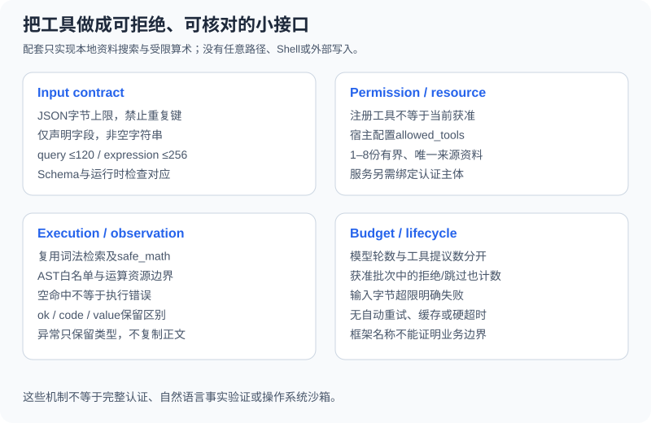

# 3.3 自定义工具的设计与实现

设计工具时先列出资源、参数、返回和失败，再编写模型可见说明。一个函数可调用，不意味着适合暴露给模型。能力越宽，宿主需要验证的输入、授权范围和副作用也越多；不能用一个没有依据的“工具质量大于模型能力”排名代替任务测试。



## 小接口，同时保留完整合同

| 工具 | 参数 | 结果 | 明确不做 |
|---|---|---|---|
| `search_documents` | 非空query，最多120字符 | 最多2条本地命中，含source/text/sha256 | 不联网、不接受路径、不验证资料真伪 |
| `calculate` | 非空expression，最多256字符 | 有限范围数值 | 不读文件、不导入、不执行通用Python，不理解单位 |

`ToolHost`只接收调用方注入的1–8份资料，每份最多2000 UTF-8字节，来源标签唯一。它复用主线词法检索和已有 `safe_math`；没有实现向量编码、全功能Schema引擎或操作系统沙箱。

## 先验证，再执行

```python
from reference_code.tool_calling import ToolHost

host = ToolHost()
for raw in ['{"expression":true}', '{"expression":"1+1","extra":1}',
            '{"expression":"1+1","expression":"2+2"}', '[]',
            '{"expression":NaN}', '{"expression":', '{"expression":" "}']:
    assert host.execute("calculate", raw)["code"] == "invalid_arguments"
print("malformed or out-of-contract arguments rejected before execution")
```

`decode_arguments`限制JSON文本字节、拒绝重复键和非有限常量，只接受声明的字段及非空字符串。`true`在Python中与整数有关联，但这里不能作为字符串表达式；不要用宽松真值或自动转换代替合同。

本例手写校验对应两个单字段Schema，便于读者对照。扩充复杂Schema时可使用验证库，但要测试类型强制转换、额外字段、默认值和错误路径；Pydantic、dataclass及JSON Schema不是可以不加区分地互换的实现。

## 注册表不是授权表

```python
import json
from reference_code.tool_calling import ToolHost

host = ToolHost(allowed_tools=("search_documents",))
assert host.execute("calculate", json.dumps({"expression": "1+1"}))["code"] == "permission_denied"
assert host.execute("read_file", json.dumps({"path": "/etc/passwd"}))["code"] == "unknown_tool"
assert host.execute("shell", json.dumps({"command": "echo test"}))["code"] == "unknown_tool"
print("registered name and host permission are separate checks")
```

`allowed_tools`由宿主配置。模型即使返回已注册的名字，也可能被拒绝；描述中写“已授权”没有效果。这里只演示整工具许可，真实业务还需校验对象归属、查询行范围、发送目标等资源级约束。调用方能随意创建允许所有工具的宿主，并不等于系统已完成认证。

## 受限算术，不开放解释器

```python
import json
from reference_code.tool_calling import ToolHost

host = ToolHost()
assert host.execute("calculate", json.dumps({"expression": "sqrt(144) + 2 * 3"}))["value"]["value"] == 18
for expression in ["1/0", "2**101", "__import__('os')", "(1).__class__", "open('secret')"]:
    result = host.execute("calculate", json.dumps({"expression": expression}))
    assert result["ok"] is False and result["code"] == "tool_error"
print("unsupported arithmetic and execution syntax fail")
```

共享解释器按AST白名单处理算术、限定函数和常量，限制字符、节点、指数及数值范围，拒绝属性、导入和任意调用。算术异常、非法语法与不支持操作保留为 `tool_error/error_type`，不会成为成功数值。该解释器不是通用代码沙箱；增加网络、文件或用户函数会改变安全模型。

## 失败分类与预算

| code/原因 | 本例处理 | 扩展时需要决定 |
|---|---|---|
| `invalid_arguments` | 执行前拒绝 | 可否在明确次数内请求修正 |
| `permission_denied`/`unknown_tool` | 保留拒绝，停止任务 | 由用户/宿主改变授权，不能绕过 |
| `ok=True`且hits为空 | 搜索正常但无资料 | 不生成虚构证据；缺资料时未完成 |
| `tool_error` | 只保留异常类型，停止任务 | 区分临时只读故障与不确定写入 |
| 模型/工具/输入预算耗尽 | 报未完成，不制造最终成功 | 总预算如何覆盖重试与备用路径 |

本例不自动重试，也不把所有异常正文送进模型；异常可能含敏感路径或输入。`KeyboardInterrupt`仍可中断。获准批次中的拒绝与跳过也计入已处理工具提议数，模型轮数另计；它们不等于token、耗时或子进程配额。

缓存同样不是默认保证：只读工具的缓存键需包含规范参数、来源/权限版本，且要处理到期、更正和撤回。写入重试还需幂等和结果查询。配套没有缓存、外部写入或硬超时，不把框架名称当作这些能力已存在的证据。

练习为一项只读订单查询写合同，区分参数Schema、对象权限、空结果、数据库错误和输出上限。先用固定记录测试拒绝发生在读取前，再考虑真正的数据连接，参考[22.2](../chapter_24_data_agent/02_data_connection.md)。

*下一节：[3.4 工具描述的编写技巧](./04_tool_description.md)*
