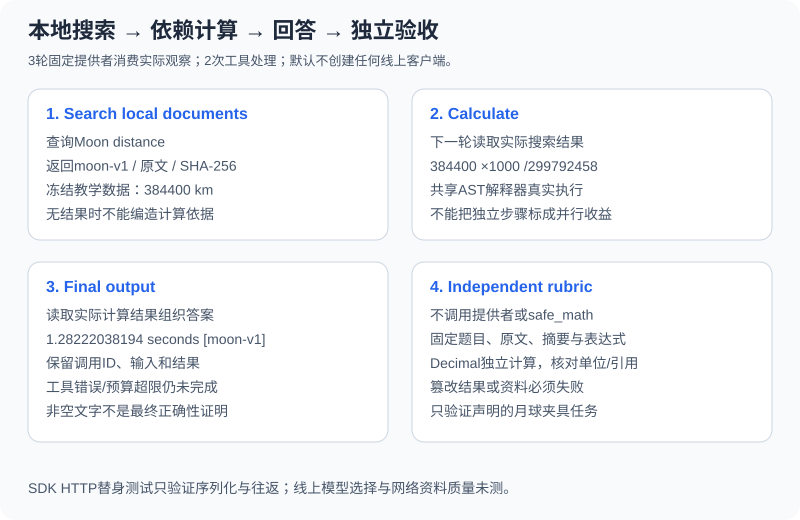

# 3.5 实战：搜索引擎 + 计算器 Agent

本节把“搜索后计算”落实为可跑的**本地资料搜索**。任务是：读取冻结的月球距离教学资料，换成米，再除以固定光速，输出秒数和来源。资料数值是夹具，不是实时天文测量；不把一个网络搜索摘要当作已证实事实。



## 运行与阅读入口

从仓库根目录使用Python 3.11+：

```bash
python -m reference_code.tool_calling
python -m unittest examples.integration_tests.test_tool_calling_chapter -v
```

配套核心用标准库，依赖仓库已有的受限算术与词法检索模块。`core.py`的阅读顺序是 `tool_specs/decode_arguments` → `ToolHost.execute` → `FixedProvider.complete` → `run_agent` → `verify_fixture`。固定提供者严格按教学任务工作，不能理解任意问题；它确实读取上一轮tool结果，不从原始文档对象旁路取最终答案。

## 正常路径：工具结果进入下一次决策

```python
import json
from reference_code.tool_calling import run_agent

report = run_agent()
assert report["status"] == "completed" and report["accepted"] is True
assert report["usage"] == {"model_calls": 3, "tool_calls": 2}
assert [row["name"] for row in report["trace"]] == ["search_documents", "calculate"]
assert json.loads(report["trace"][1]["arguments"])["expression"] == "384400 * 1000 / 299792458"
for message in report["messages"]:
    if message["role"] == "tool":
        assert message["tool_call_id"] in {row["id"] for row in report["trace"]}
print(report["answer"], report["verification"])
```

预期答案为 `1.28222038194 seconds [moon-v1]`，报告 `completed/accepted=True`。三轮提供者依次提出搜索、根据搜索返回的距离提出计算、读取计算结果组织最终文本。两次工具分别返回来源/原文/摘要校验值和真实算术结果；ID关联可在messages和trace里核对。

| 阶段 | 输入与输出 | 实际检查 |
|---|---|---|
| 搜索 | query → 最多2条本地命中 | 参数、许可、来源唯一/大小、词项命中 |
| 计算 | 从命中数据解析出的表达式 → 数值 | 宿主参数检查、AST限制、范围与算术错误 |
| 回答 | 实际工具结果 → 秒数与标签 | 非空正文、独立固定任务判据 |

资料与计算有依赖，因此不是同一轮互不相关的并行任务。`run_agent`逐个处理获准的调用，未实现并发或自动查询扩展。若首个工具失败，同批后续调用不执行，但仍留下对应的跳过结果；错误不会被下一次模型文本覆盖为成功。

## 预算和许可失败必须仍是未完成

```python
from reference_code.tool_calling import ToolHost, run_agent

for kwargs, reason in [
    ({"max_calls": 1}, "tool_budget_exhausted"),
    ({"max_rounds": 1}, "model_budget_exhausted"),
    ({"max_input_bytes": 10}, "input_budget_exhausted"),
    ({"host": ToolHost(allowed_tools=("search_documents",))}, "tool_failed"),
]:
    report = run_agent(**kwargs)
    assert report["status"] == "incomplete" and report["accepted"] is False
    assert report["reason"] == reason
    print(reason, report["usage"])
```

另可运行：

```bash
python -m reference_code.tool_calling --max-calls 1
```

预期退出码1，`incomplete/accepted=False`。`max_rounds`限制提供者调用次数；`max_calls`限制已处理的工具提议，包含获准批次内的拒绝/跳过。整批放不下时执行前拒绝。输入预算计算messages与tools的序列化UTF-8字节；输出也有体积限制，当前问题不被静默裁掉。

这些上限不等于模型token费用、耗时、CPU或进程隔离。没有网络与外部写入，本例也不提供硬超时或重试控制器；接入远程工具需另行建立总期限、调用方取消、服务端超时和副作用处理合同。

## 独立验收不能读模型的“我已成功”

```python
from copy import deepcopy
from reference_code.tool_calling import QUESTION, run_agent, verify_fixture

report = run_agent()
assert verify_fixture(QUESTION, report["answer"], report["trace"])["status"] == "passed"
assert verify_fixture(QUESTION, "999 seconds [moon-v1]", report["trace"])["status"] == "failed"
corrupted = deepcopy(report["trace"])
corrupted[1]["result"]["value"]["value"] = 999
assert verify_fixture(QUESTION, report["answer"], corrupted)["status"] == "failed"
corrupted = deepcopy(report["trace"])
corrupted[0]["result"]["value"]["hits"][0]["text"] = "Moon distance is 1 km."
assert verify_fixture(QUESTION, report["answer"], corrupted)["status"] == "failed"
print("wrong answer, wrong tool result, and changed evidence rejected")
```

判据不调用提供者或 `safe_math`，以冻结题目、原文、SHA-256、计算表达式与Decimal独立数值检查实际轨迹和最终值/单位/引用。结果允许1e-9秒的绝对数值差，适用于这个练习，不是通用精度规则。

验收仅接受这道已声明的夹具任务：换一个自由问题不会凭非空答案完成；改原文、工具结果、单位或来源也不能沿用成功。内容哈希检查追踪一致性，不认证现实文档；该判据不是通用自然语言语义验证器。主线的多来源、单位和光行时间合同另见[共享项目](../learning_project.md)。

## SDK与线上扩展的边界

`OpenAIChatProvider(client, model)`只接受显式注入的SDK客户端，默认入口不会创建它。集成测试用OpenAI 2.54.0及HTTP替身实际经过SDK请求/响应解析，并核对tool_call_id、tools和下一轮输入；没有连线上模型，也没有验证真实模型是否选对工具或服务端严格模式效果。 测试客户端显式设 `max_retries=0`；若以后注入真实客户端，应另设请求超时和SDK重试策略。`max_rounds`统计提供者调用轮数，不统计底层SDK的重发请求。

旧章节入口 `examples/chapter03/search_calc_agent.py --demo`仍是单工具演示，不能代替本节的协议/独立验收报告。其网络搜索入口已在发请求前检查query和整数结果数；正常网络请求、网页质量和交互模式未纳入本节验收。不需要真实搜索的读者可以停在这个离线闭环。

练习让固定提供者提出未知工具、重复ID、额外参数、零除或不受支持表达式，再把最终秒数改错。每种情况记录：模型调用数、工具实际处理/拒绝、ID往返、停止原因和独立验收。完成后再决定是否引入真实模型或网络适配器；它们不能继承夹具的质量结论。

*下一节：[3.6 论文解读](./06_paper_readings.md)*
