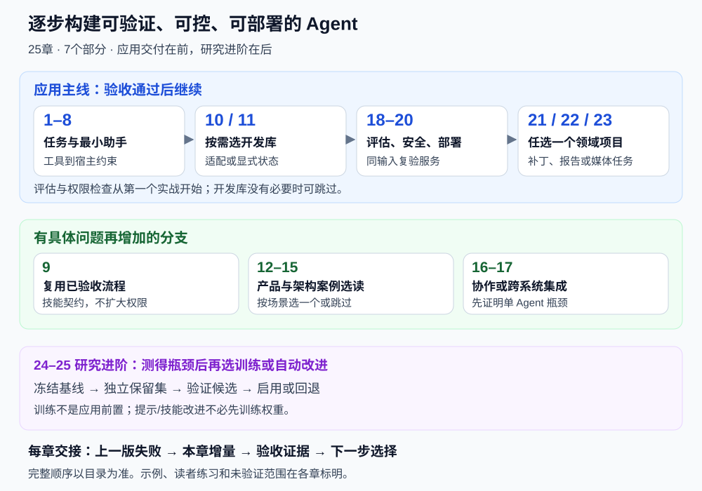

# 前言

> 🤖 *"未来不是属于会写代码的人，而是属于会指挥 AI 写代码的人。而 Agent，就是连接人类意图与 AI 能力的桥梁。"*

## 为什么写这本书？

2023 年以来，大语言模型（LLM）引发了一场技术革命。但很多人发现，单纯的"对话"远远不够——我们需要 AI 能够**自主决策、使用工具、完成复杂任务**。这就是 **Agent（智能体）** 诞生的意义。

然而，Agent 开发的学习资料分散在各种论文、博客和框架文档中，缺乏一个**系统化、面向初学者、注重实战**的学习路径。这本书正是为了填补这个空白。

## 这本书适合谁？

- 🐍 **有 Python 基础**的开发者，想进入 AI Agent 领域
- 🎓 **对 LLM 感兴趣**的学生或研究者，想了解 Agent 的原理与实现
- 💼 **产品经理或技术负责人**，想理解 Agent 的能力边界与应用场景
- 🔧 **已经在用 ChatGPT** 等工具，想更深入理解和定制 AI 能力的人

## 这本书的特色

| 特色 | 说明 |
|------|------|
| 📖 **由浅入深** | 从"什么是 Agent"讲起，先完成可验证的应用与部署，再按需进入训练研究 |
| 🐍 **Python 实战** | 按章节提供配套脚本、正文示例与教学片段，明确运行边界 |
| 🎨 **图文并茂** | 大量架构图、流程图、时序图，帮助直观理解概念 |
| 🔨 **项目驱动** | 3 类综合项目设计与组装实践，按需选择领域 |
| 🌐 **紧跟前沿** | 覆盖 LangChain、LangGraph、MCP/A2A/ANP 协议、上下文工程、Agentic-RL 等最新技术 |
| 📚 **学术追溯** | 每章配有权威论文引用和参考文献，从符号主义到 LLM 驱动的完整学术谱系 |
| 📊 **评估体系** | 深度拆解 BFCL、GAIA、AgentBench、SWE-bench 等主流基准测试 |

## 如何使用这本书？

如果你只是想先了解**大模型怎么用**，暂时不打算学习 Agent 开发、代码实战或底层原理，可以先只看 [第一部分：入门篇](./part1.md)。这一部分会用更适合零基础读者的方式，讲清楚大模型能做什么、怎么提问、如何选择工具，以及新手应该怎样开始使用。

**每章先完成一次可核验的迭代**：

1. **失败入口**：接过上一版产物，指出它仍会失败的具体输入或场景。
2. **能力增量**：解释本章机制改变哪一段数据流、状态或执行边界。
3. **实现与边界**：区分仓库已有入口、正文示例和需要自行实现的练习。
4. **验收证据**：固定成功与失败用例，留下预期、实际结果和判定依据。
5. **下一步选择**：只在出现新问题时增加框架、协作或训练；论文作为选读深入。

## 贯穿全书的实践主线

完整入口与逐步验收见[贯穿项目与实战验收](./learning_project.md)。

本书围绕一个目标展开：**逐步构建一个可验证、可控、可部署的 Agent**。独立参考代码位于 `reference_code/evidence_assistant/`，主体验是“本地资料调研助手”：从几份虚构项目文档回答多个问题，生成带来源的报告。先运行，再替换资料和问题，最后阅读检索、计划、上下文与报告生成的核心代码。它比单次计算更接近应用，又不要求先部署数据库、框架或远程服务。

前几章的月球距离计算保留为基础验证练习，用来观察单位、记忆、数据流和独立验收。基础练习与调研助手是两种任务，共用部分机制；后续框架、产品和领域项目并未全部接入同一应用，仍需按明确契约迁移和验证。

每增加一种能力，都先问：上一版在哪里失败？这次改动解决什么问题？用什么证据证明它有效？

| 阶段 | 要解决的失败 | 应留下的学习产物 |
|---|---|---|
| 第1–3章：最小 Agent | 只会回答，不能可靠地获取信息和执行计算 | 一次可追踪的工具调用，以及正常、失败两类用例 |
| 第4–7章：补齐信息与任务能力 | 忘记偏好、缺少证据、任务跑偏、上下文超限 | 固定问题集、检索来源、任务状态与上下文预算 |
| 第8–9章：约束执行与复用能力 | 越权、未验证就结束、重复实现同类能力 | 工具权限清单、验证门禁与技能接口 |
| 第10–17章：选择实现方式 | 状态难维护、工具难集成、协作成本过高 | 一种适合任务的实现，以及与原有基线的比较 |
| 第18–20章：系统化验证与上线 | 演示能跑，质量、风险、成本却不可控 | 回归报告、边界测试、运行日志与部署检查 |
| 第21–23章：综合应用 | 单个组件正确，完整业务仍不能交付 | 一个有明确验收条件的领域项目 |

目录按应用实践在前、研究进阶在后排列，共25章、7个部分。第24–25章提供训练与自我改进的研究路线。先证明现有模型与工程方案的具体瓶颈，再决定是否需要训练或自动优化。

## 必读与选读路径

- **首次开发应用**：第1–8章 → 第10–11章中所需的框架 → 第18–19章 → 选做一个综合项目；准备上线时学习第20章。第18–19章应随前面的实战反复查阅。
- **补充工程能力**：在上述基础上，按需学习第9章技能复用、第16章多 Agent、第17章协议集成。第12–15章选择与实际场景相关的案例深入阅读。
- **研究训练与自我改进**：具备工具调用、数据与评估基础后，再学习第24–25章及各章论文解读。训练不是调用现成模型的前置条件。

每章首页的“本章迭代”说明机制怎样解决具体失败。第3–8章的六阶段计算是基础练习；独立目录中的调研助手用于组合检索、计划、上下文和报告。先读四个核心模块，记忆持久化、Harness、框架迁移和训练按需进阶；不同业务示例的结果不混作同题性能评测。

每章首页标注阅读层次。每个实战先完成成功与失败用例，再考虑扩展功能；正文中的演示输出不能替代你自己的验证记录。

## 代码示例的使用边界

本书区分三类代码：**配套脚本**给出真实仓库路径与运行命令；**正文示例**需要保存为文件并安装所列依赖；**教学片段或脚手架**用于解释接口和控制流，省略的节点、业务后端与凭据需要自行补齐。出现 `...` 的片段不能作为完整应用直接运行。

先从 `reference_code/evidence_assistant/` 的独立参考项目开始；运行与输入契约见其 `README.md` 和 `CONTRACTS.md`。仓库的 `examples/README.md` 保留各章扩展示例入口。`reference-agent/` 提供默认离线可测的最小执行、评估和防护底座；离线测试通过，只证明这些固定行为符合预期，不能据此推断真实模型质量或生产安全性。

## 技术栈概览

本书主要使用以下技术栈：

- **编程语言**：Python 3.11+
- **核心框架**：LangChain, LangGraph, OpenAI Agents SDK
- **LLM 服务**：OpenAI API, Anthropic（Claude 系列）, 开源模型（Llama, Qwen 等）
- **Agent 协议**：MCP（Model Context Protocol）, A2A（Agent-to-Agent）, ANP（Agent Network Protocol）
- **向量数据库**：ChromaDB, FAISS
- **Web 框架**：FastAPI
- **其他工具**：Docker, Pydantic, asyncio, uv

---

*准备好了吗？让我们一起开启 Agent 开发之旅！🚀*
